English: [README.md](README.md)

# OverLap

Overlay para iRacing en Windows. OverLap lee la telemetría oficial del simulador y dibuja sus
widgets encima del juego: relativo, posiciones, batalla, tráfico, radar, spotter, mapa de pista, mapa, clima, delta,
vueltas, combustible, pedales, avisos, testigos, boxes y reincorporación. Cada uno se coloca, se escala y se personaliza a tu gusto, y puedes
guardar un layout distinto para cada coche.

- Solo **lee** los datos del SDK de iRacing: no inyecta nada en el juego. A internet solo sale para
  buscar actualizaciones en GitHub, y se puede apagar (ver
  [Privacidad y anti-cheat](#privacidad-y-anti-cheat)).
- Los widgets van en ventanas transparentes, siempre encima, que nunca cogen el foco y dejan pasar
  los clics al juego.
- En español o en inglés: la primera vez, en el idioma de Windows (si no es ninguno de los dos, en
  inglés).

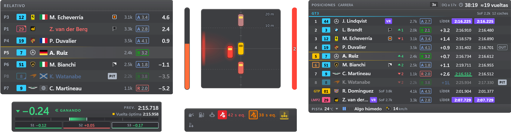

_Todas las capturas usan los datos de ejemplo de la propia app (pilotos inventados) sobre fondo
transparente; en pista, el panel deja ver el juego a través según la opacidad que elijas._

## Contenido

- [Instalación](#instalación)
- [Widgets](#widgets)
- [Ajustes y personalización](#ajustes-y-personalización)
- [Modo edición](#modo-edición)
- [Layouts](#layouts)
- [Atajos de teclado](#atajos-de-teclado)
- [Cuándo se ve el overlay](#cuándo-se-ve-el-overlay)
- [Streaming](#streaming)
- [VR](#vr)
- [Privacidad y anti-cheat](#privacidad-y-anti-cheat)
- [Problemas conocidos](#problemas-conocidos)
- [Licencia y créditos](#licencia-y-créditos)
- [Firma del código](#firma-del-código)
- [Apoyar OverLap](#apoyar-overlap)

## Instalación

> [!WARNING]
> **Windows SmartScreen / Microsoft Defender te avisará al abrir OverLap.** La primera vez que abras
> cada versión descargada, Windows dirá que ha protegido tu equipo de una «aplicación no
> reconocida», y Smart App Control puede bloquearla. No es porque OverLap contenga nada dañino: es
> que no está firmado, porque un certificado de firma cuesta dinero cada año, y OverLap es un
> proyecto pequeño y gratuito. La hice para mis carreras y ahora la comparto.
>
> - **Qué hacer:** pulsa **Más información → Ejecutar de todas formas**.
> - **Si la bloquea Smart App Control:** no se puede permitir solo una aplicación. Puedes desactivar
>   Smart App Control (Configuración › Privacidad y seguridad › Seguridad de Windows › Control de
>   aplicaciones y navegador › Configuración de Smart App Control; en la mayoría de versiones de
>   Windows 11, una vez desactivado no se puede volver a activar sin reinstalar Windows) o esperar a
>   una versión firmada.
> - **Para ir sobre seguro:** descarga OverLap solo de la
>   [página oficial de releases](https://github.com/jesus-molano/OverLap/releases), y si quieres,
>   comprueba el archivo en [VirusTotal](https://www.virustotal.com/) antes de abrirlo.

### Requisitos

| Requisito | Detalle                                                           |
| --------- | ----------------------------------------------------------------- |
| Sistema   | Windows 10 u 11 de 64 bits                                        |
| iRacing   | En ventana sin bordes (borderless / pantalla completa en ventana) |

- En **pantalla completa exclusiva** el overlay no se ve.
- En **VR** no se ve, salvo con OpenKneeboard: mira [VR](#vr).

### Descargar y abrir

En cada [release de GitHub](https://github.com/jesus-molano/OverLap/releases/latest) hay dos
versiones; elige una:

- **Instalador (recomendado)**: `OverLap-<versión>-setup.exe`. Se instala solo para tu usuario, sin
  pedir permisos de administrador, en `%LOCALAPPDATA%\Programs\overlap`, con acceso directo en el
  menú Inicio y en el escritorio (abren los Ajustes). **Se actualiza solo** (ver
  [Actualizaciones](#actualizaciones)). Se desinstala desde **Configuración › Aplicaciones**, y tus
  ajustes se quedan.
- **Portable**: `OverLap-<versión>-portable.exe`. No instala nada: es un ejecutable que puedes dejar
  donde quieras. **No se actualiza solo**: avisa cuando hay una versión nueva y abre la página de
  descarga.

Las dos usan los mismos ajustes, así que puedes pasar del portable al instalador sin perder nada (no
se pueden abrir a la vez: si abres la instalada con el portable en marcha, el portable te avisa de que
lo cierres). Windows avisa la primera vez que abres cada versión descargada: ver el aviso al
principio de esta sección.

OverLap se queda en la **bandeja del sistema** (junto al reloj). Desde su icono ves su estado (y si
algún atajo no funciona), abres los **Ajustes…**, muestras u ocultas cada widget (agrupados como en
los Ajustes), cambias el alcance del radar, los nombres (**Nombres**: Piloto, Equipo o Equipo ·
piloto), cuándo se ve el overlay y el layout en uso, muestras u ocultas todo el overlay
(**Mostrar el overlay**), entras en modo edición, traes los widgets a la pantalla del ratón
(**Traer todos los widgets a esta pantalla**), deshaces lo último (**Deshacer: …**, cuando hay algo
que deshacer), abres la carpeta de ajustes o sales. Volver a abrir el `.exe` con OverLap ya en
marcha abre los Ajustes.

Si iRacing no está abierto, Relativo y Posiciones muestran «Esperando a iRacing…» unos segundos y
se ocultan (salvo con **Mantener «Esperando a iRacing»** en Visibilidad); OverLap se conecta solo en cuanto arranca el simulador.

Los ajustes se guardan en `%APPDATA%\iracing-overlay\` (**Ajustes › Ayuda y acerca de › Si algo falla › Abrir carpeta**,
o la bandeja). En esa página, **Exportar todo…** guarda en un archivo todos los ajustes (Apariencia,
atajos, visibilidad y todos los layouts con sus opciones) y tus récords, e **Importar todo…**
los recupera en otro equipo o tras reinstalar: los ajustes se ponen al momento (con **Deshacer**,
mientras no cambies nada más) y los récords del archivo se suman a los tuyos (gana la vuelta más
rápida; ninguno de los tuyos se borra, y si la lista está llena se dice cuántos no caben). La página tiene dos
columnas. A la izquierda están una ayuda rápida, **Si algo falla** (**Copiar diagnóstico**,
**Informar de un problema** en el Discord o en GitHub, la carpeta, **Abrir registro** y **Datos de
la sesión**, que guarda `session-info.json` con los nombres y el iRating de los pilotos, solo si
te lo piden) y la **Guía de uso** con la comunidad. A la derecha están **Versión y
actualizaciones**, la copia de seguridad, **Ver la bienvenida** y **Restablecer todo** (pulsa otra
vez para confirmar; como recién instalado, en tu idioma; tus récords se quedan; con **Deshacer**).
Los botones con una flecha abren el navegador. Al final, **Licencia** dice que OverLap es gratuito pero no es de código abierto (sin garantía) y
abre en el navegador la licencia y los avisos de terceros.

### Actualizaciones

La versión instalada busca una versión nueva en las releases de GitHub al minuto de arrancar y
luego cada 5 horas, la descarga en segundo plano y la instala **al cerrar OverLap**, o al momento con
**Reiniciar y actualizar** (en **Ajustes › Ayuda y acerca de › Versión y actualizaciones** o en la bandeja).

- **Nunca durante una sesión de iRacing**: no se descarga nada (una descarga a medias se para y
  sigue al acabar la sesión), no se instala nada, OverLap no se reinicia y no sale ningún aviso sobre
  el juego (solo una línea en la bandeja y en Ajustes). La sesión acaba cuando iRacing lleva medio
  minuto cerrado. Si cierras OverLap con iRacing abierto, la actualización espera a la próxima vez;
  tampoco se instala si Windows se está apagando o reiniciando.
- Cuando está lista, Windows lo dice con una notificación que no te quita el foco (una vez por
  versión, nunca en sesión). Después de instalarse, OverLap dice que ya está en la versión nueva; si
  no se pudo instalar, lo dice en Ajustes (los detalles, en **Abrir registro**).
- **Omitir esta versión** la deja sin instalar; **Buscar ahora** mira al momento (y vuelve a ofrecer
  una versión omitida).
- **Buscar actualizaciones automáticamente** se puede apagar; entonces solo se mira al pulsar
  **Buscar ahora**. Es una opción de este equipo: **Importar todo** y **Restablecer todo** no la
  cambian. Sin conexión no pasa nada: se apunta una línea en el registro y se vuelve a intentar más
  tarde.
- Las actualizaciones **no están firmadas** (como el resto de la app, ver
  [Firma del código](#firma-del-código)). Al descargarla, OverLap comprueba que coincide con la
  huella (sha512) publicada con la release: eso protege de una descarga dañada, no de quien controle
  las releases de este repositorio, que controla las actualizaciones.
- El portable no se actualiza solo: avisa de la versión nueva y **Descargar** abre su release.

## Widgets

Cada widget tiene su página en los Ajustes, con una vista previa en vivo y sus opciones. Todos se
pueden mostrar u ocultar, bloquear, escalar y limitar a ciertas sesiones (práctica, clasificación,
carrera). Van en el mismo orden y los mismos grupos que en la barra lateral de los Ajustes y en la
bandeja: **Pista y rivales** (Relativo, Posiciones, Batalla, Tráfico, Radar, Spotter, Mapa de pista, Mapa y Clima), **Tu
vuelta** (Delta, Vueltas, Combustible y Pedales) y **Estado del coche** (Avisos, Testigos, Boxes y Reincorporación), más las tres **Líneas de datos**.

### Relativo

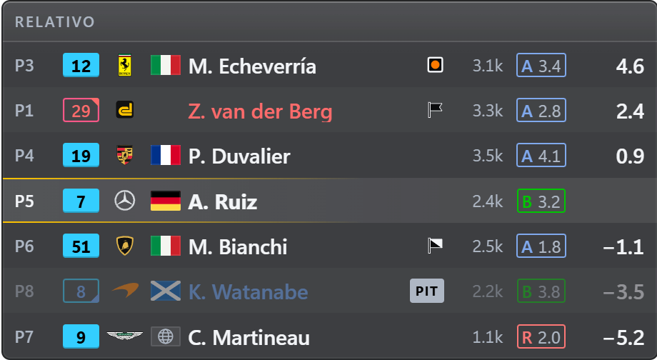

Los coches que tienes delante y detrás en pista (3 y 3 por defecto, hasta 10) con el hueco en
segundos: positivo delante, negativo detrás. Cada fila lleva posición en clase, número con el color
de su clase, marca, bandera del país, nombre, iRating y licencia (en el mismo orden que Posiciones
y Batalla). En rojo quien te va a doblar, en
azul los doblados (con una muesca arriba o abajo en su número, para no depender del color) y
atenuados los que están en boxes. En la cabecera, su nombre; tus incidentes y
el próximo límite de la sesión («3x · DQ a 17x»), la sesión y el tiempo restante salen por
defecto en Posiciones, y aquí con un clic en su cabecera. En Opciones, **Densidad** (la global
de Apariencia o una propia).

Opcionales: columnas de boxes (PIT o GRÚA en su columna; sin ella, tras el nombre, como en
Posiciones), vueltas del stint y neumático (en el mismo orden que en Posiciones), última vuelta
(como la de Posiciones: morada la rápida de su clase, verde su récord; fuera de carrera, su mejor
vuelta), puestos ganados (solo en carrera, como en Posiciones), títulos de columna y una barra de
datos arriba y abajo (sesión, tiempo restante, SoF,
iRating en juego, SR proyectado, condiciones de pista…). El principio de la fila también son
columnas, como en Posiciones (ver más abajo): posición, número, logo, bandera del país, nombre y
banderas de penalización van donde los pongas. Cada columna tiene su ojo, también la posición, el
número y el hueco: solo el nombre sale siempre. Sobre la lista, **Títulos de columna**, y a su pie,
**Copiar de Posiciones**.

### Posiciones

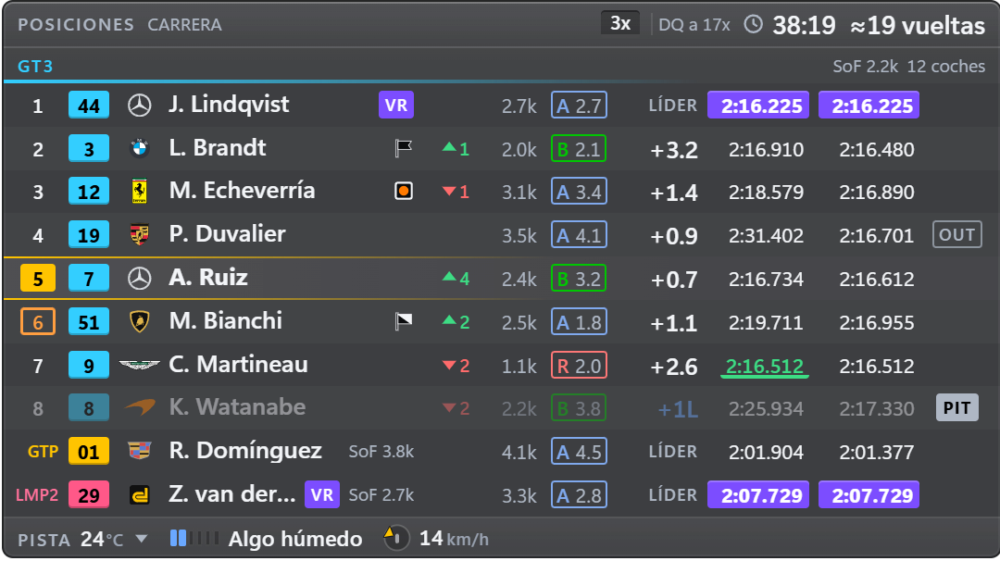

Tabla resumida (los primeros, tu entorno y los primeros de cada otra clase: **Primeros puestos** y
**Alrededor de ti**, 3 y 3 de serie; de cada otra clase, de serie su líder, en una línea; con
**Coches de otras clases** de 0 a 10, los que quieras bajo el nombre de su clase) o entera. La
línea de cada clase lleva su SoF y su número de coches, cada uno con su ojo en **Elementos ›
Línea de clase**; con **También con una sola clase**, una sesión de una clase también tiene su línea, y su SoF y sus coches dejan
las barras; el SoF va también al final de un líder en una línea. Columnas que se ordenan
arrastrando y se esconden solas si la ventana se estrecha: puestos ganados (solo en carrera),
iRating, licencia, iRating en juego, hueco (**Medir el hueco** al de delante, al líder o ambos; de serie,
al de delante), última y mejor vuelta (en morado la más rápida de la clase), boxes, última parada,
stint y neumático. De serie ocultas: iRating en juego, hueco al líder, última parada, stint y
neumático. La fila del iRating en juego tiene **iRating en juego en todas las filas** (apagado: solo el
tuyo), y sobre la lista, **Títulos de columna**. En Opciones, **Densidad** (la global o una
propia).

El principio de la fila también son columnas de la misma lista, en Posiciones y en Relativo:
**Posición**, **Número**, **Logo de la marca**, **Bandera del país**, **Nombre** (siempre visible)
y **Banderas** (las de penalización). De serie, en el orden de siempre, con las banderas tras el
nombre. Cualquier columna puede ir entre ellas: «Puestos ganados» entre la posición y el número,
las banderas entre el número y el logo… Lo que queda pegado al nombre va con él, en su celda:
delante, alineado de fila a fila; detrás, al final de su celda, también alineado. Separado por
otra columna, va en una columna propia. Una regla:
**la lista dice dónde; el bloque «Pilotos», si salen y cómo** el logo, la bandera del país y las
banderas (su fila de la lista no tiene ojo sino un enlace a su fila de «Pilotos», y dice cómo están
ahí). La posición y el número, que no están en el bloque, tienen su ojo. «Copiar de…» lo lleva
todo, y en la vista previa se arrastran como las demás. Cabecera con la sesión, su SoF, tus
incidentes y lo que queda; pie con el nombre del circuito, las condiciones de pista (temperatura y
su tendencia, agua, porcentaje de lluvia, viento con un dial que apunta a tu coche) y los coches. A
un clic en Elementos: una
segunda línea con tu iRating en juego, tu SR proyectado y la vuelta rápida de clase, y el aire y la
goma en el pie (de serie no salen en una instalación nueva, para leerla de un vistazo).

Con varias clases, **Orden de las clases** pone tu clase primero (de serie), la más rápida primero
(como iRacing) o el orden que quieras (**A mano**): una lista de clases por su nombre corto que se
recuerda entre sesiones y se ordena arrastrando, con ↑ ↓ o arrastrando la línea de una clase en la
vista previa. La lista se llena sola mientras corres: cada clase de una sesión multiclase se recuerda
al final, en todos los layouts, sin tocar tu orden, y la × de una clase recordada la
olvida (hasta que vuelva en otra sesión).

Antes de la verde muestra la parrilla entera, y al acabar la sesión se queda con los resultados en
la pantalla de sesión.

### Batalla

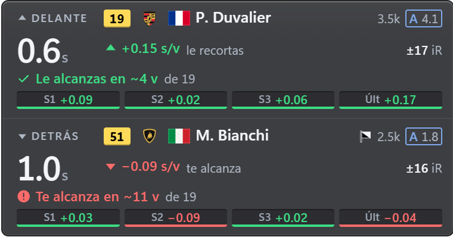

Tu rival de clase de delante y el de detrás mientras estén a menos del hueco que elijas (1,5 s por
defecto): el hueco y su tendencia, la predicción («Le alcanzas en ≈4 v y quedan 19»), los sectores (S1 S2
S3 y la última vuelta) y el iRating en juego; las tres últimas vueltas, a un clic en Elementos
(**Líneas de cada rival › Vueltas**). Uno encima del otro o lado a lado. Por defecto, solo en carrera.
**Mantener visible** (3 s de serie) deja la batalla en pantalla un momento después de que el rival
salga del hueco. El hueco, sin signo (el medido, de serie) o **Con signo** (el mismo tiempo,
positivo delante y negativo detrás); y cada frase de la predicción («Le alcanzas en…», «Te alcanza
en…», «Necesitas… s/v», «No le alcanzas o no te alcanza») con su ojo, en **Predicción de
alcance**. En Elementos, cada rival (**Rivales**: el de delante y el de detrás; sin ninguno, el
widget no se muestra) y cada detalle (**Datos de cada rival**: iRating, licencia, texto de la tendencia e
iRating en juego) tienen su ojo. Opcionales: cabecera y pie con datos de la sesión (ver más abajo).

### Tráfico

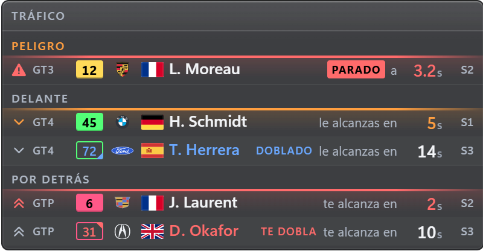

Los coches más rápidos que te alcanzan por detrás (en cuánto tiempo y en qué sector), el tráfico
lento al que alcanzas y los peligros de delante (coches parados, muy lentos o fuera de pista). Quien
te dobla, o te adelanta con bandera azul, sale siempre que esté dentro de **Mirar atrás** (con el
grupo **Clase más rápida** visible), en ámbar o rojo según se acerca. Cada
coche lleva, como en el relativo, el logo de su marca, la bandera de su piloto y su bandera de
penalización (el bloque «Pilotos» de su página). Se
desvanece cuando no hay nadie cerca. La cabecera (el título) admite más datos, y hay un pie
opcional.

En Opciones, hasta dónde mira: **Mirar atrás** (12 s de serie), **Mirar delante** (8 s) y
**Peligros hasta** (8 s); **Coches por grupo** (3 de serie, de 1 a 5) y **Solo en multiclase**
(activado: en una carrera de una sola clase solo avisa de quien te dobla o te adelanta con bandera
azul, y de los peligros). **Hueco**, como en Batalla: **Sin signo** (de serie: «te alcanza en 6 s»,
«le alcanzas en 5 s») o **Con signo** (el tiempo de cada coche tal como lo muestra el Relativo,
positivo delante y negativo detrás, sin el texto antes del tiempo); un peligro siempre dice «a 3.2
s». En Elementos, los **Grupos** (Peligros, Tráfico lento y Clase más rápida) y las **Columnas**
de cada línea (icono, clase, piloto, banderas, texto antes del tiempo, tiempo y sector) se ordenan y
se ocultan, y **Rótulos de los grupos** (activado) pone el nombre encima de cada grupo.

### Radar

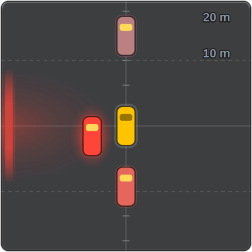

Vista cenital con los coches a escala alrededor del tuyo, que pasan a rojo según se acercan, y un
aviso en el lateral cuando tienes a alguien al lado. Alcance de 5 a 100 m (20 m por defecto, con
botones de 10, 20, 30 y 50 m; en pies con unidades imperiales). Un coche que te acaba de pasar
conserva su lado unos segundos aunque iRacing ya no lo diga. Se oculta solo cuando no hay nadie
cerca. En **Elementos › Partes del radar** se quitan las guías de distancia, sus distancias y los avisos
laterales. Siempre se dibuja encima de los demás widgets (ver [Modo edición](#modo-edición)).

iRacing no da la posición lateral, solo cuántos coches hay a cada lado, así que un coche con borde
discontinuo es una estimación nuestra. Su distancia a lo largo de la pista siempre es la de iRacing. Los
coches de tu carril que se taparían se abren en horizontal. En **Opciones** puedes cambiar el **Panel**
(cuadrado, redondo o sin panel), los **Coches** (bloque o silueta), el **Aviso de lado**, las **Guías**
(líneas o anillos) y el **Color de los coches**, añadir la **Flecha de acercamiento** o usar **Ajuste
rápido** para cambiarlos de una vez.

### Cuentavueltas

La marcha en el centro y las revoluciones en un arco, del ralentí a la línea roja de tu coche. Desde la primera luz de
cambio el arco pasa a ámbar, y en el punto de cambio a rojo con un borde rojo, que parpadea si te pasas de vueltas y se
queda fijo con **Sin parpadeos**. **Aspecto** elige entre **Línea**, **Disco**, **LED**, **Esfera**, **Media luna** y **Neón**.
También puedes elegir **Color del arco**, **Fondo**, **Brillo** y **Aviso de cambio**, o usar **Ajuste rápido** para cambiarlos
de una vez. En **Elementos › Partes del cuentavueltas** se quitan la velocidad y la marca del punto de cambio. Empieza
oculto. Si un coche no trae puntos de cambio, se calculan con su línea roja y la marca sale discontinua.

### Spotter

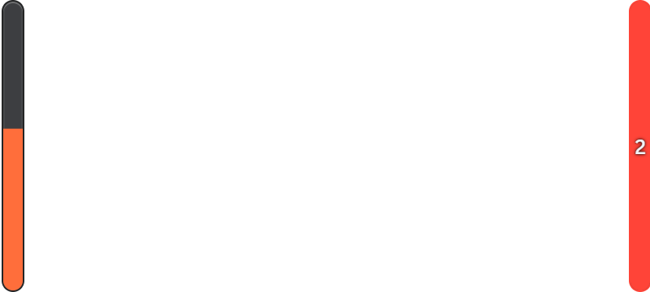

Dos barras, una a cada lado, para quien prefiere los laterales al radar central (o los quiere
con él: son independientes, cada uno con su página y su visibilidad). **Estilo de barra** elige qué
cuentan:

- **Cercanía** (de serie): el radar en dos barras. Cada barra se llena desde abajo cuanto más cerca
  está el coche de ese lado, con la misma regla que el radar: llena cuando va a tu lado, y se vacía
  según se aleja delante o detrás (hasta unos 12 m), del ámbar al rojo; llena se marca también con
  el borde rojo. Con dos coches en un lado, un «2».
- **Dónde te cubre**: cada barra es tu coche, de morro (arriba) a cola (abajo), y se llena con lo
  que te cubre el coche de ese lado: desde arriba si va por delante, desde abajo si va por detrás,
  y entera cuando va justo a tu lado, del gris al rojo. Con dos coches en un lado, un «2»; con uno
  que acaba de estar a tu lado y ahora va justo delante o detrás, un tope tenue en ese extremo. Si
  iRacing dice que hay alguien pero no se puede situar, la barra entera sale discontinua.

**Aspecto** elige cómo se dibujan, y todos cuentan lo mismo: **Línea**, **Barra** (de serie), **LED**,
**Flechas**, **Neón** o **Coche**. También puedes cambiar el **Color**, **Brillo alrededor**, **Fondo de la
barra** y **Destello al llegar un coche**, o usar **Ajuste rápido** para cambiarlos de una vez.

Las dos marcas (el tope y el «2») tienen su ojo en **Elementos › Partes de la barra** («Coche a punto de
ponerse al lado», este solo con **Barra** y «Dónde te cubre», y «Dos coches en un lado»); de serie, las dos.

Qué lado lo dice el spotter de iRacing, y solo cuando el coche ya está a tu altura: uno que se
acerca por detrás sin haber estado a tu lado no tiene lado todavía. Cuánto, la distancia a lo largo
de la pista. iRacing no da la distancia lateral: llena es «a tu lado», no «golpe».

El ancho de la ventana es la separación entre las barras (para ponerlas a los lados del coche o
de la pantalla) y su alto, su largo; el grosor, **Grosor de las barras** (14 px de serie), se elige
en Opciones. De serie solo se ve con un coche al lado o a punto de estarlo (**Solo con un coche
al lado**, en Opciones, activado), y está oculto: se activa en Visibilidad, la barra lateral o la
bandeja.

### Mapa de pista

Todos los coches a lo largo de una línea que va de la meta a la meta, con una marca para cada sector.
Cada punto es un coche en su fracción de vuelta, y no dice nada más: OverLap nunca coloca un coche
del que no tiene datos. Las clases se distinguen por el color y por la forma, tu coche es más grande
y va con un contorno, un coche que te saca una vuelta lleva el contorno a rayas y uno al que le sacas
una vuelta a puntos, y el coche de seguridad va en gris con la etiqueta PC. Un coche que se sale o que
está parado se queda en su sitio y cambia de estilo, porque iRacing no da la posición lateral.

Un coche en el pit lane o en su box sale de la línea y pasa a la fila **Boxes**, como una ficha con su
número y sin ninguna posición en ella. Un inscrito del que iRacing no manda datos no se dibuja: una
línea al pie dice cuántos son y cuáles («2 sin datos: #12 y #44»). Tu coche sigue en el mapa
mientras conduce un compañero, porque se lee como cualquier otro; para verlo también en la pantalla
de sesión de iRacing, enciende su interruptor en Visibilidad.

En Opciones eliges la **etiqueta** de cada punto (ninguna, número o puesto en su clase; si dos se
pisan se quita una, pero la tuya siempre se queda) y los **coches en el mapa** (todos o tu clase). En
**Elementos › Partes del mapa** puedes quitar las marcas de sector, la fila de boxes y la línea de coches
sin datos, y la cabecera y el pie están ahí para las vueltas, el tiempo o el puesto tras la parada.
Su pestaña **Leyenda** enseña cada marca como la dibuja el widget y dice qué significa. Viene oculto:
enciéndelo en Visibilidad, la barra lateral o la bandeja.

### Mapa

La forma de la pista con todos los coches encima, para una pista que hayas conducido. iRacing no da la forma ni
la posición de los coches, solo lo que lleva cada uno de vuelta, así que la forma la grabas tú. OverLap suma tu
velocidad y tu rumbo a lo largo de tus vueltas limpias. Hacen falta dos vueltas que coincidan, y hasta entonces
el widget dice cuántas faltan y por qué no contó la última, y te sugiere **Mapa de pista**, que funciona desde
la primera vuelta. La forma se guarda en tu ordenador, en `track-shapes.json`, y OverLap no trae ninguna pista.
El archivo no sale de tu ordenador, y la forma de la pista en la que estás solo viaja a tu propia página de
streaming si pones allí el Mapa. Un botón en su página las olvida todas.

La línea es nuestra estimación y lleva esa marca. Es la que tú trazas y no el centro de la pista, y cada vuelta
nueva se mezcla con ella. Una vuelta no cuenta si toca boxes, sale de pista, se para, te suma un incidente, o es
de un compañero o de una repetición. Tampoco cuenta si acaba demasiado lejos de donde empezó, si no mide lo que
mide la pista o si no coincide con la anterior. Esos límites aún no se han medido en carreras reales, así que en
una pista larga puede que ninguna vuelta cierre, y esa pista se queda con la tira. Una forma en pantalla no
cambia durante una carrera. Si iRacing reescanea una pista, unas cuantas vueltas seguidas que coincidan entre sí
y no con la forma la sustituyen.

Cada coche va donde iRacing dice que lleva su vuelta. Las clases tienen su color y su forma, y tu coche es la marca
más grande, en tu color de acento salvo que elijas el de tu clase, y conserva su aro en cualquier paleta. Un
coche que se sale sigue sobre la línea con otro estilo, porque iRacing no da la posición lateral. Un coche en
boxes va en la fila **Boxes**, igual que en la tira. No hay números de curva porque iRacing no dice dónde está
cada una.

En **Opciones** eliges la vista (la pista entera, una zona alrededor de tu coche con los metros que abarca, o sin
etiquetas), el giro (ajustar al widget, o de 0 a 270 grados), lo que dice cada coche, qué coches salen, su tamaño
y el color de tu coche. En **Elementos** cada parte tiene sus opciones: el grosor y el borde oscuro de la línea,
la flecha de la meta, los sectores como rayas, rayas con número o tramos alternos, y la calle de boxes discontinua
o continua, que se dibuja cuando has pasado por ella con la pista ya aprendida. Está oculto por defecto: actívalo
en Visibilidad, en la barra lateral o en la bandeja.

### Clima

Cuánta agua hay en la pista y qué hace el cielo, dibujado para leerlo de un vistazo. Cada fila empieza
por un gráfico y deja las palabras para después: siete escalones y una gota que se llena con el nivel
de agua de iRacing, una nube con hasta tres gotas para la lluvia de ahora, un gráfico de los últimos
minutos, un punto por cada coche de tu clase, termómetros para la pista y el aire, una brújula para el
viento y un icono para el cielo, con la luna cuando el sol ya se ha puesto. Una placa azul avisa cuando
iRacing declara la pista mojada. Cada escalón es más alto que el anterior y cada punto está relleno o
vacío, así que se lee igual con la paleta para daltónicos, y con **Sin parpadeos** nada se anima.

El agua, la lluvia, las temperaturas y el cielo son lo que da iRacing, tal cual. Si iRacing no sabe el
nivel de agua, los escalones se quedan vacíos y nunca dicen seco. iRacing no da ninguna previsión aquí,
así que este widget tampoco. La lluvia es lo que llueve ahora, nunca la probabilidad de que llueva.
Cuatro cosas las calculamos nosotros con lo que da iRacing. El viento es la media del último minuto, y la
flecha de la temperatura de la pista dice si sube o baja en los últimos minutos. La dirección (se moja, se
seca o estable) compara el agua de los últimos minutos y lleva una marca que dice que es nuestra: cuenta
lo que ha hecho la pista, no lo que hará. En la tira esa marca es un anillo discontinuo alrededor de su
flecha. El recuento de neumáticos de lluvia
lo hacemos nosotros con los coches de tu clase de los que se sabe el compuesto y, si hemos deducido
alguno, el anillo de la W sale discontinuo, como en la columna **Neumático**. Esa fila no sale si la sesión
no nombra compuestos, ni con la pista seca si nadie lleva lluvia.

En Opciones eliges su forma (lista, cuadrícula de dos columnas o una sola tira), la densidad, el tamaño
de los iconos, si cada fila dice su nombre y **Solo con mojado**, para que salga solo si la pista está
mojada, si llueve o si está declarada mojada. En **Elementos** ordenas u ocultas cada fila y despliegas
sus propias opciones: el agua en escalones, gota o nombre, con el número del nivel si lo quieres. La
lluvia en gotas, barra o porcentaje. El historial de 10, 20 o 30 minutos, con agua, lluvia o las dos, en
área, línea a escalones o barras, del alto que quieras y con la dirección o sin ella. Los neumáticos en
puntos, barra o número, por ejemplo 5 de 12. Las temperaturas que quieras, con termómetro o solo el valor
y con la tendencia o sin ella. El viento en brújula, flecha o texto, respecto a tu coche o al norte. El
cielo con su nombre o sin él, y la humedad y la niebla como filas propias.

El historial empieza cuando enciendes el widget, sigue acumulándose aunque una regla lo oculte y empieza de
nuevo en cada sesión. Viene oculto: enciéndelo en Visibilidad, la barra lateral o la bandeja.

### Delta

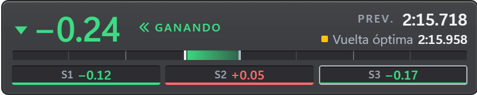

Barra delta frente a la referencia que elijas, con tendencia, vuelta prevista y cada sector. La
referencia puede ser tu récord personal con ese coche en ese trazado (se guarda en tu equipo y no se
pierde al cambiar de sesión; la lista está en la pestaña **Récords** de la página de
Delta), tu mejor vuelta de la sesión, tu vuelta óptima por sectores, la mejor de tu clase o la
óptima de tu clase, y puede ser distinta en práctica, clasificación y carrera: de serie, tu récord
personal en práctica y tu vuelta óptima en clasificación y en carrera. Con **Usar la siguiente si
no existe** (activado), mientras no haya esa referencia el delta usa la siguiente (por ejemplo, tu
récord hasta tener una vuelta limpia). Si no existe ninguna vuelta limpia, compara con tu vuelta más
rápida hasta el momento, con la etiqueta **no limpia**, así que las vueltas con salidas de pista o la
primera de una carrera ya te dan delta en la siguiente. Apagado, no muestra delta hasta que exista la
elegida. Con **Mostrar sin
referencia** (activado), mientras conduces sin ninguna referencia el widget sigue a la vista con el
tiempo de la vuelta en curso de iRacing, los sectores vacíos y una frase que pide una vuelta, y
marca como inválida una vuelta sucia, pero nunca un delta ni una vuelta prevista inventados; apagado,
se oculta hasta que haya una. **En carreras por
equipos, comparar con** decide de quién son las vueltas de tu mejor vuelta y tu óptima: tuyas de
serie (las del equipo, con la etiqueta **equipo**, hasta que tengas una limpia) o de todo el equipo.
**Rango de la barra** (1 s de serie, de 0,5 a 3 s) es lo que la llena. Solo cuentan las vueltas legales: sin
salirte de pista (tampoco con un 1x de iRacing), sin pararte, sin pit lane, grúa ni amarilla; un
toque o un trompo no la invalidan. La referencia solo cambia al empezar una vuelta.

En **Elementos › Líneas**, la **Línea superior** (estado de la vuelta, vuelta prevista y
referencia, cada uno con su ojo). Opcional: una fila de **Tiempos de vuelta** con tu última, tu
mejor y tu óptima (y tu récord, a un clic), y varias referencias a la vez (**Filas por
referencia**, de serie las tres tuyas; las dos de clase, a un clic): cada una con una fila
igual (su nombre, su delta, su tendencia y su barra, todas a la misma escala, verde a la izquierda:
más rápido), bajo una línea que nombra la que usa el delta (la vuelta prevista y los sectores van
con ella; sin esa línea, los sectores llevan su nombre). Con una sola, el delta de siempre. Al
encender filas desde su página la ventana crece lo justo para que quepan todas; si luego la
achicas, se ven las que caben (siempre la de la referencia en uso) y la página dice que en las demás no hay
sitio.

### Vueltas

Tus propias vueltas en una lista, en un gráfico de barras o en los dos, y tú eliges. En el gráfico hay una
barra por vuelta y cuanto más baja, más rápida, con una línea discontinua en tu mejor vuelta. Tu mejor vuelta
lleva su color y una estrella, la que no es limpia lleva un triángulo, y la de boxes sale atenuada, con una P
y la barra cortada, para que no aplaste a las demás. Las mismas marcas encabezan las filas de la lista, así que
la paleta para daltónicos se sigue leyendo. Cada fila tiene el número de la vuelta, su tiempo y lo que pierde
contra tu mejor vuelta, como cifra, como barra o las dos cosas. Arriba hay dos cifras, tu mejor vuelta con su
estrella y tu consistencia. Nada parpadea.

Los tiempos son los de iRacing tal como los da. Una vuelta limpia es lo mismo que para el Delta: no toca boxes,
no sale de pista, no se para, no va bajo bandera amarilla, no es la primera de la carrera y no te suma
un incidente por salirte de pista. Un contacto o un trompo que no te saque de la pista no la estropean por sí
solos, porque iRacing la sigue contando. Tu mejor vuelta es también la del Delta, la más rápida de tus vueltas limpias. La consistencia es
nuestra estimación y lleva esa marca: es cuánto varían tus últimas vueltas limpias, y hacen falta tres para dar
la cifra. Una vuelta nueva puede tardar hasta cinco segundos en salir mientras iRacing publica su tiempo. Si no lo publica, lleva nuestro cronometraje con la misma marca, y si no
tenemos ninguno, esa vuelta no sale. En una carrera por equipos solo salen las vueltas que conduces tú, nunca
las de tus compañeros. Se guardan tus últimas 40 vueltas.

En **Elementos** ordenas u ocultas cada parte y cada columna de la lista y despliegas sus opciones. El gráfico
tiene 10, 20 o 40 barras, su altura, las vueltas de boxes cortadas o fuera, la línea de tu mejor vuelta y los
números de vuelta. La lista tiene 5, 10 o 20 filas, con la última arriba o abajo. Cada marca se puede apagar
por separado, el tiempo puede llevar dos o tres decimales, y la consistencia se puede contar sobre 5, 10 o 20
vueltas limpias o todas, en segundos o en porcentaje. Está oculto por defecto: actívalo en Visibilidad, la
barra lateral o la bandeja.

### Combustible

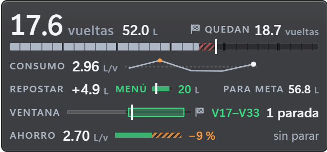

Más dibujo que texto: las vueltas que te da el combustible en grande (en verde si llegas a meta),
los litros y las vueltas que quedan; el depósito marcado en vueltas, con una raya donde llega lo que
necesitas; el consumo con una línea de tus últimas vueltas limpias (media, última y la que más
gastó); lo que hay que echar junto a una barra del menú de boxes; la carrera como una línea con tu
posición, la ventana de parada («V17–V33») y las paradas («1 parada»); el ahorro por vuelta que te
quita una parada, como una barra con el recorte; el coche visto desde arriba con el desgaste de cada
neumático en tres franjas (de verde a rojo, o de azul a naranja con la paleta para daltónicos,
medido en tu última parada) y los juegos que quedan; y las reparaciones rápidas si la sesión las
limita (estas dos líneas, a un clic en Elementos: no salen de serie en una instalación nueva). Solo mide vueltas limpias, y el plan no cambia dentro de la vuelta. Por defecto, en práctica
(donde se mide el consumo) y en carrera. Opcionales: cabecera y pie con datos de la sesión.

En Opciones, **Vueltas para la media** (cuántas vueltas limpias se promedian: 5 de serie) y
**Margen de seguridad** (0,5 vueltas de sobra en meta; los avisos de combustible usan la misma media, sin el margen).
En **Elementos › Líneas**, cada línea salvo «Combustible y vueltas» tiene su ojo, y la de
«Repostar y para meta» lleva la barra del **Menú de boxes** (activada).

### Pedales

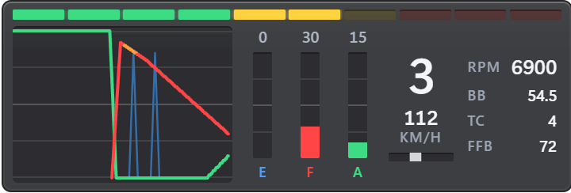

Traza de acelerador, freno y embrague, barras, marcha, velocidad y volante, en el orden que quieras.
Luces de cambio con los regímenes del propio coche y un bloque «Coche» con RPM, reparto de frenada,
nivel de TC y FFB (en rojo cuando llega al 100 %). El volante puede ser una barra o un volante
minimalista, realista (GT) o de fórmula que gira los grados reales. El **Viento** (apagado de
serie; enciéndelo en Datos) dice de dónde te viene el aire y con qué fuerza, en km/h o mph: suelto,
en un pequeño dial con tu coche en el centro, o **En el volante**, una flecha que gira alrededor del
aro (con la barra, suelto). La flecha va en color (de serie, el acento global) y con el aire en
calma se atenúa.

Todo está en Elementos: **Segundos de traza** (5 de serie, de 2 a 10), **Grosor de la traza**,
**Embrague en la traza** (activado; apágalo si cambias con levas), el color de cada pedal y, en
Volante, su **Estilo del volante** (Barra de serie), **Tamaño del volante**, **Color de la marca
central** (de serie, el acento global) y **Grados del volante** (apagado); en Viento, su **Estilo
del viento** (Suelto de serie) y su **Color del viento** (de serie, el acento global).

**Mostrar** elige entre **Lo que pisas** (de serie) y **Lo que aplica el coche**. Parado, iRacing
aplica el freno y el embrague por su cuenta, así que con la segunda opción ambos salen al máximo sin
que los toques.

### Avisos

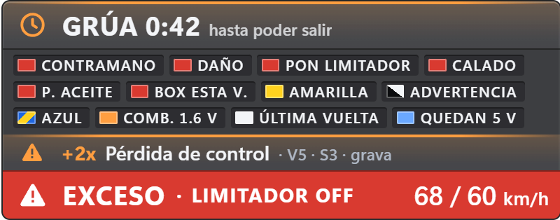

Una banda con lo que te afecta, lo más importante en grande y el resto debajo, en pequeño. Banderas (también
la bandera de advertencia y la azul, cada una con su fila), limitador y exceso de velocidad en el pit lane («LIMITADOR OFF» espera a que el coche salga de su box), «PON LIMITADOR» antes de
entrar, 10 y 5 vueltas para el final, grúa con cuenta atrás, motor calado, sentido contrario,
presión de aceite, «ENTRA ESTA VUELTA», combustible bajo y cada
incidente al sumarlo («+2x Pérdida de control · V5 · S3 · grava»). Cada caso se muestra u oculta
con su ojo en **Elementos › Avisos**, agrupado (Banderas, Boxes, Durante la carrera, Motor,
Combustible), y cada aviso tiene su forma además de su color (se lee con la paleta para
daltónicos). Motor calado, presión de aceite y limitador de boxes
son también testigos: su fila tiene una casilla **Sale en Testigos** que enciende o apaga el
suyo en Testigos, y al revés (**Sale en Avisos** en la página de Testigos). **Mantener visible** (3 s de
serie) deja un aviso breve en pantalla el tiempo de leerlo; en **Elementos › Junto al aviso** se quitan
la línea de qué hacer y los chips de los demás avisos. La bandera azul dice que hay un coche más
rápido detrás. Dura justo lo que le da iRacing y no sale mientras esté la verde, porque entonces el
gráfico de iRacing muestra la verde.

### Testigos

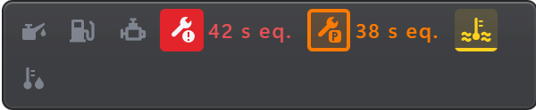

Los testigos del motor como en un salpicadero, en fila o en columna (**Orientación**): presión de
aceite y de combustible, motor calado, reparación obligatoria y opcional (con el tiempo de los mecánicos,
«42 s (equipo)», o «42 s eq.» si la ventana es estrecha; con **Cuenta atrás real**, los segundos reales estimados parado en tu box),
temperatura del agua y del aceite y, si los activas, limitador de boxes y corte de revoluciones.
Cada gravedad tiene su color y su forma; en amarillo avisa cuando el agua o el aceite suben muy por
encima de tu media, antes de que se encienda el testigo del coche. Su página de Ajustes explica qué
es cada uno y qué hacer, en su **Leyenda**.

En Opciones, **Solo encendidos** (apagado: con él, el widget se oculta mientras no hay ninguno
encendido). En **Elementos › Testigos**, cada uno con su ojo (y **Sale en Avisos** en los que comparte
con Avisos), y en el grupo **Junto a cada testigo**, **Nombre junto al icono** (apagado), **Lado de los textos** (en columna),
**Temperaturas** (apagado: «98° +6°»), **Tiempo de reparación** (activado, con **Marcar el tiempo de los
mecánicos**, activado, y **Cuenta atrás real (estimada)**, apagado) y **Temperatura al alza**
(activado).

### Boxes

Todo lo que necesitas entre la entrada y la salida de boxes, y nada durante el resto de la vuelta: solo
sale en la calle de boxes o yendo hacia su entrada. Cada fila empieza por un gráfico. Tu velocidad es
una barra con una marca en el límite y una cifra grande, junto al límite en una señal redonda. Por debajo
del límite va en verde, y por encima la barra pasa la marca y se pone en rojo con un triángulo, así que
se lee igual con la paleta para daltónicos. Se pone en rojo a la vez que el aviso de exceso de **Avisos**,
porque los dos usan la misma regla. Yendo hacia la entrada va en un color neutro, porque el límite no se
aplica hasta que estás en la calle de boxes. El limitador es una etiqueta con un visto o un triángulo, y nada
parpadea. El camino a tu box es una carretera por la que avanza tu coche hasta la marca del box, o una
cifra grande con cinco bloques que se apagan al acercarte. Los coches en la calle de boxes son marcas a
cada lado de tu coche, y una etiqueta dice cuándo estás parado en tu box y cuándo trabaja el equipo.

La velocidad, el límite, el limitador y el estado de tu box son lo que da iRacing, tal cual, y lo que
iRacing no da no sale. La distancia a tu box es nuestra: sale de dónde pone iRacing tu box y tu coche
en la vuelta, también al cruzar la línea de meta, así que puede diferir un poco de lo que mide la calle de
boxes, y lleva la marca **estimación**. Desaparece cuando dejas tu box atrás. El recuento de coches también
lo hacemos nosotros con los que iRacing da en boxes, y no cuenta el coche de seguridad, que aparca ahí,
y lleva la misma marca.
La cuenta atrás de las reparaciones está en **Testigos** y aquí no se repite.

En Opciones eliges su forma (lista o una sola tira), la densidad, el tamaño de las cifras, si cada fila
dice su nombre y **También hacia la entrada**, para que pueda esperar a que estés dentro de la calle de
boxes. En **Elementos** ordenas u ocultas cada fila y despliegas sus propias opciones: la velocidad con
barra y cifra, solo barra o solo cifra, con la señal del límite o sin ella. El limitador y el estado de tu
box con sus palabras o solo con el icono. El camino a tu box como carretera, con la cifra o sin ella, o
como cifra con bloques. Los coches como marcas o como cifra, delante, detrás o los dos. Las velocidades y
las distancias siguen tus unidades. Viene oculto: enciéndelo en Visibilidad, la barra lateral o la bandeja.

### Reincorporación

Para cuando te has salido o te has parado, y nada durante el resto de la vuelta: solo sale si estás fuera
de pista, parado o casi parado y no estás en boxes. Su estado va dibujado con una forma y un color, así
que se lee igual con la paleta para daltónicos: un cuadrado rojo dice **Espera**, un triángulo amarillo
dice **Con cuidado** y un círculo verde dice **Hueco libre**. Debajo, una tira lleva tu coche a la derecha,
el próximo coche acercándose y los segundos que le faltan para llegar. Nada parpadea.

Todo es nuestra estimación y lleva esa marca. iRacing no da la posición lateral de los coches, así que esto
es solo un hueco a lo largo de la vuelta. Es lo que tardaría el próximo coche en llegar a donde estás, a su
ritmo. No puede ver tu trazada de vuelta a la pista ni por dónde pasa ese coche, y no garantiza nada, así
que mira siempre antes de volver. Cuenta los coches de todas las clases, y no cuenta los que están fuera de
pista o en boxes. También cuenta el coche de seguridad cuando está en pista, y como no sabemos su ritmo le
damos el tuyo. Si no tenemos el hueco, se queda vacío, con un contorno sin palabra y sin coche, y nunca con
el círculo verde. Si ocultas el estado, la tira lleva su forma.

En Opciones eliges una luz grande o una banda fina, la densidad y los segundos por debajo de los que sale
cada estado, de serie 5 para **Espera** y 10 para **Con cuidado**. En **Elementos** ordenas u ocultas cada fila
y despliegas sus propias opciones: el estado con su palabra o solo con su forma, con los segundos al lado o
sin ellos. La tira abarcando 15, 30 o 60 segundos, con su cifra o sin ella. El número del próximo coche,
oculto de serie, con su clase o sin ella. Viene oculto: enciéndelo en Visibilidad, la barra lateral o la bandeja.

### Líneas de datos

Es una línea suelta con los datos que elijas, sin ningún widget alrededor, para ponerla donde quieras de la
pantalla. Hay tres independientes, cada una con su sitio, sus datos y su atajo. Vienen ocultas, así que tu layout no
cambia hasta que las actives.

Admiten los mismos datos que las cabeceras, con los mismos huecos, y además **Tu texto**, por ejemplo el nombre de tu
copa para un directo. En **Elementos** los ordenas arrastrándolos en la vista previa. Si falta sitio, se cae primero
el dato menos importante.

**Estilo** elige cómo se dibujan:

- **Indicadores**: cada dato lleva un dibujo de lo que significa, como un anillo con lo que va de sesión, la parrilla
  de tu clase contigo marcado o las pastillas de incidentes hasta el siguiente límite. Puedes quitarle el dibujo a cada
  dato con **Con gráfico**. Lo que calculamos nosotros (las vueltas de combustible y los ratings proyectados) lleva ≈.
- **Celdas**: su icono y el valor en grande.
- **Retransmisión**: un rótulo de televisión, con el dato del primer hueco en una placa, con **Corte inclinado** o recto.
- **Marcador**: el dato del primer hueco en el centro y más alto, con los demás a los lados. Con **Lado del
  protagonista** lo sacas hacia abajo o hacia arriba, según dónde pongas la línea.

En los dos últimos, el dato del primer hueco es el último que se cae, y **Progreso de la sesión** añade una línea fina
con lo que va de sesión. También puedes quitar los **Rótulos** y elegir los **Anchos**, según el dato o iguales.

## Ajustes y personalización

La primera vez, OverLap abre los Ajustes, en el idioma de Windows (español o, si no, inglés), con
una **bienvenida** de tres pasos: idioma y unidades, qué widgets usar (seis marcados de inicio, al
menos uno) y dónde está todo, con **Probar con datos de ejemplo** para ver los widgets en tu
pantalla y colocarlos. Windows avisa de que OverLap queda en la bandeja.

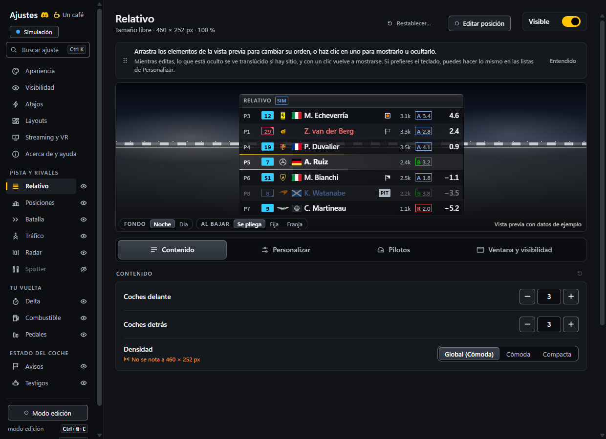

Se abren desde la bandeja (**Ajustes…**), con `Ctrl+Mayús+O`, volviendo a abrir el `.exe` o
arrancándolo con `--settings` (los accesos directos del instalador lo llevan). Todo se aplica
**en vivo** y se guarda solo; arriba de
cada página hay una vista previa del widget sobre un fondo de circuito de noche o de día, que se queda arriba
al bajar por las opciones. Ocupa como mucho el 45 % de la ventana, nunca baja de un tamaño que se lea (si no cabe, enseña sus primeras filas) y la línea que tiene debajo cambia su altura: al estirarla más de lo que el widget necesita, este crece con ella, hasta el doble de su tamaño real o hasta el 60 % de la ventana. Cada widget guarda la suya y con un doble clic vuelve
al tamaño inicial. **Sacar a ventana** lleva la vista previa a una ventana propia que queda encima, puede ir a otra pantalla y sigue la página en la que estás. Se abre justo al lado de Ajustes si esa pantalla tiene sitio, y después donde la dejaste. Se edita igual que la de Ajustes, con datos de ejemplo: un clic oculta un elemento, y arrastrándolo lo mueves o lo cambias de espacio, con su **Deshacer**. Queda también encima de los widgets y se cierra con Ajustes, mientras las opciones ocupan todo el sitio. Bajo la vista previa, la página
de cada widget tiene **pestañas**, con los mismos nombres y en el mismo orden en todas:
**Opciones**, **Elementos**, la propia del widget si la tiene (**Pilotos** en Relativo,
Posiciones, Batalla y Tráfico, **Récords** en Delta, **Leyenda** en Testigos, Mapa de pista y Mapa) y **Tamaño y
visibilidad**. Ninguna marca en las pestañas indica cambios: eso lo dicen el ↺ del final de la barra
de pestañas y el menú **Restablecer…** de arriba. La barra de pestañas se queda bajo la vista previa,
`Ctrl+RePág` / `Ctrl+AvPág` cambian de pestaña y la pestaña elegida se mantiene al pasar
de un widget a otro mientras la ventana sigue abierta. En una ventana estrecha las pestañas
pierden los iconos, luego ponen **Tamaño** y solo entonces se desplazan de lado. Algunas líneas
llevan a un ajuste de otra pestaña: «Qué avisos salen», con su botón a Elementos, «La altura de las filas se elige en
Densidad, en la pestaña Opciones», «Para cambiar el ancho, arrastra el borde de la vista previa o entra en modo edición» («Para cambiar el tamaño…» cuando también el
alto lo eliges tú), la fila de Opciones que además decide cuándo salen Batalla, Spotter o
Testigos y, en **Pilotos**, la fila de la columna del iRating en Elementos. Con la ventana ancha
(desde 1100 px) Elementos lleva las listas del widget a la izquierda y las barras y lo que las
acompaña a la derecha (una sola lista se queda en una columna más ancha), y Opciones, Pilotos y Tamaño y visibilidad llevan sus grupos con
título a dos columnas (las filas nunca se reparten entre ellas). Lo que
cambias se ve en la vista previa; si no se ve, la opción dice por qué con una nota corta: **A 540 px
de ancho no hay sitio para esto** (el ancho del widget no deja sitio para esa columna o ese dato:
ensánchalo u oculta otro). Las opciones que actúan durante la sesión (cuándo se ve un widget, el
bloqueo, cuánto tiempo sigue un aviso…) dicen **No cambia la vista previa**. Cuando un ajuste solo
se ve en otra situación, la vista previa se pone en ella y lo dice debajo: la referencia de la
sesión que cambias en Delta, tu coche más atrás al cambiar los primeros puestos de Posiciones, cinco
coches por grupo al cambiar las entradas de Tráfico. Una lista que va dentro de un bloque oculto
(los datos del coche en Pedales, los tiempos de vuelta en Delta) lo dice debajo, y al mostrar uno de
sus elementos se muestra también el bloque.
Arriba de la barra lateral (o con **Ctrl+K**), **Buscar ajuste** encuentra cualquier ajuste por sus palabras y te
lleva a él (abre su pestaña y su sección y lo señala), también los botones («exportar», «editar posición»,
«restablecer») y las opciones de cada selector («imperiales», «apellido», «English»), por palabras
de uso diario («zoom», «bloquear», «parpadeo», «daltonismo», «galones», «rpm», «tecla», «botón del
volante», «por coche», «letra grande») o por el nombre de un estilo; lo que ahora oculta otro ajuste sale marcado «con otro
ajuste». La barra lateral agrupa los widgets en **Pista y rivales**, **Tu vuelta** y **Estado del
coche**, igual que la bandeja. El ojo de cada uno lo muestra u oculta; tenue y con un círculo
discontinuo, está activado pero no se ve ahora: una regla lo oculta o has ocultado el overlay (el
ratón encima dice por qué). En una ventana estrecha (menos de 640 px) la barra lateral se queda
en una columna de iconos, con el ojo de cada widget al lado y su nombre al pasar el ratón, y el
buscador, el chip de estado y **Modo edición** van arriba. El **chip de
estado** de arriba dice qué está oculto y por qué; con un clic abre un panel con qué hacer,
**Copiar diagnóstico** (para un informe de error, sin nombres) y **Abrir registro**.

- **Por widget**: visible, bloqueado, fondo (el global de Apariencia o una opacidad propia, y la
  misma elección para su color; solo el panel: el texto sigue nítido y, con poca opacidad, lleva contorno), escala (la misma fila y los
  mismos botones 80/100/125/150 % en todos; en Relativo, Radar, Spotter y Delta cambia el tamaño de su
  ventana, como la rueda en modo edición), alto automático o fijo, hacia dónde crece (abajo o arriba, con alto automático), en qué sesiones
  se muestra, ocultar en boxes (salvo Avisos, que avisa del limitador y de la entrada a boxes) y
  mostrar en la pantalla de sesión (salvo los que solo tienen datos en el coche; de serie, solo
  Posiciones).
- **Restablecer y deshacer**: arriba de cada página (los widgets, Apariencia, Visibilidad y Atajos),
  **Restablecer…** dice qué deja de serie, sección por sección (en un widget: Opciones,
  Elementos, Pilotos, Tamaño y visibilidad, Posición y tamaño, o todo), y cada sección tiene su
  icono ↺ (en un widget, al final de la barra de pestañas; en las demás páginas, en la cabecera),
  que restablece solo esa sección. Es un solo clic: un aviso abajo dice qué
  se ha restablecido (y en qué layout, si tienes varios) con **Deshacer** (o `Ctrl+Z`)
  durante unos segundos. Lo mismo al restablecer una lista o un atajo, al usar «Usar el de Apariencia en todos»
  los widgets, al ocultar un widget y al eliminar un layout. Piden un segundo clic
  **Restablecer todo** (en Ayuda y acerca de) y **Copiar estas opciones a todos los layouts**, que también se
  deshacen, y borrar récords personales, lo único que no se puede deshacer.
- **Elementos**: en esa pestaña de la página de cada widget, editores para ordenar (arrastrando o con ↑ ↓) y
  mostrar u ocultar cada parte: columnas, cabecera, segunda línea, pie, filas, grupos, avisos…
  La vista previa dibuja solo lo que el widget muestra de verdad, un clic en un elemento lo oculta, con
  **Deshacer**, y lo oculto vuelve con el ojo de su fila.
  Una regla para todas las páginas: **Opciones** es el comportamiento (cuántos, cuánto tiempo,
  umbrales, modos) y **Elementos** lo que se ve (cada lista con su ojo y, con ella, cómo se
  ven sus elementos; la opción de un elemento, en su fila).
- **Cabecera y pie**: Relativo, Posiciones, Mapa de pista, Combustible, Tráfico y Batalla tienen los mismos:
  una fila de 0 a 9 **espacios**, un tamaño «Pequeña / Normal / Grande» y los datos que quieras del
  mismo catálogo (con **+ Añadir dato**: título, sesión, tiempo restante, hora local, hora en pista (la del simulador, con un sol), SoF, coches, incidentes,
  iRating en juego, SR proyectado, vuelta rápida de clase, vueltas de combustible, nombre del
  circuito, temperatura de la pista, agua, lluvia, viento, aire, goma, y por separado vueltas hechas
  y total, vueltas hechas, vueltas que quedan,
  tiempo pasado y total, tiempo pasado, tiempo que queda, vueltas del stint, puesto tras la parada
  (una estimación en carrera, cuando alguien ya ha parado) y cada parte del iRating; Combustible no ofrece sus propias vueltas de combustible, que ya dice). Por
  defecto cada barra es una sola línea con sus datos juntos: la cabecera dice el título y la sesión,
  y luego tus incidentes y el tiempo restante; el pie las condiciones, y luego los coches y el
  combustible; y los datos de la sesión y el nombre del circuito, solo en Posiciones. Los espacios
  reparten el ancho a partes iguales: el primero alinea su dato a la izquierda, el último a la derecha
  y los de en medio al centro, así que los datos en los espacios 1, 3 y 5 de 5 quedan en un extremo, en el
  centro exacto y en el otro extremo. Un espacio vacío solo deja sitio libre, y con 0 espacios la barra no se
  muestra y sus datos se quedan guardados. Un dato sin nada que decir, como el agua con la pista seca,
  deja su espacio vacío y nada más se mueve. Si ninguno de los datos de una barra tiene nada que decir,
  como una línea de cifras de carrera en entrenamientos, la barra no se muestra sobre el juego ni en las
  páginas de streaming. Vuelve en cuanto un dato tiene algo que decir y se va unos segundos después de
  que se vaya el último, o enseguida en una sesión nueva. La vista previa la sigue mostrando con sus espacios
  vacíos para que puedas editarla. Un dato más largo que su espacio toma sitio de los espacios vacíos
  y luego de los que les sobra. En la vista previa, con la pestaña **Elementos** abierta, cada espacio
  vacío se ve como un contorno tenue: un clic te deja elegir qué poner, un clic en un dato lo quita, y
  arrastrando lo llevas a cualquier espacio de la cabecera, la segunda línea o el pie de ese widget, y
  cambia de sitio con lo que hubiera. Con el teclado se hace lo mismo desde la lista, con flechas y un
  menú. Quitar espacios nunca pierde un dato: los datos pasan a los espacios libres, o la barra se queda
  como estaba y te dice por qué. Un dato puede estar en dos barras de un widget, como la hora en la
  cabecera y en el pie. **Resaltar**, en la fila de un dato, lo dibuja en el color de acento de
  **Apariencia** y un 9 % más grande, sin cambiar la altura de la barra, y lo que avisa de algo conserva
  su propio color. En su fila, **Agua en la pista** elige **Gráfico y texto**, **Solo texto** o **Solo gráfico**,
  y **Lluvia**, **Temperatura del aire**, **Temperatura de la pista**, **Goma**, **Viento** sin su dial, **SoF**, el número de coches,
  las vueltas de combustible, la posición tras boxes y el stint eligen **Nombre y valor** o **Icono y valor**, y los
  incidentes **Solo texto** o **Icono y valor**, la hora en pista **Icono y valor** o **Nombre y valor** («PISTA 14:32») y la hora local **Solo la hora** o **Nombre y hora** («LOCAL 14:32»), en cada widget. En la vista previa, una franja fina en los bordes del widget
  cambia su tamaño como en el modo edición, solo el ancho si su alto sigue al contenido, con **Deshacer**. El nombre del circuito es el que escribe
  iRacing, y con su opción puedes elegir **Nombre completo**,
  **Nombre y layout** o **Solo el layout**, y la lluvia es el porcentaje de precipitación de
  iRacing, también con 0 %, y lo primero que se quita cuando la línea va justa. **Copiar a** pasa una cabecera o un
  pie, con su tamaño, al mismo sitio de otro widget. Si de verdad la línea no cabe, se quitan enteros los menos importantes, y
  vuelven cuando sobra sitio de forma clara; el texto nunca se encoge. Delta, Pedales, Radar, Spotter, Testigos, Avisos, Mapa, Clima, Vueltas, Boxes y Reincorporación no tienen: son lecturas compactas, y una barra
  solo les añadiría altura.
- **Estilo** (arriba de Apariencia), cuatro distintos a simple vista: **OverLap** (todo de serie: el
  aspecto y lo que muestra cada widget, con Relativo y Delta a su tamaño de serie, o lo justo más si
  muestras más coches, para que el texto no encoja), **Limpio** (sin fondo: solo el texto sobre el
  juego, con su contorno; sin filas alternas, logos ni banderas, número en franja, licencia solo letra), **Compacto**
  (pequeño pero legible: filas compactas, texto al 85 %, apellidos, número en franja, licencia solo
  letra, sin logos ni banderas de país) y **Completo** (fondo al 90 %, logos siempre y todo a la vista en todos los widgets del layout en uso: cada columna,
  elemento, barra de información y aviso; los widgets crecen para que el texto no encoja). Si va a
  cambiar algo que pusiste tú, antes te dice qué cambia (de antes a después) y dónde se guarda, y
  esperas a **Aplicar**; todo se deshace con **Deshacer**, ventanas incluidas. El resto de
  Apariencia queda como **Ajuste fino** (Color, Texto y Filas a la izquierda, Pilotos a
  la derecha), y si lo tocas (o lo que muestra un widget, con OverLap o Completo) el estilo pasa a
  «Personalizado». Limpio y Compacto solo cambian el aspecto: al dejar **Completo** por uno de
  ellos, lo que Completo añadió se queda, salvo que marques «Quitar también lo que añadió
  Completo» (cada widget vuelve a lo que mostraba antes); con **OverLap** se va siempre, porque
  vuelve todo de serie. No cambian el acento, la Accesibilidad, la etiqueta SIM, el idioma, las
  unidades, los sitios ni qué widgets se ven (eso lo eligen los layouts).
- **Apariencia**: idioma, color de acento (te marca a ti y nada más), fondo de los widgets (80 %
  por defecto, el que siguen todos salvo los que tengan uno propio) y su **Color del fondo** (de serie, el casi negro de siempre; sobre un color claro el texto se vuelve oscuro solo y los logos de las marcas usan sus colores impresos, sobre uno saturado el texto de color se aclara hasta leerse, y solo aparece una nota en un tono medio donde ni el texto claro ni el oscuro se leen bien), tamaño del texto (multiplica la escala de todos los widgets:
  en Relativo, Radar, Spotter y Delta, que llenan su ventana, agranda su ventana en la misma
  proporción, en todos tus layouts), contorno del texto, densidad y filas alternas,
  **Líneas entre filas** (la línea fina que se dibuja con las filas alternas apagadas; con las dos
  cosas apagadas las filas quedan limpias), **Resaltado de tu fila** (**Línea** de serie, o
  **Degradado**: tu acento cruza la fila y se apaga hacia el final),
  estilo de la licencia y del número, color del logo (color o monocromo), unidades métricas o
  imperiales (mph, °F, galones en Combustible y pies en el alcance del radar), **etiqueta SIM**
  (marca los widgets con datos simulados; activada de serie) y el bloque **Pilotos** global: **Qué nombre se muestra** (**Piloto**, de serie; **Equipo**: en carreras por equipos cada coche se
  nombra por su equipo, tal como lo manda iRacing, también la vuelta rápida de clase del Delta; o
  **Equipo y piloto**: los dos en la misma línea, «Vela Rossa Corse · M. Echeverría», el piloto
  más pequeño y en gris y con el formato del nombre; si no cabe se recorta antes el piloto. Un
  coche sin equipo propio, como en cualquier otra carrera, sigue con su piloto), formato del nombre, logo de la marca (Auto, Siempre o
  Nunca), bandera del país, banderas de penalización, **formato del iRating** («2.5k», cortado y sin redondear, o el número
  entero, «2.520», con los miles del idioma; también el SoF) e **iRating con el color de la
  licencia** (apagado de serie: el de cada piloto con los colores y el estilo de su licencia).
- **Accesibilidad** (en el grupo **General** de Apariencia, con Idioma y unidades), todo apagado de serie: **paleta para daltónicos**
  (azul y naranja en lugar de verde y rojo, también en los pedales, con la traza del freno más
  gruesa), **texto mínimo de 10 px** (en vez de 9; ningún widget se ensancha, quitan antes un dato),
  **sin parpadeos** (las luces de cambio fijas en azul) y el **tamaño de esta ventana** (80–150 %,
  también con `Ctrl` y `+` / `-` / `0` o `Ctrl` y la rueda; botones 80/100/125/150 %, como los demás
  tamaños). Al pie, dos botones llevan a **Tamaño del texto** y **Contorno del texto**.
- **Bloque «Pilotos»**: Relativo, Posiciones, Batalla y Tráfico tienen en su página, en su propia
  pestaña **Pilotos**, las mismas filas en tres grupos: **Nombres** (qué nombre se muestra y su formato), **iRating** (su formato e
  iRating con el color de la licencia; en Tráfico, que no muestra el iRating de los pilotos, esta última
  está apagada) y **Logos, banderas y etiquetas** (logo de la marca, bandera del país, banderas de penalización y etiquetas de pilotos).
  Cada una tiene «Como Apariencia (…)» o un valor propio, salvo las etiquetas de pilotos, que no tienen valor en Apariencia ni están en Tráfico. El
  logo, la bandera del país y las banderas de penalización salen o no según su fila; dónde, lo
  decide la lista de columnas de Relativo y Posiciones (y la de columnas de Tráfico, para las
  banderas): justo tras el nombre, tras su texto; en otro sitio, en una columna propia. Batalla,
  sin columnas, las lleva tras el nombre.
- **Récords personales** (una pestaña de la página de Delta, que dice también dónde se elige su referencia): la lista por coche y trazado, con borrar uno, el actual o todos.
- **Pilotos**: tus etiquetas y notas sobre otros pilotos, de una sesión a otra. Mira más abajo.

### Pilotos

La página **Pilotos** lista los pilotos de la sesión y a todos los que etiquetaste antes, con un buscador por
nombre, número, equipo, ID, nota o etiqueta. A cualquiera le puedes poner las etiquetas **Amigo**, **Equipo**,
**Rápido**, **Limpio** o **Sucio**, cada una con su icono, y una nota libre. Limpio y Sucio no pueden ir
juntas. A quien no está en la sesión lo puedes añadir por su ID de iRacing. Un piloto se conoce solo por lo
que da iRacing, su ID y su nombre, y en un evento por equipos es el que va al volante, así que la etiqueta le
sigue de coche en coche. Las notas se escriben en esta página, nunca sobre el overlay.

Relativo, Posiciones y Batalla dibujan las etiquetas como diga la pestaña **Pilotos** de cada uno: **Icono**,
**Etiqueta completa** con su icono y su nombre, **Franja** al lado de la fila, **Nombre** subrayado en el color de la etiqueta con
su icono, o **Nada**. Después del nombre, la etiqueta le deja sitio primero, hasta quedarse en su icono. Cada etiqueta tiene su icono y su dibujo de franja, así que se distinguen sin mirar el
color, también con la paleta para daltónicos. En las tablas se colocan en **Columnas** como las demás partes
del nombre, y una tabla sin nadie etiquetado deja su sitio como estaba. A los widgets solo les llegan las etiquetas,
nunca una nota.

Tus etiquetas y notas son tuyas. Se quedan en este ordenador, en `driver-tags.json`, y ni los layouts ni
**Exportar todo** las llevan. Las notas nunca salen de él. Las fuentes del stream no reciben ninguna etiqueta
salvo que actives **Etiquetas de pilotos en el stream** en la página de Streaming, que vale también para una
página abierta en otro PC de tu red, y entonces reciben solo las etiquetas de quienes están en la sesión.
**Restablecer todo** no las toca.

## Modo edición

Entra con `Ctrl+Mayús+E`, desde la bandeja o con el botón **Modo edición** de los Ajustes. En la
página de un widget, **Mover y redimensionar** (junto a «Visible») entra y señala ese widget sobre el
juego.

- Arrastra un widget para moverlo y usa sus bordes y esquinas para cambiar su tamaño; la rueda del
  ratón lo escala. La ayuda sobre cada widget y el aviso de los Ajustes usan las mismas palabras
  («Rueda: escala · Flechas: mover · Alt: sin imán · Esc: salir»). Se pega a los bordes de los demás widgets y de la pantalla, y a su centro, y una
  línea marca dónde se ha pegado (con `Alt` o `Mayús` pulsado, no).
- Para afinar, las **flechas** mueven 1 px el último widget que has tocado (`Mayús`: 10 px) y
  `Ctrl` + flechas cambian su tamaño. Su etiqueta lleva el borde en el color de edición, para que
  sepas a cuál se aplican; `Tab` y `Mayús+Tab` pasan al widget siguiente o al anterior (de arriba
  abajo), también sin cursor, con un aviso «Flechas: Relativo». Funcionan con el juego o el
  escritorio delante, y también con los Ajustes delante (justo después de **Mover y redimensionar**,
  también `Tab`), salvo mientras un campo, un deslizador o una lista de los Ajustes tiene el foco:
  entonces son suyas.
- `Ctrl+Z` deshace el último cambio del modo edición (un arrastre, un cambio de tamaño, la rueda,
  las flechas o el ojo y el candado de la etiqueta), y luego el anterior; la bandeja ofrece
  también **Deshacer: …** con lo que hiciste («mover Relativo», «cambiar el tamaño de Relativo»,
  «ocultar Batalla»). Al salir del modo edición se olvidan.
- Arrástralo fuera de su pantalla para llevarlo a otra («Suelta para moverlo a la otra pantalla»). Si desconectas un monitor, **Traer todos
  los widgets a esta pantalla** (en la bandeja, a la pantalla del ratón, o en **Visibilidad**,
  a la de los Ajustes) los recupera de una vez. Durante un minuto se deshace desde
  cualquiera de los dos sitios (**Deshacer: …** en la bandeja).
- El radar siempre queda por encima de los demás widgets (para no perder nunca el coche que va a tu
  lado). En modo edición, su etiqueta dice qué paneles tapa («Tapa: Avisos, Delta») y un panel
  tapado dice «El radar lo tapa».
- La etiqueta de cada widget tiene un **ojo** (mostrar u ocultar), un **candado** (bloquear) y un
  **⚙** que abre su página en los Ajustes. Un widget oculto se ve como un hueco discontinuo para
  poder recuperarlo.
- Sal con `Esc`, con el mismo atajo o desde la bandeja. Salir en mitad de un arrastre lo cancela.
- Con iRacing delante y tú en el coche, el simulador oculta el cursor: el aviso sobre el juego
  nombra el atajo de **Abrir los Ajustes** (que liberan el cursor) y `Alt+Tab`, y recuerda que
  `Tab` y las flechas mueven los widgets sin él. Lo más cómodo es colocar los widgets en el garaje o en
  los menús.
- Para que la rueda funcione sobre un widget, Windows necesita _Configuración > Bluetooth y
  dispositivos > Mouse > Desplazar ventanas inactivas al mantener el puntero sobre ellas_.

Posición, tamaño y visibilidad se guardan solos. Fuera del modo edición los widgets dejan pasar
todos los clics al juego.

## Layouts

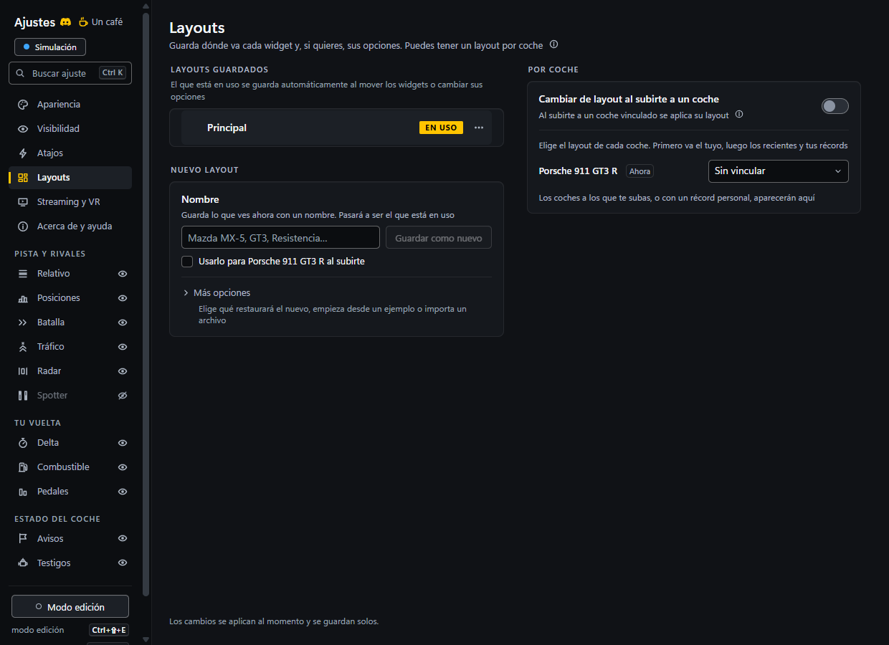

Un layout guarda, con un nombre, dónde está cada widget (en cada pantalla), su tamaño, su
escala, si se ve y si está bloqueado, y también las opciones de cada widget: columnas y su orden,
elementos, barras de información, referencias del delta, estilo del volante, opacidad, en qué
sesiones se ve… Uno para el Mazda, otro para el GT3. La apariencia (idioma, unidades, color,
tamaño del texto…), cuándo se ve el overlay y los atajos son siempre los mismos.

- Cada layout es **Sitio, tamaño y opciones** (de serie) o **Sitio y tamaño**: este solo devuelve
  cada widget a su sitio y su tamaño, y usa las **opciones compartidas** por todos los de su tipo. Lo
  eliges al guardarlo, en **Qué guarda este layout**, y lo cambias luego con **Renombrar o editar**;
  solo uno de sitio y tamaño lo dice en su fila. Al importar lo decide el archivo: si lleva opciones
  las conserva y, si no, usa las compartidas.
- **Ajustes › Layouts** tiene cuatro bloques. **Layouts guardados**: cada fila muestra
  su nombre, sus coches y **Aplicar** (o **En uso**); su menú **⋯** tiene **Renombrar o editar**
  (un doble clic en el nombre hace lo mismo), **Duplicar**,
  **Exportar…** (un `.json` con sus opciones), **Subir** / **Bajar** y **Eliminar** (el que está
  en uso no se puede eliminar). Arrastra una fila por los puntos de su izquierda, o enfócalos y usa las flechas,
  para cambiar tu orden. **Nuevo layout** guarda lo que ves con un nombre y lo que elijas en **Qué
  guarda este layout**. **Por coche** reúne todos los vínculos con coches: el coche en el que estás
  va aparte, y los demás pasan a una caja con scroll cuando son más de 8. **Añadir un layout hecho**
  tiene **Layouts de ejemplo** e **Importar desde un archivo**. Hasta 30 layouts; **Buscar layouts** los
  encuentra por nombre o por coche, y **Orden** los lista en tu orden (**Personalizado**, de serie,
  el mismo de la bandeja y del atajo), por **Nombre** o por **Uso reciente**. La bandeja muestra
  los cinco primeros y **Más…**.
- **El que está en uso se guarda automáticamente** al mover, redimensionar, ocultar o bloquear un widget y
  al cambiar sus opciones. En la página de cada widget, una línea sobre la vista previa (con dos
  layouts o más, o uno de sitio y tamaño) dice dónde se guarda lo que cambias (**Guardando en** el layout, o en **Opciones compartidas**). Su menú **⋯**
  tiene **Copiar estas opciones a todos los layouts**, para llevar las opciones de ese widget a todos los layouts, con un segundo clic para confirmar
  y una frase que dice cómo ha ido.
- Se cambia desde la bandeja (submenú **Layout**), desde los Ajustes o con el atajo
  **Siguiente layout**.
- **Layouts de ejemplo** (en **Añadir un layout hecho**) añade a la lista, sin aplicarlo, uno de dos
  layouts muy distintos, con sus propios sitios (para la pantalla de tus widgets: dibujados
  para 1920 x 1080, a la misma distancia de sus bordes en cualquier 16:9 y en el centro de una
  ultrapanorámica) y opciones; tu Apariencia no cambia:
  - **Equilibrado**: lo esencial para una carrera (Relativo, Radar, Delta, Combustible, Avisos y
    Pedales) en sitios cómodos y a buen tamaño, con las opciones de serie.
  - **Ingeniero de pista**: todos los widgets, pequeños y con todos los datos, en los bordes (el
    retrovisor y la carretera quedan libres), cada uno en su otro aspecto: todas las columnas, más
    coches, una barra por referencia, los datos del coche...

  Con **Siguiente layout** alternas entre ellos en carrera.

- **Por coche**: el interruptor **Cambiar de layout al subirte a un coche** (desactivado de serie) y una sola lista de
  coches, primero en el que estás, después los recientes y los de tus récords, cada uno con la
  layout que usa; ese layout se aplica automáticamente al subirte a ese modelo. Vincular un coche
  activa el interruptor (con **Deshacer**, en la página o en la bandeja, que también vuelve al
  layout que tenías). Estando en un coche sin layout, la página ofrece **Usar «…»** y la bandeja
  **Vincular … a «…»**, y al guardar uno nuevo puedes usarlo para tu coche (marcado de inicio solo
  si el interruptor ya está activado y el coche aún no tiene layout). Cada layout muestra sus coches como
  etiquetas. Un coche sin vínculo se queda con el último que usaste.

## Atajos de teclado

Son globales: funcionan con iRacing en primer plano. Cada acción puede tener **hasta tres atajos a
la vez**, cada uno una combinación de teclas o un botón del volante, la button box, los pedales o
el cambio (ver [Botones del volante](#botones-del-volante)): por ejemplo `Ctrl+Mayús+H` y el
botón 24 del G29, o un botón en cada volante. Cualquiera de ellos ejecuta la acción.

| Atajo (por defecto) | Acción                                                      |
| ------------------- | ----------------------------------------------------------- |
| `Ctrl+Mayús+H`      | Mostrar u ocultar todo el overlay de golpe                  |
| `Ctrl+Mayús+E`      | Entrar o salir del modo edición                             |
| `Ctrl+Mayús+O`      | Abrir los Ajustes (o traerlos al frente)                    |
| (sin asignar)       | Siguiente layout                                            |
| (sin asignar)       | Cambiar la referencia del delta                             |
| (sin asignar)       | Cambiar entre piloto y equipo, en todos los widgets         |
| `Esc`               | Salir del modo edición (solo mientras editas; no se cambia) |
| (sin asignar)       | **Más acciones**: mostrar u ocultar cada widget, uno a uno  |

- **Más acciones**, plegado bajo la tabla, tiene una fila por widget («Mostrar u ocultar
  Relativo»…): lo mismo que su ojo en la barra lateral o su casilla en la bandeja (que muestra el
  atajo junto al widget). Ninguna tiene atajo de serie; se despliega solo si alguna lo tiene. Para
  quitar o poner un widget en carrera sin cambiar de layout; el aviso sobre el juego dice
  «Oculto: Posiciones» o «Visible: Posiciones».
- **Cambiar entre piloto y equipo** pasa todos los widgets al siguiente de **Piloto**, **Equipo** y
  **Equipo y piloto** (el **Qué nombre se muestra** de Apariencia y el de cada widget que tenga uno propio,
  también en cada layout guardado, así que todos coinciden; si no coincidían, a Equipo). Se
  guarda como cualquier opción y el aviso sobre el juego dice «Nombres: Equipo», «Nombres: Equipo ·
  piloto» o «Nombres: Piloto» (fuera de una sesión por equipos añade que se ven los pilotos). Si
  unos widgets mostraban unos nombres y otros otros, **Deshacer** en la bandeja lo devuelve.
  También está en la bandeja (**Nombres**, con los tres y marcado el que muestran todos).
- Ocultar el overlay no detiene la telemetría: al mostrarlo vuelve con los datos al día. Al abrir
  la app, el overlay siempre está visible.
- Se cambian en **Ajustes › Atajos**, una tabla con una fila por acción y una columna por atajo
  (**Atajo principal** y después **Alternativos**), como la pantalla de controles de un juego.
  Cada casilla es el control: un clic en una casilla con atajo lo cambia por otro, y su **×** (al
  pasar el ratón) o `Supr` lo quitan; la primera casilla libre dice **+ Asignar** y espera una
  combinación o un botón del volante. Al quitar uno, los de la derecha se corren a la izquierda (el
  primero es el que lee la versión 2.1.1). Sin ninguno, la acción queda desactivada. El icono ↺ de la
  derecha la deja solo con el de serie. Mientras grabas, `Esc` cancela y `Retroceso` o `Supr`
  quitan el atajo que estás cambiando.
- Los avisos van en la casilla a la que se refieren (**Desconectado**, **En uso por otra app**), y
  una frase que haga falta (un atajo rechazado, el aviso de `AltGr`) sale debajo de esa misma
  columna.
- Al usarlo (también `Esc` al salir del modo edición), un aviso breve arriba de la pantalla
  donde están tus widgets dice qué ha hecho, o por qué no se ve nada (por ejemplo, «Solo hay un
  layout»); también confirma **Traer todos…** y **Vincular…** de la bandeja. Se apaga en
  **Confirmar sobre el juego**. La fila de la acción dice «Pulsado hace 3 s», para probarlo desde
  el juego, y si un atajo no se puede
  registrar, la bandeja lo dice bajo el estado.
- Un mismo atajo no puede estar en dos acciones (ni dos veces en la misma): la página dice quién
  lo tiene ya.
- **Una combinación asignada deja de llegar a los demás programas, iRacing incluido**, mientras
  OverLap está abierto: no elijas una que uses en el simulador. Si otra aplicación ya la tiene, la
  página lo dice.
- Necesitan `Ctrl` o `Alt`, salvo `F13`–`F24`, que envían muchas button box y teclados de macros.
  `Ctrl+Alt` equivale a `AltGr` en un teclado español: se permite, pero avisa de que puede impedir
  escribir `@`, `#` o `€`. La tecla Windows no se puede usar; valen letras, números, `F1`–`F24`, el
  teclado numérico, `Espacio` y las teclas de navegación.

### Botones del volante

- En **Ajustes › Atajos**, pulsa **+ Asignar** (o el atajo que quieras cambiar) y luego el botón:
  vale cualquier botón de un volante o su aro, una button box, unos pedales, un cambio o un freno
  de mano que Windows vea como mando de juego, también los de más de 32 botones. Se ve como «Botón
  12 · G29 Driving Force Racing Wheel».
- **Solo se leen**: el botón se comparte con iRacing y no se bloquea nada, así que **iRacing
  también recibe la pulsación**. Elige uno que no tengas asignado en iRacing.
- Mantenerlo pulsado cuenta como una sola pulsación.
- Las crucetas (D-pad) y los hats no se pueden asignar: solo los botones.
- Si la página pide **pulsar el botón otra vez**, es que acaba de empezar a leer ese mando y no
  sabe qué botones estaban ya abajo (un selector giratorio o un interruptor fijo); la segunda
  pulsación es la que se guarda.
- Si el dispositivo está desenchufado, el atajo sigue guardado y su casilla dice **Desconectado**
  (los otros atajos de la acción siguen funcionando); al enchufarlo vuelve a funcionar solo.
- Dos dispositivos idénticos (mismo modelo) comparten los botones: cualquiera de los dos sirve.
- `Esc` para salir del modo edición sigue siendo solo de teclado.
- Los botones solo se leen mientras algún atajo es un botón (o mientras eliges uno): sin ninguno,
  OverLap no lee los mandos.
- Si vuelves a la versión 2.1.1, cada acción conserva solo su primer atajo (los demás se pierden al
  guardar), y si era un botón vuelve a su combinación de serie.

## Cuándo se ve el overlay

En **Ajustes › Visibilidad**:

- **Mostrar el overlay**: solo cuando estás en el coche (por defecto), solo en carrera o
  siempre. Fuera del coche solo se queda Posiciones en la pantalla de sesión, con los resultados.
- **En repeticiones**: **Ocultar** (por defecto) o **Seguir al coche en cámara**: los widgets siguen
  al coche que miras; al rebobinar solo queda Posiciones (con la carrera en directo), y los que solo
  tienen datos de tu coche (Radar, Pedales, Delta…) se ocultan mientras miras otro.
- **Ocultar con la interfaz de iRacing**, **Ocultar en el garaje** y **Ocultar en la pantalla de
  sesión**, activados de serie (el último solo se ofrece cuando cambia algo). Solo la pantalla de
  sesión tiene excepción por widget: **Mostrar en la pantalla de sesión**, en su página.
- **Mantener «Esperando a iRacing»** (apagado): sin iRacing, Posiciones y Relativo siguen con el
  aviso en vez de ocultarse.
- Cada widget tiene además sus propias reglas: en qué sesiones se muestra y si se oculta en boxes.
  Debajo, la tabla **Dónde se ve cada widget** las reúne todas: Visible, **Se ve en** (práctica,
  clasificación, carrera y pantalla de sesión), **Se oculta** (ocultar en boxes) y **Al editar**
  (bloqueado), una fila por widget. Cada casilla es el mismo ajuste, con el mismo sentido, que en
  su página (la columna Visible es el ojo de la barra lateral), y su nombre lleva a ella. Un guion
  dice que ese widget nunca puede verse en la pantalla de sesión.
- El modo edición siempre enseña todos los widgets, con el motivo si alguno está oculto.

Para OBS y otros programas de streaming, mira [Streaming](#streaming): tus widgets como fuentes de
navegador, con el fondo transparente. Capturar la ventana «Pantalla N · OverLap» o la pantalla
sigue funcionando.

## Streaming

OverLap puede llevar tus widgets a **OBS, Streamlabs, vMix o XSplit** como **fuente de navegador**:
una página que tu programa de streaming pinta encima del juego, con el fondo transparente. Eliges
qué widgets van al stream, aparte de lo que ves en pantalla, y colocas y das tamaño a cada uno en tu
programa de streaming. Se activa en **Ajustes › Streaming y VR**.

**Cómo añadir un widget a OBS**

Tu programa de streaming va en **este mismo PC**, o en un PC de streaming aparte de tu red de casa
con **Desde otro PC de mi red** (mira **Un PC de streaming aparte**, más abajo).

1. En **Ajustes › Streaming y VR**, activa **Activar el modo streaming**.
2. En OBS: arrastra **Arrastrar a OBS**, junto al widget (a la pantalla o a la cortina), hasta la
   escena de OBS. OBS pregunta si añade la fuente («Add Source via URL»): di **Sí**. Crea una fuente
   de navegador con su nombre («OverLap · Relativo») y su tamaño: el de tu pantalla, y para un widget
   que crece con la sesión (Posiciones, Relativo…) su ancho y alto de sobra, debajo es transparente.
   La pantalla y la cortina toman el tamaño del lienzo.
3. Con Streamlabs, o en OBS a mano: pulsa **Copiar URL**, **Añadir fuente › Navegador**, pega la
   URL y pon el ancho y el alto que indica la fila de ese widget. Vale
   cualquier tamaño con la misma proporción: el widget se escala a la fuente.
4. Desactiva **Actualizar el navegador cuando la escena se active** (Refresh browser when scene
   becomes active): la fuente se reconecta sola cuando OverLap se reinicia y se recarga sola tras una
   actualización de OverLap.
5. vMix: **Añadir entrada › Web Browser**. XSplit: **Añadir fuente › Página web**. Misma URL y
   tamaño (**Copiar URL**).

Añade `?preview=1` al final de una URL para ver un ejemplo mientras la colocas sin iRacing.
Mientras iRacing no está abierto, las fuentes quedan vacías y transparentes: sin «Esperando a
iRacing».

**Las direcciones** (el puerto es `39217` salvo que lo cambies):

- `http://127.0.0.1:39217/w/relative` (una por widget: `standings`, `battle`, `inputs`,
  `delta`…): ese widget solo. Se ve mientras está marcado **En el stream**, aunque lo hayas ocultado
  en tu pantalla. La lista va en dos grupos, **Los que suelen interesar a quien te ve** y **Conviene pensarlo
  antes de enseñarlos**. De serie van al stream Posiciones, Relativo, Pedales, Delta y Batalla.
  Todos los demás quedan fuera hasta que los marques: Combustible (estrategia que un rival podría
  leer en directo), las ayudas al piloto (Radar, Spotter, Tráfico, Testigos, Avisos), Mapa de pista,
  Mapa, Clima, Vueltas, Boxes, Reincorporación y las líneas de datos.
- `http://127.0.0.1:39217/screen/1` (una por pantalla, el **espejo de pantalla**): lo que OverLap
  dibuja sobre el juego en esa pantalla, en su sitio y transparente, pero solo los widgets del
  stream: una sola fuente con los widgets que tienes visibles en ese monitor y marcados **En el
  stream**. Un widget oculto en tu pantalla no sale aquí, aunque su propia URL sí lo enseñe. Úsala en
  lugar de los widgets sueltos, no a la vez (saldrían repetidos). La fila de cada pantalla dibuja su monitor en
  pequeño con sus widgets del stream y dice cuántos enseña; **Identificar** muestra en grande el
  número de cada pantalla sobre su monitor tres segundos, para saber cuál arrastrar (la del monitor
  donde juegas).
- `http://127.0.0.1:39217/curtain` (**Cortina de setup**): mientras iRacing enseña el garaje (la
  pantalla de setup), un panel opaco con tu texto («Ajustando el coche…» si no escribes otro) tapa el
  stream; el resto del tiempo es transparente. Ponla encima de todo en tu programa de streaming: del
  tamaño del lienzo para taparlo todo, o más pequeña para tapar solo una parte. Solo sale en el
  stream, nunca en tu pantalla.

  **Imagen** (en **Cortina de setup**): tu logo o una imagen de fondo para la cortina, con
  **Elegir imagen…**: PNG, JPG, WebP o GIF (también animado), hasta 20 MB. OverLap guarda una copia
  en su carpeta, así que sigue funcionando aunque muevas el archivo, y cambia en el stream al
  momento, sin recargar la fuente. **Ajuste**: **Cubrir** (de serie: llena la cortina y recorta lo
  que sobra) o **Encajar** (se ve entera, con bandas oscuras). **Mostrar texto** (de serie sí; con imagen
  o sin ella) pone tu texto en la cortina, abajo sobre la imagen con una sombra y un fondo suave;
  apagado, la cortina es solo el panel o tu imagen. **Quitar imagen** borra la
  copia. Una copia de seguridad no lleva la imagen: al importarla se queda la de este PC.

**Un PC de streaming aparte**

Con **Desde otro PC de mi red** (en **PC de streaming aparte**, apagado de serie), un segundo PC de
tu casa lleva OBS y lee los widgets del PC de juego por tu red. La página lo explica en pasos
numerados, plegados en **Ver qué hace falta** mientras está apagado y a la vista al activarlo, con el
modo streaming ya activado:

1. Activa **Desde otro PC de mi red**.
2. En el PC de streaming, abre el navegador y escribe tal cual, en la barra de arriba, la dirección
   que enseña la página (por ejemplo `http://192.168.1.37:39217/links`). Si salen dos, la marcada
   **Prueba primero esta**; si la primera no abre, prueba la otra. (**Copiar dirección** la copia con
   el código ya puesto, por si te la mandas al otro PC en un mensaje.)
3. Pon el código de este PC (pulsa **Mostrar** para verlo): 20 letras y números en grupos de cuatro,
   sin I, L, O ni U para no confundirlas; da igual mayúsculas o minúsculas y los guiones. Salen todas
   las fuentes del stream.
4. En ese PC, añade cada widget a tu programa de streaming, arrastrándolo si usas OBS (OBS pregunta
   si añade la fuente: di **Sí**) o con **Copiar URL** en otro programa. Cada dirección lleva el
   código.
5. Si Windows pregunta, marca solo **Redes privadas** y pulsa **Permitir** (nunca **Redes
   públicas**).

Encima de los pasos, una línea dice cómo va el otro PC: **Esperando al otro PC**, **Conectado, con 1
fuente desde el otro PC**, **Has cambiado el código: actualiza las fuentes del otro PC** o,
apagado, **Apagado, así que el otro PC no recibe nada**.

**Si no funciona** (la misma lista está plegada bajo los pasos, y abierta mientras no hay fuentes):

- Los dos PCs, en la misma red de casa o Wi‑Fi (OverLap no contesta a otra red, tampoco a una VPN).
- OverLap abierto en este PC, con **Desde otro PC de mi red** activado.
- La dirección, en la barra de direcciones del navegador (no en el buscador) y con los números del
  final.
- Si sale una segunda dirección, prueba esa.
- Windows: tu red como **Privada** (**Configuración › Red e Internet**).
- Firewall: OverLap con **Privada** marcada (**Seguridad de Windows › Firewall y protección de red ›
  Permitir una aplicación a través del firewall**).
- Usa la versión instalada: la portable se ejecuta desde una carpeta nueva en cada versión, así que
  Windows vuelve a preguntar tras cada actualización.
- ¿Cambiaste el código? Escribe el nuevo en el otro PC y arrastra otra vez las fuentes.

El código es aleatorio y es de este PC (importar y **Restablecer todo** lo conservan; una copia de
seguridad nunca lo lleva). Quien tenga este código ve tus widgets: no enseñes la ventana de Ajustes
en el stream. **Cambiar el código** (en su propia línea, pide un segundo clic) si lo has compartido
sin querer: las fuentes del otro PC dejan de funcionar, y allí tendrás que volver a abrir la
dirección, escribir el código nuevo y arrastrarlas otra vez; la línea lo recuerda hasta que vuelve
una fuente del otro PC. Apagado, el otro PC deja de recibir los widgets: sus fuentes se quedan
vacías hasta que lo vuelvas a activar (con el mismo código, vuelven solas); las de este PC siguen.

Los **logos de marcas en el stream** pueden ir **Como en pantalla** (de serie), **Monocromo**,
**Texto** (las tres letras de la marca) o **Nada**. **Etiquetas de pilotos en el stream** (apagado de serie)
lleva a las fuentes las etiquetas que pones en **Pilotos**, nunca tus notas. **Ocultar el overlay de la captura** (apagado de
serie) es solo para un programa de streaming que captura la pantalla entera (en OBS, **Captura de
pantalla**): pide a Windows que deje las ventanas de OverLap fuera de las capturas de pantalla, así
que el overlay de tu monitor no sale en esa captura y en el stream solo salen los widgets que añades
como fuentes. Si capturas solo el juego (en OBS, **Captura de juego**), no hace falta. También
desaparece de tus propias grabaciones,
capturas y de lo que compartes en Discord, y Windows no garantiza que todos los programas lo
respeten.

Si apagas el modo streaming o el servidor se para, una cortina que está puesta sigue puesta hasta
que OverLap vuelve y sales del garaje. Una dirección mal escrita no pinta nada en el stream (con
`?preview=1` lo dice).

**Privacidad y seguridad.** El servidor solo existe mientras el modo streaming está activado
(apagado, no hay ningún puerto abierto; importar una copia nunca lo activa), escucha solo en este PC
(`127.0.0.1`: nada de tu red ni de internet puede conectarse) salvo que actives **Desde otro PC de
mi red**, y es **de solo lectura**: una página
solo puede recibir los datos de los widgets, no puede cambiar nada de OverLap. Rechaza peticiones de
otras webs, sirve solo los archivos de la página del stream (y la copia de la imagen de la cortina,
si eliges una; ningún otro archivo tuyo) y a cada página le manda solo lo que
pintan sus widgets (nunca los nombres de tus mandos, tus atajos ni tus layouts). Su puerto es fijo para
que tus fuentes de OBS sigan funcionando; si otro programa lo usa, la página lo dice y ofrece uno
libre, pero OverLap nunca lo cambia por su cuenta. Nada del modo streaming toca iRacing: enseña los
mismos datos que los widgets ya leen.

Con **Desde otro PC de mi red** activado, escucha también en las direcciones de red privadas de este
PC (las sigue si cambian), y ahí: solo pueden conectarse equipos de la misma red que esa dirección
(la subred del adaptador: nunca una dirección pública, ni la de CGNAT, `100.64.0.0/10`, ni otra red
privada como la de una VPN, aunque traigan el código), cada petición y cada conexión debe llevar el
código de este PC (en la dirección; los archivos de código y estilo de la página lo toman de una
cookie con el nombre del puerto que solo va a `/assets/`), comparado en tiempo constante; el código
correcto siempre entra, y una dirección que prueba códigos equivocados tiene que esperar, cada vez
más, hasta cinco minutos (un código viejo tras **Cambiar el código** se rechaza sin contar, así una
fuente olvidada en OBS nunca deja fuera al PC de streaming); la petición debe nombrar este PC por su
dirección de red o su nombre; el código nunca se escribe en el registro. Apagado, nada escucha en tu
red.

## VR

OverLap no dibuja dentro del visor, pero [OpenKneeboard](https://openkneeboard.com), un programa
gratuito, puede enseñar tus widgets en VR. Está probado con unas Quest 3S y Meta Horizon Link. Los
mismos pasos están en **Ajustes › Streaming y VR**, con el botón **Guía de VR** de arriba.

**En tu PC**

1. Instala OpenKneeboard. En OverLap, activa **Activar el modo streaming**.
2. Marca **En el stream** los widgets que quieras ver en el visor y copia su URL con **Copiar URL**.
3. En OpenKneeboard, abre **Settings › Tabs**, pulsa **Add a tab**, elige **Web Dashboard** y pega la
   URL. Cada widget va en su propia pestaña, y la página le dice a OpenKneeboard su nombre y su
   tamaño, así que el widget llena su panel con fondo transparente.

**En el visor**

4. Con unas Quest, abre Meta Horizon Link y márcalo como runtime de OpenXR activo en **Settings ›
   General**. Conéctalas con Link o Air Link.
5. En iRacing, elige **OpenXR** en el menú de modo de pantalla, arriba a la derecha. El modo Oculus
   no funciona con OpenKneeboard.
6. Entra en pista con el visor puesto. El panel sale sobre tus rodillas y el widget aparece cuando
   iRacing está en marcha.

**Colocar el panel**

7. Asigna una tecla a **Recenter VR** en **Settings › Input** de OpenKneeboard y púlsala sentado como
   conduces, mirando al frente. Eso desbloquea la posición en **Settings › Virtual Reality**.
8. Este es un buen punto de partida para verlo delante de ti:

| Ajuste de OpenKneeboard          | Valor                           |
| -------------------------------- | ------------------------------- |
| Vertical distance from eye level | 0,25 m                          |
| Forward position                 | 0,70 m                          |
| Left-to-right position           | a tu gusto, por ejemplo -0,30 m |
| Kneeboard width y height limit   | 0,40 m                          |
| Pitch                            | 67°, para que mire hacia ti     |

Para ver varios widgets a la vez, añade más vistas en **Settings › Virtual Reality**. También puedes
pegar la URL de una pantalla y ver juntos los que tienes visibles en ese monitor y marcados
**En el stream**, aunque más pequeños.

**Si algo falla.** Si no ves el panel, pulsa Recenter y comprueba que OpenXR está activado en
OpenKneeboard. Si queda detrás del cockpit, cierra iRacing y pon `DepthLayerExtensionEnabled=0` en la
sección `[OpenXR]` de `Documents\iRacing\rendererDX11OpenXR.ini`.

**El antitrampas.** OpenKneeboard se engancha al dibujo del juego. Su
[página de compatibilidad](https://openkneeboard.com/compatibility/games/) dice que no les consta
ningún baneo, pero que el riesgo teórico existe, así que usarlo es decisión tuya.

## Privacidad y anti-cheat

- OverLap **solo lee** el mapa de memoria compartida del SDK oficial de iRacing, en modo solo
  lectura, igual que cualquier herramienta de telemetría. **No inyecta nada** en el proceso del juego
  (iRacing usa EasyAntiCheat) ni escribe en esa memoria.
- Los widgets son ventanas propias, transparentes, que no cogen el foco ni envían nada al juego. Los
  atajos usan el registro de teclas de Windows: no hay ganchos de teclado. Los botones del volante
  se leen con Raw Input de Windows, como SimHub o Crew Chief: compartidos con iRacing, sin
  bloquear ni abrir el dispositivo, sin ganchos y sin enviarle nada.
- **Red, solo para actualizaciones**: OverLap no tiene cuentas ni envía datos tuyos a ningún sitio.
  Su única conexión es la búsqueda de actualizaciones en las releases de GitHub de este repositorio
  (al minuto de arrancar y cada 5 horas; GitHub ve tu dirección IP, como en cualquier descarga), y
  se apaga en **Ayuda y acerca de › Versión y actualizaciones**. Tus ajustes y récords se quedan en tu equipo.
  Los botones de **Ayuda y acerca de** (guía, problemas, licencia, avisos de terceros y descargar)
  solo abren el navegador cuando los pulsas.
- **Modo streaming, solo en este PC**: apagado de serie. Activado, abre un servidor local de solo
  lectura en `127.0.0.1` para tu programa de streaming; nada de tu red ni de internet puede
  llegar a él y no sale nada. Solo si activas también **Desde otro PC de mi red** responde a tu red
  de casa, y solo con el código de este PC (mira [Streaming](#streaming)).
- No activa la grabación de telemetría `.ibt` de iRacing.

La política de privacidad completa está en [PRIVACY.md](PRIVACY.md).

## Problemas conocidos

- Los `.exe` no están firmados, así que Windows avisa al abrirlos (ver el aviso al principio de
  [Instalación](#instalación)).
- El portable se descomprime en una carpeta temporal en cada arranque, así que tarda unos segundos
  en abrirse (el instalador no).
- Si alguna ventana se ve con fondo negro en lugar de transparente, puede ser la aceleración por
  hardware de la tarjeta gráfica.
- Los nombres con letras que no existen en Windows-1252 (cirílico, chino…) ya llegan de iRacing como
  `?`: se muestran con el nombre del equipo o como «Piloto #7».
- Lo pendiente de confirmar en una sesión real está en el [registro de cambios](CHANGELOG.md).

## Licencia y créditos

OverLap es **gratuito, pero no es de código abierto** (freeware). Copyright © 2026 Jesús Molano.

Puedes instalarlo y usarlo gratis, para uso personal o comercial (retransmisiones y vídeos
incluidos), y compartir el instalador o el portable oficiales sin modificar; la mejor forma de
compartirlo es un enlace a la [página de
releases](https://github.com/jesus-molano/OverLap/releases/latest). No puedes venderlo, modificarlo,
descompilarlo ni hacerle ingeniería inversa (salvo donde la ley lo permita), ni distribuir copias
modificadas. Se ofrece **sin ninguna garantía**. Las condiciones completas están en
[LICENSE](LICENSE) (en inglés, con un resumen en español), y la que vale es la versión en inglés. El
nombre OverLap y el icono «OL» no se licencian. iRacing es una marca de iRacing.com Motorsport
Simulations, LLC; OverLap no está afiliado a iRacing ni cuenta con su respaldo.

Las versiones 2.4.2 a 2.5.2 se publicaron bajo la GNU GPL versión 3 o posterior
(`GPL-3.0-or-later`), y las copias de esas versiones conservan esa licencia.

**Los logos en color de las marcas de coches no están bajo la licencia de OverLap.** Son marcas y
dibujos de terceros (de Wikimedia, de worldvectorlogo.com y de las webs de Dallara y Tatuus), que se
muestran solo para saber de qué marca es cada coche; sus dueños conservan todos sus derechos y
OverLap no concede ninguno. El juego monocromo sale de [Simple Icons](https://simpleicons.org) (CC0,
de dominio público) y se elige en **Apariencia › Pilotos › Color del logo › Monocromo**:
tiene 18 de las marcas, y las demás se siguen dibujando en grises a partir del juego en color.
OverLap no está afiliado a ninguna marca de coches. El detalle, fuente por fuente, está en
[THIRD_PARTY_NOTICES.md](THIRD_PARTY_NOTICES.md#brand-logos).

OverLap usa componentes de terceros (como [irsdk-node](https://github.com/bengsfort/irsdk-node)
para leer el SDK de iRacing y las banderas de
[country-flag-icons](https://gitlab.com/catamphetamine/country-flag-icons)), cada uno con su propia
licencia; los avisos de terceros están en [THIRD_PARTY_NOTICES.md](THIRD_PARTY_NOTICES.md).
[irDashies](https://github.com/tariknz/irdashies) sirvió de referencia para la convención de signo
del relativo.

Los cambios de cada versión están en el [registro de cambios](CHANGELOG.md).

## Firma del código

**Estado: los ejecutables de OverLap no están firmados** (qué hace Windows al abrirlos: ver
[Instalación](#instalación)). El
actualizador de la versión instalada acepta actualizaciones sin firmar: comprueba que el instalador
descargado coincide con la huella sha512 del `latest.yml` de la release, servido por HTTPS desde las
releases de GitHub de este repositorio, así que quien controle las releases de este repositorio
controla las actualizaciones. Ninguna release de OverLap está firmada por nadie.

- **Quién publica:** cada release la compila y la sube a mano el autor,
  [jesus-molano](https://github.com/jesus-molano), solo a las
  [releases](https://github.com/jesus-molano/OverLap/releases) de este repositorio. Descarga OverLap
  solo de ahí.
- **Privacidad:** ver [PRIVACY.md](PRIVACY.md). La única conexión de OverLap a internet es la
  búsqueda de actualizaciones en las releases de GitHub de este repositorio, que se puede apagar; no
  envía nada de iRacing ni de tus ajustes. El modo streaming (apagado de serie) solo escucha en este
  PC, o también en tu red de casa, con un código, si lo activas.

## Apoyar OverLap

OverLap es gratis y lo seguirá siendo, sin cuentas, sin anuncios y sin funciones de pago. Si te sirve
y quieres ayudar a mantenerlo, un donativo es voluntario y no desbloquea nada. Puedes invitarme a un café en
[Ko-fi](https://ko-fi.com/jesusmolano) (también desde **Ayuda y acerca de › Apoyar OverLap** en la
app). Informar de errores o proponer ideas en los
[issues](https://github.com/jesus-molano/OverLap/issues) ayuda igual.

