# OverLap

> **In English:** OverLap is a free and open-source overlay for iRacing on Windows. It reads the
> sim's official telemetry (the iRacing SDK shared memory, read-only; nothing is injected into the
> game) and draws eleven widgets on top of it: relative, radar, spotter, standings, battle, inputs,
> traffic, alerts, warning lights, delta and fuel. Every widget can be moved, scaled and customised,
> with a different layout per car. The app speaks Spanish and English; it needs no account and makes
> no network connections. Download the portable `.exe` from
> [Releases](https://github.com/jesus-molano/OverLap/releases). Licensed under the
> [GPL-3.0-or-later](#licencia-y-créditos); see also [building from source](#compilar-desde-el-código),
> [privacy](PRIVACY.md), the [code signing policy](#code-signing-policy) and
> [contributing](CONTRIBUTING.md). The rest of this guide is in Spanish.

Overlay para iRacing en Windows. OverLap lee la telemetría oficial del simulador y dibuja once
widgets encima del juego: relativo, radar, spotter, posiciones, batalla, pedales, tráfico, avisos,
testigos, delta y combustible. Cada uno se coloca, se escala y se personaliza a tu gusto, y puedes
guardar una disposición distinta para cada coche.

- Solo **lee** los datos del SDK de iRacing: no inyecta nada en el juego ni usa la red (ver
  [Privacidad y anti-cheat](#privacidad-y-anti-cheat)).
- Los widgets van en ventanas transparentes, siempre encima, que nunca cogen el foco y dejan pasar
  los clics al juego.
- En español o en inglés: la primera vez, en el idioma de Windows (si no es ninguno de los dos, en
  inglés).

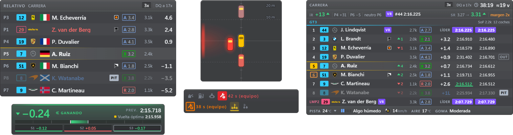

_Todas las capturas usan los datos de ejemplo de la propia app (pilotos inventados) sobre fondo
transparente; en pista, el panel deja ver el juego a través según la opacidad que elijas._

## Contenido

- [Instalación](#instalación)
- [Widgets](#widgets)
- [Ajustes y personalización](#ajustes-y-personalización)
- [Modo edición](#modo-edición)
- [Disposiciones](#disposiciones)
- [Atajos de teclado](#atajos-de-teclado)
- [Cuándo se ve el overlay](#cuándo-se-ve-el-overlay)
- [Privacidad y anti-cheat](#privacidad-y-anti-cheat)
- [Problemas conocidos](#problemas-conocidos)
- [Compilar desde el código](#compilar-desde-el-código)
- [Licencia y créditos](#licencia-y-créditos)
- [Code signing policy](#code-signing-policy)
- [Apoyar OverLap](#apoyar-overlap)

## Instalación

### Requisitos

| Requisito | Detalle                                                           |
| --------- | ----------------------------------------------------------------- |
| Sistema   | Windows 10 u 11 de 64 bits                                        |
| iRacing   | En ventana sin bordes (borderless / pantalla completa en ventana) |

- En **pantalla completa exclusiva** el overlay no se ve.
- En **VR** no se ve, salvo con una herramienta como OpenKneeboard.

### Descargar y abrir

1. Descarga `OverLap-2.2.0-portable.exe` de la última release en GitHub.
2. Ábrelo. No se instala nada: es un ejecutable portable que puedes dejar donde quieras.
3. El `.exe` no está firmado, así que **Windows SmartScreen** avisará la primera vez. Pulsa **Más
   información → Ejecutar de todas formas**.

OverLap se queda en la **bandeja del sistema** (junto al reloj). Desde su icono abres los
**Ajustes…**, muestras u ocultas cada widget, cambias el alcance del radar, cuándo se ve el overlay y
la disposición en uso, entras en modo edición, abres la carpeta de ajustes o sales. Volver a abrir
el `.exe` con OverLap ya en marcha abre los Ajustes.

Si iRacing no está abierto, Relativo y Posiciones muestran «Esperando a iRacing…» unos segundos y
se ocultan; OverLap se conecta solo en cuanto arranca el simulador.

Los ajustes se guardan en `%APPDATA%\iracing-overlay\` (**Ajustes › Acerca de y ayuda › Abrir carpeta**,
o la bandeja). En esa página, **Exportar todo…** guarda en un archivo todos los ajustes (Apariencia,
atajos, visibilidad y todas las disposiciones con sus opciones) y tus récords, e **Importar todo…**
los recupera en otro equipo o tras reinstalar: los ajustes se ponen al momento (con **Deshacer**,
mientras no cambies nada más) y los récords del archivo se suman a los tuyos (gana la vuelta más
rápida; ninguno de los tuyos se borra, y si la lista está llena se dice cuántos no caben). Ahí están también la
versión, una ayuda rápida, **Abrir registro**, **Copiar diagnóstico**, **Ver la bienvenida** y
**Restablecer todo** (como recién instalado, en tu idioma; tus récords se quedan; con **Deshacer**).
Al final, **Licencia** dice que OverLap es software libre (GPL-3.0 o posterior, sin garantía) y
abre en el navegador el código fuente, la licencia y los avisos de terceros.

## Widgets

Cada widget tiene su página en los Ajustes, con una vista previa en vivo y sus opciones. Todos se
pueden mostrar u ocultar, bloquear, escalar y limitar a ciertas sesiones (práctica, clasificación,
carrera).

### Relativo

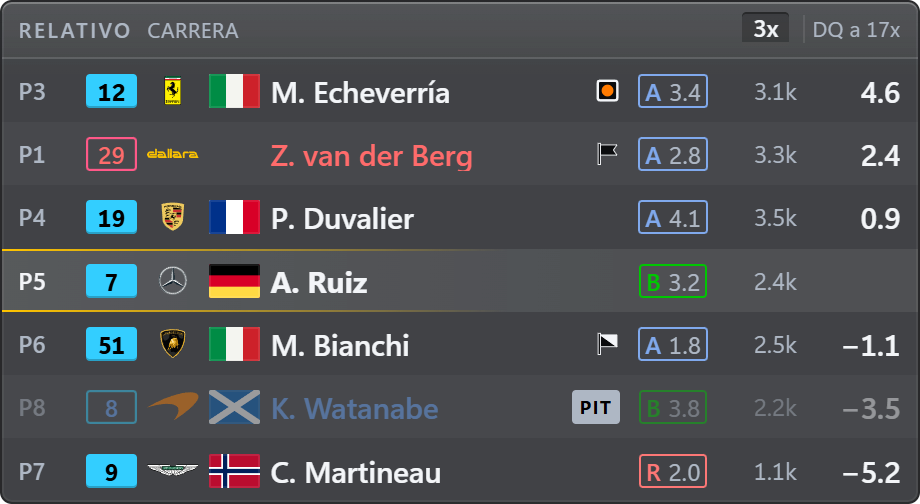

Los coches que tienes delante y detrás en pista (3 y 3 por defecto, hasta 10) con el hueco en
segundos: positivo delante, negativo detrás. Cada fila lleva posición en clase, número con el color
de su clase, marca, bandera del país, nombre, iRating y licencia (en el mismo orden que Posiciones
y Batalla). En rojo quien te va a doblar, en
azul los doblados (con una muesca arriba o abajo en su número, para no depender del color) y
atenuados los que están en boxes. En la cabecera, su nombre; tus incidentes y
el próximo límite de la sesión («3x · DQ a 17x»), la sesión y el tiempo restante salen por
defecto en Posiciones, y aquí con un clic en su cabecera.

Opcionales: columnas de boxes (PIT o GRÚA en su columna; sin ella, tras el nombre, como en
Posiciones), vueltas del stint y neumático (en el mismo orden que en Posiciones), última vuelta
(como la de Posiciones: morada la rápida de su clase, verde su récord; fuera de carrera, su mejor
vuelta), puestos ganados (solo en carrera, como en Posiciones), títulos de columna y una barra de
datos arriba y abajo (sesión, tiempo restante, SoF,
iRating en juego, SR proyectado, condiciones de pista…). El principio de la fila también son
columnas, como en Posiciones (ver más abajo): posición, número, logo, bandera del país, nombre y
banderas de penalización van donde los pongas.

### Radar

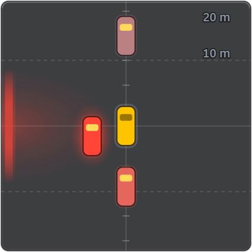

Vista cenital con los coches a escala alrededor del tuyo, que pasan a rojo según se acercan, y un
aviso en el lateral cuando tienes a alguien al lado. Alcance de 5 a 100 m (20 m por defecto). Un
coche que te acaba de pasar conserva su lado unos segundos aunque iRacing ya no lo diga. Se oculta
solo cuando no hay nadie cerca.

### Spotter

Dos barras, una a cada lado, para quien prefiere los laterales al radar central (o los quiere
con él: son independientes, cada uno con su página y su visibilidad). **Estilo de barra** elige qué
cuentan:

- **Cercanía** (de serie): el radar en dos barras. Cada barra se llena desde abajo cuanto más cerca
  está el coche de ese lado, con la misma regla que el radar: llena cuando va a tu lado, y se vacía
  según se aleja delante o detrás (hasta unos 12 m), del ámbar al rojo; llena se marca también con
  el borde rojo. Con dos coches en un lado, un «2».
- **Dónde te cubre**: cada barra es tu coche, de morro (arriba) a cola (abajo), y se llena con lo
  que te cubre el coche de ese lado: desde arriba si va por delante, desde abajo si va por detrás,
  y entera cuando va justo a tu lado, del gris al rojo. Con dos coches en un lado, un «2»; con uno
  que acaba de estar a tu lado y ahora va justo delante o detrás, un tope tenue en ese extremo. Si
  iRacing dice que hay alguien pero no se puede situar, la barra entera sale discontinua.

Qué lado lo dice el spotter de iRacing, y solo cuando el coche ya está a tu altura: uno que se
acerca por detrás sin haber estado a tu lado no tiene lado todavía. Cuánto, la distancia a lo largo
de la pista. iRacing no da la distancia lateral: llena es «a tu lado», no «golpe».

El ancho de la ventana es la separación entre las barras (para ponerlas a los lados del coche o
de la pantalla) y su alto, su largo; el grosor se elige en Contenido. De serie solo se ve con un
coche al lado o a punto de estarlo, y está oculto: se activa en Visibilidad, la barra lateral o la
bandeja.

### Posiciones

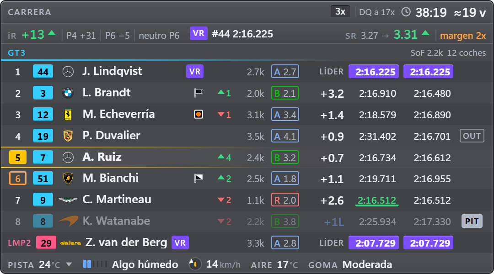

Modo compacto (los primeros, tu entorno y los primeros de cada otra clase: de serie su líder, en
una línea; con **Coches de otras clases** de 0 a 10, los que quieras bajo el nombre de su clase) o
completo. Cada clase lleva su SoF junto a su nombre, también la de un líder en una línea. Columnas que
se ordenan arrastrando y se esconden solas si la ventana se estrecha: puestos ganados (solo en
carrera), iRating, licencia, iRating en juego, hueco al de delante y al líder, última y mejor
vuelta (en morado la más rápida de la clase), boxes, última parada, stint y neumático.

El principio de la fila también son columnas de la misma lista, en Posiciones y en Relativo:
**Posición**, **Número**, **Logo de la marca**, **Bandera del país**, **Nombre** (siempre visible)
y **Banderas** (las de penalización). De serie, en el orden de siempre, con las banderas tras el
nombre. Cualquier columna puede ir entre ellas: «Puestos ganados» entre la posición y el número,
las banderas entre el número y el logo… Lo que queda pegado al nombre va con él, en su celda:
delante, alineado de fila a fila; detrás, al final de su celda, también alineado. Separado por
otra columna, va en una columna propia. Una regla:
**la lista dice dónde; el bloque «Piloto», si salen y cómo** el logo, la bandera del país y las
banderas (su fila de la lista no tiene ojo sino un enlace a su fila de «Piloto», y dice cómo están
ahí). La posición y el número, que no están en el bloque, tienen su ojo. «Igualar con…» lo lleva
todo, y en la vista previa se arrastran como las demás. Cabecera con lo que queda de
sesión y tus incidentes; pie con las condiciones de pista (temperatura y su tendencia, agua y
lluvia, viento con un dial que apunta a tu coche) y los coches. A un clic en Personalizar: una
segunda línea con tu iRating en juego, tu SR proyectado y la vuelta rápida de clase, y el aire y la
goma en el pie (de serie no salen en una instalación nueva, para leerla de un vistazo).

Con varias clases, **Orden de las clases** pone tu clase primero (de serie), la más rápida primero
(como iRacing) o el orden que quieras (**A mano**): una lista de clases por su nombre corto que se
recuerda entre sesiones y se ordena arrastrando, con ↑ ↓ o arrastrando la línea de una clase en la
vista previa.

Antes de la verde muestra la parrilla entera, y al acabar la sesión se queda con los resultados en
la pantalla de sesión.

### Batalla

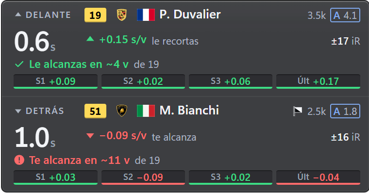

Tu rival de clase de delante y el de detrás mientras estén a menos del hueco que elijas (1,5 s por
defecto): el hueco y su tendencia, la predicción («Le alcanzas en ~4 v de 19»), la diferencia por
sector y por vuelta y el iRating en juego. Uno encima del otro o lado a lado. Por defecto, solo en
carrera. El hueco, sin signo (el medido, de serie) o **como Relativo** (el mismo tiempo, positivo
delante y negativo detrás); y cada frase de la predicción («Le alcanzas en…», «Te alcanza en…»,
«Necesitas…», «No le alcanzas») con su ojo, en las partes de su línea. Opcionales: cabecera y pie
con datos de la sesión (ver más abajo).

### Pedales

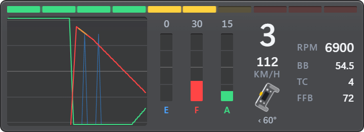

Traza de acelerador, freno y embrague, barras, marcha, velocidad y volante, en el orden que quieras.
Luces de cambio con los regímenes del propio coche y un bloque «Coche» con RPM, reparto de frenada,
nivel de TC y FFB (en rojo cuando llega al 100 %). El volante puede ser una barra o un volante
minimalista, realista (GT) o de fórmula que gira los grados reales.

### Tráfico

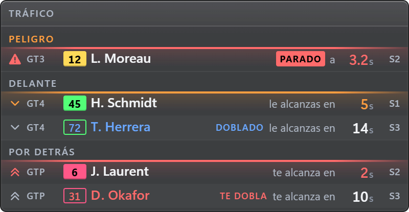

Los coches más rápidos que te alcanzan por detrás (en cuánto tiempo y en qué sector), el tráfico
lento al que alcanzas y los peligros de delante (coches parados, muy lentos o fuera de pista). Quien
te dobla, o te adelanta con bandera azul, sale siempre, en ámbar o rojo según se acerca. Cada
coche lleva, como en el relativo, el logo de su marca, la bandera de su piloto y su bandera de
penalización (el bloque «Piloto» de su página). Se
desvanece cuando no hay nadie cerca. La cabecera (el título) admite más datos, y hay un pie
opcional.

### Avisos

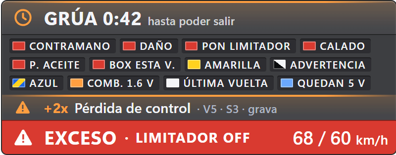

Una banda con lo que te afecta, lo más importante en grande y el resto al lado. Banderas (también
la negra enrollada), limitador y exceso de velocidad en el pit lane, «PON LIMITADOR» antes de
entrar, 10 y 5 vueltas para el final, grúa con cuenta atrás, motor calado, sentido contrario,
presión de aceite, daños con reparación obligatoria, «ENTRA ESTA VUELTA», combustible bajo y cada
incidente al sumarlo («+2x Pérdida de control · V5 · S3 · grava»). Cada caso se muestra u oculta
con su ojo en **Personalizar › Avisos**, agrupado (Banderas, Boxes, Durante la carrera, Motor,
Combustible), y cada aviso tiene su forma además de su color (se lee con la paleta para
daltónicos). Motor calado, presión de aceite, limitador de boxes y daños (la reparación
obligatoria) son también testigos: su fila tiene una casilla **Testigo** que enciende o apaga el
suyo en Testigos, y al revés (**Aviso** en la página de Testigos).

### Testigos

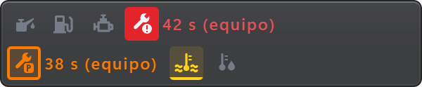

Los testigos del motor como en un salpicadero, en fila o en columna: presión de aceite y de
gasolina, motor calado, reparación obligatoria y opcional (con el tiempo que falta), temperatura
del agua y del aceite y, si los activas, limitador de boxes y corte de revoluciones. Cada gravedad
tiene su color y su forma; en amarillo avisa cuando el agua o el aceite suben muy por encima de tu
media, antes de que se encienda el testigo del coche. Su página de Ajustes explica qué es cada uno y
qué hacer.

### Delta

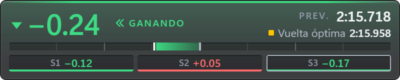

Barra delta frente a la referencia que elijas, con tendencia, vuelta prevista y cada sector. La
referencia puede ser tu récord personal con ese coche en ese trazado (se guarda en tu equipo y no se
pierde al cambiar de sesión), tu mejor vuelta de la sesión, tu vuelta óptima por sectores, la mejor
de tu clase o la óptima de tu clase, y puede ser distinta en práctica, clasificación y carrera. Solo
cuentan las vueltas legales (sin salirte de pista, sin incidentes, sin pit lane, grúa ni amarilla),
y la referencia solo cambia al empezar una vuelta. Opcional: una fila con tu última, tu mejor, tu
óptima y tu récord, y varias referencias a la vez (**Filas por referencia**): cada una con una fila
igual (su nombre, su delta, su tendencia y su barra, todas a la misma escala, verde a la izquierda:
más rápido), bajo una línea que nombra la que usa el delta (la vuelta prevista y los sectores van
con ella; sin esa línea, los sectores llevan su nombre). Con una sola, el delta de siempre. Al
encender filas desde su página la ventana crece lo justo para que quepan todas; si luego la
achicas, se ven las que caben (siempre la de la referencia en uso) y la página dice «No cabe» en las
demás.

### Combustible

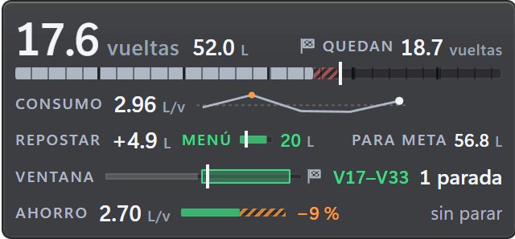

Más dibujo que texto: las vueltas que te da el combustible en grande (en verde si llegas a meta),
los litros y las vueltas que quedan; el depósito marcado en vueltas, con una raya donde llega lo que
necesitas; el consumo con una línea de tus últimas vueltas limpias (media, última y la que más
gastó); lo que hay que echar junto a una barra del menú de boxes; la carrera como una línea con tu
posición, la ventana de parada («V17–V33») y las paradas («1 parada»); el ahorro por vuelta que te
quita una parada, como una barra con el recorte; el coche visto desde arriba con el desgaste de cada
neumático en tres franjas (de verde a rojo, o de azul a naranja con la paleta para daltónicos,
medido en tu última parada) y los juegos que quedan; y las reparaciones rápidas si la sesión las
limita (estas dos líneas, a un clic en Personalizar: no salen de serie en una instalación nueva). Solo mide vueltas limpias, y el plan no cambia dentro de la vuelta. Por defecto, en práctica
(donde se mide el consumo) y en carrera. Opcionales: cabecera y pie con datos de la sesión.

## Ajustes y personalización

La primera vez, OverLap abre los Ajustes, en el idioma de Windows (español o, si no, inglés), con
una **bienvenida** de tres pasos: idioma y unidades, qué widgets usar (seis marcados de inicio, al
menos uno) y dónde está todo, con **Probar con datos de ejemplo** para ver los widgets en tu
pantalla y colocarlos. Windows avisa de que OverLap queda en la bandeja.

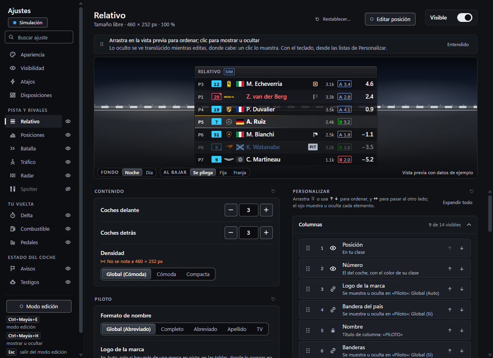

Se abren desde la bandeja (**Ajustes…**), volviendo a abrir el `.exe` o arrancándolo con
`--settings` (útil para un acceso directo). Todo se aplica **en vivo** y se guarda solo; arriba de
cada página hay una vista previa del widget sobre un fondo de circuito de noche o de día; al bajar
por las opciones se pliega en una franja (o queda fija, o siempre en franja: **Al bajar**, en su
pie). Con la ventana ancha (desde 1100 px) las opciones van a dos columnas: «Personalizar» a la
derecha. Lo que cambias se ve en la vista previa; si no se ve, la opción dice por qué con una nota
corta: **No cabe a 540 px** (el ancho del widget no deja sitio para esa columna o ese dato:
ensánchalo u oculta otro). Las opciones que actúan durante la sesión (cuándo se ve un widget, el
bloqueo, cuánto tiempo sigue un aviso…) dicen **No cambia la vista previa**. Cuando un ajuste solo
se ve en otra situación, la vista previa se pone en ella y lo dice debajo: la referencia de la
sesión que cambias en Delta, tu coche más atrás al cambiar los primeros puestos de Posiciones, cinco
coches por grupo al cambiar las entradas de Tráfico. Una lista que va dentro de un bloque oculto
(los datos del coche en Pedales, los tiempos de vuelta en Delta) lo dice debajo, y al mostrar uno de
sus elementos se muestra también el bloque.
Arriba de la barra lateral, **Buscar ajuste** encuentra cualquier ajuste por sus palabras y te
lleva a él (abre su sección y lo señala), también los botones («exportar», «editar posición»,
«restablecer») y las opciones de cada selector («imperiales», «apellido», «English»), por palabras
de uso diario («zoom», «bloquear», «parpadeo», «daltonismo», «galones», «rpm», «tecla», «botón del
volante», «por coche», «letra grande») o por el nombre de un estilo; lo que ahora oculta otro ajuste sale marcado «con otro
ajuste». La barra lateral agrupa los widgets en **Pista y rivales**, **Tu vuelta** y **Estado del
coche**, igual que la bandeja. El ojo de cada uno lo muestra u oculta; tenue y con un círculo
discontinuo, está activado pero no se ve ahora: una regla lo oculta o has ocultado el overlay (el
ratón encima dice por qué). En una ventana estrecha (menos de 640 px) la barra lateral se queda
en una columna de iconos, con el ojo de cada widget al lado y su nombre al pasar el ratón, y el
buscador, el chip de estado y **Modo edición** van arriba. El **chip de
estado** de arriba dice qué está oculto y por qué; con un clic abre un panel con qué hacer,
**Copiar diagnóstico** (para un informe de error, sin nombres) y **Abrir registro**.

- **Por widget**: visible, bloqueado, fondo (el global de Apariencia o una opacidad propia; solo el
  panel: el texto sigue nítido y, con poca opacidad, lleva contorno), escala (la misma fila y los
  mismos botones 80/100/125/150 % en los once; en Relativo, Radar, Spotter y Delta cambia el tamaño de su
  ventana, como la rueda en modo edición), alto automático o fijo, en qué sesiones se muestra, ocultar en boxes (salvo Avisos, que avisa del limitador y de la
  entrada a boxes).
- **Restablecer y deshacer**: arriba de cada página (los widgets, Apariencia y Atajos),
  **Restablecer…** dice qué devuelve a fábrica, sección por sección (en un widget: Contenido,
  Piloto, Personalizar, Ventana y visibilidad, Posición y tamaño, o todo), y cada sección tiene su
  icono ↺ en la cabecera, que restablece solo esa sección. Es un solo clic: un aviso abajo dice qué
  se ha restablecido (y en qué disposición, si tienes varias) con **Deshacer** (o `Ctrl+Z`)
  durante unos segundos. Lo mismo al restablecer una lista o un atajo, al usar «Global» en todos
  los widgets, al ocultar un widget y al eliminar una disposición. Solo borrar récords personales
  pide un segundo clic: eso no se puede deshacer.
- **Personalizar**: en la página de cada widget, editores para ordenar (arrastrando o con ↑ ↓) y
  mostrar u ocultar cada parte: columnas, cabecera, segunda línea, pie, filas, grupos, avisos…
  Una regla para todas las páginas: **Contenido** es el comportamiento (cuántos, cuánto tiempo,
  umbrales, modos) y **Personalizar** lo que se ve (cada lista con su ojo y, con ella, cómo se
  ven sus elementos; la opción de un elemento, en su fila).
- **Cabecera y pie**: Relativo, Posiciones, Combustible, Tráfico y Batalla tienen los mismos:
  un selector «No / Pequeña / Normal / Grande» y las cajas Izquierda y Derecha con los datos que
  quieras del mismo catálogo (con **+ Añadir dato**, a la izquierda o a la derecha: título, sesión, tiempo restante, hora local, hora en pista (la del simulador, con un sol), SoF, coches, incidentes,
  iRating en juego, SR proyectado, vuelta rápida de clase, vueltas de combustible, pista, agua,
  viento, aire, goma; Combustible no ofrece sus propias vueltas de combustible, que ya dice). Por
  defecto siguen una regla: a la izquierda de la cabecera el título y la sesión, a la derecha tus
  incidentes y el reloj; a la izquierda del pie las condiciones, a la derecha los coches y el
  combustible; y los datos de la sesión, solo en Posiciones. **Copiar a** pasa una cabecera o un
  pie, con su tamaño, al mismo sitio de otro widget. Si no caben, se quitan enteros los menos importantes; el texto nunca se
  encoge. Delta, Pedales, Radar, Spotter, Testigos y Avisos no tienen: son lecturas compactas, y una barra
  solo les añadiría altura.
- **Estilo** (arriba de Apariencia), cuatro distintos a simple vista: **OverLap** (todo de serie: el
  aspecto y lo que muestra cada widget, con Relativo y Delta a su tamaño de serie, o lo justo más si
  muestras más coches, para que el texto no encoja), **Limpio** (sin fondo: solo el texto sobre el
  juego, con su contorno; sin filas alternas, logos ni banderas), **Compacto** (pequeño pero
  legible: filas compactas, texto al 85 %, apellidos, número en franja, licencia solo letra) y
  **Completo** (todo a la vista en los once widgets de la disposición en uso: cada columna,
  elemento, barra de información y aviso; los widgets crecen para que el texto no encoja). Si va a
  cambiar algo que pusiste tú, antes te dice qué cambia (de antes a después) y dónde se guarda, y
  esperas a **Aplicar**; todo se deshace con **Deshacer**, ventanas incluidas. El resto de
  Apariencia queda como **Ajuste fino del estilo** (Color y Texto a la izquierda, Filas y pilotos a
  la derecha), y si lo tocas (o lo que muestra un widget, con OverLap o Completo) el estilo pasa a
  «Personalizado». Limpio y Compacto solo cambian el aspecto: al dejar **Completo** por uno de
  ellos, lo que Completo añadió se queda, salvo que marques «Quitar también lo que añadió
  Completo» (cada widget vuelve a lo que mostraba antes); con **OverLap** se va siempre, porque
  vuelve todo de serie. No cambian el acento, la Accesibilidad, la etiqueta SIM, el idioma, las
  unidades, los sitios ni qué widgets se ven (eso lo eligen las disposiciones).
- **Apariencia**: idioma, color de acento (te marca a ti y nada más), fondo de los widgets (80 %
  por defecto, el que siguen todos salvo los que tengan uno propio), tamaño del texto (multiplica la escala de los once widgets:
  en Relativo, Radar, Spotter y Delta, que llenan su ventana, agranda su ventana en la misma
  proporción, en todas tus disposiciones), contorno del texto, densidad y filas alternas,
  estilo de la licencia y del número, color del logo (color o monocromo), unidades métricas o
  imperiales (mph, °F, galones en Combustible y pies en el alcance del radar) y el bloque **Piloto** global: formato del nombre, logo de la marca (Auto, Siempre o
  Nunca), bandera del país, banderas de penalización, **formato del iRating** («2.5k» o el número
  entero, «2.520», con los miles del idioma; también el SoF) e **iRating con el color de la
  licencia** (apagado de serie: el de cada piloto con los colores y el estilo de su licencia).
- **Accesibilidad** (en el grupo **General** de Apariencia, con Idioma y Otros), todo apagado de serie: **paleta para daltónicos**
  (azul y naranja en lugar de verde y rojo, también en los pedales, con la traza del freno más
  gruesa), **texto mínimo de 10 px** (en vez de 9; ningún widget se ensancha, quitan antes un dato),
  **sin parpadeos** (las luces de cambio fijas en azul) y el **tamaño de esta ventana** (80–150 %,
  también con `Ctrl` y `+` / `-` / `0` o `Ctrl` y la rueda; botones 80/100/125/150 %, como los demás
  tamaños). Al pie, dos botones llevan a **Tamaño del texto** y **Contorno del texto**.
- **Bloque «Piloto»**: Relativo, Posiciones, Batalla y Tráfico tienen en su página, justo después
  de Contenido, las mismas filas (formato de nombre, logo de la marca, bandera del país,
  banderas de penalización, formato del iRating e iRating con el color de la licencia; en Tráfico,
  que no muestra el iRating de los pilotos, esta última está apagada), cada una con «Global (…)», lo de Apariencia, o un valor propio. El
  logo, la bandera del país y las banderas de penalización salen o no según su fila; dónde, lo
  decide la lista de columnas de Relativo y Posiciones (y la de partes de Tráfico, para las
  banderas): justo tras el nombre, tras su texto; en otro sitio, en una columna propia. Batalla,
  sin columnas, las lleva tras el nombre.
- **Récords personales**: la lista por coche y trazado, con borrar uno, el actual o todos.

## Modo edición

Entra con `Ctrl+Mayús+E`, desde la bandeja o con el botón **Modo edición** de los Ajustes. En la
página de un widget, **Editar posición** (junto a «Visible») entra y señala ese widget sobre el
juego.

- Arrastra un widget para moverlo y usa sus bordes y esquinas para cambiar su tamaño; la rueda del
  ratón lo escala. La ayuda sobre cada widget y el aviso de los Ajustes usan las mismas palabras
  («Rueda: escala · Flechas: mover · Alt: sin imán · Esc: salir»). Se pega a los bordes de los demás widgets y de la pantalla, y a su centro, y una
  línea marca dónde se ha pegado (con `Alt` o `Mayús` pulsado, no).
- Para afinar, las **flechas** mueven 1 px el último widget que has tocado (`Mayús`: 10 px) y
  `Ctrl` + flechas cambian su tamaño. Su etiqueta lleva el borde en el color de edición, para que
  sepas a cuál se aplican; `Tab` y `Mayús+Tab` pasan al widget siguiente o al anterior (de arriba
  abajo), también sin cursor, con un aviso «Flechas: Relativo». Funcionan con el juego o el
  escritorio delante, y también con los Ajustes delante (justo después de **Editar posición**,
  también `Tab`), salvo mientras un campo, un deslizador o una lista de los Ajustes tiene el foco:
  entonces son suyas.
- `Ctrl+Z` deshace el último cambio del modo edición (un arrastre, un cambio de tamaño, la rueda,
  las flechas o el ojo y el candado de la etiqueta), y luego el anterior; la bandeja ofrece
  también **Deshacer: …** con lo que hiciste («mover Relativo», «cambiar el tamaño de Relativo»,
  «ocultar Batalla»). Al salir del modo edición se olvidan.
- Arrástralo fuera de su pantalla para llevarlo a otra. Si desconectas un monitor, **Traer todos
  los widgets a esta pantalla** (en la bandeja, a la pantalla del ratón, o en **Disposiciones ›
  Pantallas**, a la de los Ajustes) los recupera de una vez. Durante un minuto se deshace desde
  cualquiera de los dos sitios (**Deshacer: …** en la bandeja).
- La etiqueta de cada widget tiene un **ojo** (mostrar u ocultar), un **candado** (bloquear) y un
  **⚙** que abre su página en los Ajustes. Un widget oculto se ve como un hueco discontinuo para
  poder recuperarlo.
- Sal con `Esc`, con el mismo atajo o desde la bandeja. Salir en mitad de un arrastre lo cancela.
- Con iRacing delante y tú en el coche, el simulador oculta el cursor: el aviso sobre el juego
  nombra el atajo de **Abrir los Ajustes** (que liberan el cursor) y `Alt+Tab`, y recuerda que
  `Tab` y las flechas mueven los widgets sin él. Lo más cómodo es colocar los widgets en el garaje o en
  los menús.
- Para que la rueda funcione sobre un widget, Windows necesita _Configuración > Bluetooth y
  dispositivos > Mouse > Desplazar ventanas inactivas al mantener el puntero sobre ellas_.

Posición, tamaño y visibilidad se guardan solos. Fuera del modo edición los widgets dejan pasar
todos los clics al juego.

## Disposiciones

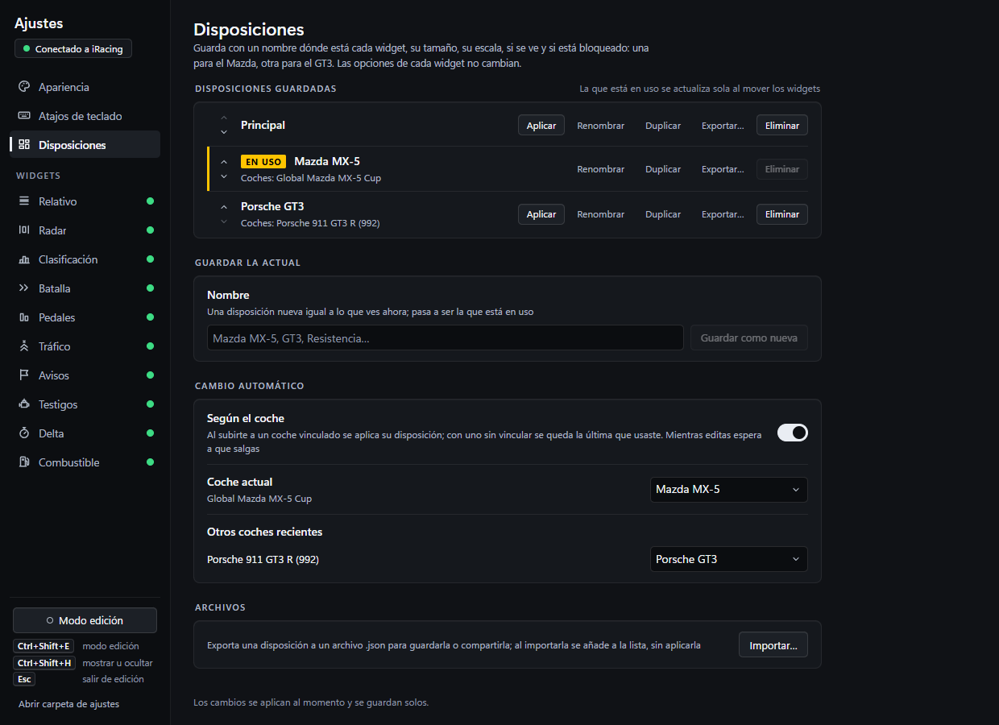

Una disposición guarda, con un nombre, dónde está cada widget (en cada pantalla), su tamaño, su
escala, si se ve y si está bloqueado, y también las opciones de cada widget: columnas y su orden,
elementos, barras de información, referencias del delta, estilo del volante, opacidad, en qué
sesiones se ve… Una para el Mazda, otra para el GT3. La apariencia (idioma, unidades, color,
tamaño del texto…), cuándo se ve el overlay y los atajos son siempre los mismos.

- Cada disposición es **Posición y opciones** (de serie) o **Solo posición**: esta solo mueve los
  widgets y usa las **opciones comunes**, compartidas por todas las de solo posición. Lo eliges al
  guardarla o importarla, y lo cambias luego con **Editar**.
- En **Ajustes > Disposiciones** guardas la actual con un nombre y aplicas, editas, duplicas,
  ordenas, exportas a un `.json` (con sus opciones), importas o eliminas.
- **La que está en uso se actualiza sola** al mover, redimensionar, ocultar o bloquear un widget y
  al cambiar sus opciones. En la página de cada widget, bajo la vista previa, pone dónde se guarda
  lo que cambias (**Guardando en:** la disposición, u **Opciones comunes**), con **Copiar estas
  opciones a todas** para llevar las opciones de ese widget a todas las disposiciones.
- Se cambia desde la bandeja (submenú **Disposición**), desde los Ajustes o con el atajo
  **Siguiente disposición**.
- **Ejemplos**: **Ligera** (Relativo con 2 coches delante y 2 detrás, Radar, Delta, Combustible y
  Avisos) y **Los once** (los once widgets) se añaden a la lista con tus widgets donde están, sin
  aplicarse; con **Siguiente disposición** alternas entre menos y más información en carrera.
- **Según el coche** (desactivado de serie): vincula una disposición al coche en el que estás, a
  uno reciente o a uno de tus récords, y se aplica sola al subirte a ese modelo; vincular un coche
  lo activa (con **Deshacer**, en la página o en la bandeja, que también vuelve a la disposición
  que tenías). Estando en un coche sin disposición, la página y la bandeja ofrecen **Vincular a
  «…»**, y al guardar una nueva puedes vincularla a tu coche (marcado de inicio solo si **Según el
  coche** ya está activado). Cada disposición muestra sus coches como
  etiquetas. Un coche sin vínculo se queda con la última que usaste.

## Atajos de teclado

Son globales: funcionan con iRacing en primer plano. Cada acción puede tener **hasta tres atajos a
la vez**, cada uno una combinación de teclas o un botón del volante, la button box, los pedales o
el cambio (ver [Botones del volante](#botones-del-volante)): por ejemplo `Ctrl+Mayús+H` y el
botón 24 del G29, o un botón en cada volante. Cualquiera de ellos ejecuta la acción.

| Atajo (por defecto) | Acción                                                      |
| ------------------- | ----------------------------------------------------------- |
| `Ctrl+Mayús+H`      | Mostrar u ocultar todo el overlay de golpe                  |
| `Ctrl+Mayús+E`      | Entrar o salir del modo edición                             |
| `Ctrl+Mayús+O`      | Abrir los Ajustes (o traerlos al frente)                    |
| (sin asignar)       | Siguiente disposición                                       |
| (sin asignar)       | Cambiar la referencia del delta                             |
| `Esc`               | Salir del modo edición (solo mientras editas; no se cambia) |
| (sin asignar)       | **Más acciones**: mostrar u ocultar cada widget, uno a uno  |

- **Más acciones**, plegado bajo la tabla, tiene una fila por widget («Mostrar u ocultar
  Relativo»…): lo mismo que su ojo en la barra lateral o su casilla en la bandeja (que muestra el
  atajo junto al widget). Ninguna tiene atajo de serie; se despliega solo si alguna lo tiene. Para
  quitar o poner un widget en carrera sin cambiar de disposición; el aviso sobre el juego dice
  «Oculto: Posiciones» o «Visible: Posiciones».
- Ocultar el overlay no detiene la telemetría: al mostrarlo vuelve con los datos al día. Al abrir
  la app, el overlay siempre está visible.
- Se cambian en **Ajustes > Atajos**, una tabla con una fila por acción y una columna por atajo
  (**Atajo 1 · principal**, **Atajo 2**, **Atajo 3**), como la pantalla de controles de un juego.
  Cada casilla es el control: un clic en una casilla con atajo lo cambia por otro, y su **×** (al
  pasar el ratón) o `Supr` lo quitan; la primera casilla libre dice **+ Asignar** y espera una
  combinación o un botón del volante. Al quitar uno, los de la derecha se corren a la izquierda (el
  primero es el que lee la versión 2.1). Sin ninguno, la acción queda desactivada. El icono ↺ de la
  derecha la deja solo con el de fábrica. Mientras grabas, `Esc` cancela y `Retroceso` o `Supr`
  quitan el atajo que estás cambiando.
- Los avisos van en la casilla a la que se refieren (**Desconectado**, **En uso por otra app**), y
  una frase que haga falta (un atajo rechazado, el aviso de `AltGr`) sale debajo de esa misma
  columna.
- Al usarlo (también `Esc` al salir del modo edición), un aviso breve arriba de la pantalla
  donde están tus widgets dice qué ha hecho, o por qué no se ve nada (por ejemplo, «Solo hay una
  disposición»); también confirma **Traer todos…** y **Vincular…** de la bandeja. Se apaga en
  **Confirmar sobre el juego**. La fila de la acción dice «Pulsado hace 3 s», para probarlo desde
  el juego, y si un atajo no se puede
  registrar, la bandeja lo dice bajo el estado.
- Un mismo atajo no puede estar en dos acciones (ni dos veces en la misma): la página dice quién
  lo tiene ya.
- **Una combinación asignada deja de llegar a los demás programas, iRacing incluido**, mientras
  OverLap está abierto: no elijas una que uses en el simulador. Si otra aplicación ya la tiene, la
  página lo dice.
- Necesitan `Ctrl` o `Alt`, salvo `F13`–`F24`, que envían muchas button box y teclados de macros.
  `Ctrl+Alt` equivale a `AltGr` en un teclado español: se permite, pero avisa de que puede impedir
  escribir `@`, `#` o `€`.

### Botones del volante

- En **Ajustes > Atajos**, pulsa **+ Asignar** (o el atajo que quieras cambiar) y luego el botón:
  vale cualquier botón de un volante o su aro, una button box, unos pedales, un cambio o un freno
  de mano que Windows vea como mando de juego, también los de más de 32 botones. Se ve como «Botón
  12 · G29 Driving Force Racing Wheel».
- **Solo se leen**: el botón se comparte con iRacing y no se bloquea nada, así que **iRacing
  también recibe la pulsación**. Elige uno que no tengas asignado en iRacing.
- Mantenerlo pulsado cuenta como una sola pulsación.
- Las crucetas (D-pad) y los hats no se pueden asignar: solo los botones.
- Si la página pide **pulsar el botón otra vez**, es que acaba de empezar a leer ese mando y no
  sabe qué botones estaban ya abajo (un selector giratorio o un interruptor fijo); la segunda
  pulsación es la que se guarda.
- Si el dispositivo está desenchufado, el atajo sigue guardado y su casilla dice **Desconectado**
  (los otros atajos de la acción siguen funcionando); al enchufarlo vuelve a funcionar solo.
- Dos dispositivos idénticos (mismo modelo) comparten los botones: cualquiera de los dos sirve.
- `Esc` para salir del modo edición sigue siendo solo de teclado.
- Los botones solo se leen mientras algún atajo es un botón (o mientras eliges uno): sin ninguno,
  OverLap no lee los mandos.
- Si vuelves a la versión 2.1.1, cada acción conserva solo su primer atajo (los demás se pierden al
  guardar), y si era un botón vuelve a su combinación de fábrica.

## Cuándo se ve el overlay

En **Ajustes > Visibilidad**:

- **Cuándo mostrar el overlay**: solo cuando estás en el coche (por defecto), solo en carrera o
  siempre. Fuera del coche solo se queda Posiciones en la pantalla de sesión, con los resultados.
- **Repeticiones**: ocultas por defecto; con «Seguir al coche en cámara», los widgets siguen al coche
  que miras.
- Se ocultan también con la interfaz de iRacing oculta, en el garaje y en la pantalla de sesión
  (cada widget puede tener su excepción).
- Cada widget tiene además sus propias reglas: en qué sesiones se muestra y si se oculta en boxes.
  Debajo, la tabla **Dónde se ve cada widget** las reúne todas (visible, práctica, clasificación,
  carrera, ocultar en boxes, pantalla de sesión y bloqueado), una fila por widget: cada casilla es
  el mismo ajuste, con el mismo sentido, que en su página (la columna Visible es el ojo de la barra
  lateral), y su nombre lleva a ella.
- El modo edición siempre enseña todos los widgets, con el motivo si alguno está oculto.

Para OBS, usa la captura de ventana «Pantalla N · OverLap» (trae todos los widgets de esa pantalla)
o la captura de pantalla.

## Privacidad y anti-cheat

- OverLap **solo lee** el mapa de memoria compartida del SDK oficial de iRacing, en modo solo
  lectura, igual que cualquier herramienta de telemetría. **No inyecta nada** en el proceso del juego
  (iRacing usa EasyAntiCheat) ni escribe en esa memoria.
- Los widgets son ventanas propias, transparentes, que no cogen el foco ni envían nada al juego. Los
  atajos usan el registro de teclas de Windows: no hay ganchos de teclado. Los botones del volante
  se leen con Raw Input de Windows, como SimHub o Crew Chief: compartidos con iRacing, sin
  bloquear ni abrir el dispositivo, sin ganchos y sin enviarle nada.
- **Sin red**: no se conecta a internet, no tiene cuentas ni envía datos a ningún sitio. Tus ajustes
  y récords se quedan en tu equipo. Los botones de **Acerca de y ayuda** (guía, problemas, código,
  licencia) solo abren el navegador cuando los pulsas.
- No activa la grabación de telemetría `.ibt` de iRacing.

La política de privacidad completa está en [PRIVACY.md](PRIVACY.md). Los detalles técnicos, en las
[notas de desarrollo](docs/README.dev.md#anti-cheat).

## Problemas conocidos

- El `.exe` no está firmado: Windows SmartScreen avisa al abrirlo (ver [Instalación](#instalación)).
- El portable se descomprime en una carpeta temporal en cada arranque, así que tarda unos segundos
  en abrirse.
- Si alguna ventana se ve con fondo negro en lugar de transparente, puede ser la aceleración por
  hardware de la tarjeta gráfica.
- Los nombres con letras que no existen en Windows-1252 (cirílico, chino…) ya llegan de iRacing como
  `?`: se muestran con el nombre del equipo o como «Piloto #7».
- Lo pendiente de confirmar en una sesión real está en el [registro de cambios](CHANGELOG.md).

## Compilar desde el código

Necesitas Windows 10 u 11 de 64 bits, [Git](https://git-scm.com) y [Node.js](https://nodejs.org)
22.12 o posterior (se desarrolla con Node 24). No hace falta Visual Studio ni Python: los addons
nativos vienen precompilados.

```bash
git clone https://github.com/jesus-molano/OverLap.git
cd OverLap
npm ci
npm run dev:mock    # pruébalo sin iRacing, con una carrera simulada
npm run build:win   # el portable, en dist/OverLap-<versión>-portable.exe
```

`npm run build:win` comprueba los tipos, compila y empaqueta con electron-builder; la primera vez
descarga las herramientas de NSIS. El `.exe` que sale no está firmado. Los demás scripts, cómo está
montado por dentro y cómo se añade un widget están en las [notas de desarrollo](docs/README.dev.md);
para enviar cambios, lee [CONTRIBUTING.md](CONTRIBUTING.md).

## Licencia y créditos

OverLap es software libre. Copyright © 2026 Jesús Molano.

Puedes redistribuirlo y modificarlo según los términos de la Licencia Pública General de GNU (GNU
GPL) publicada por la Free Software Foundation, ya sea la versión 3 de la licencia o, a tu elección,
cualquier versión posterior (`GPL-3.0-or-later`). OverLap se distribuye con la esperanza de que sea
útil, pero **sin ninguna garantía**, ni siquiera la garantía implícita de comerciabilidad o de
idoneidad para un fin concreto. El texto completo está en [LICENSE](LICENSE), en inglés, que es la
versión que vale legalmente.

El nombre OverLap y el icono «OL» no se licencian como marca (GPL §7(e)): la GPL te da el código,
no el derecho a usar ese nombre ni ese icono. Por eso, si distribuyes una versión modificada, tendrá
que llevar otro nombre y otro icono, y así nadie la confundirá con OverLap. iRacing es una
marca de iRacing.com Motorsport Simulations, LLC; OverLap no está afiliado a iRacing ni cuenta con su
respaldo.

**Los logos en color de las marcas de coches no están bajo la GPL.** Son marcas y dibujos de
terceros (de Wikimedia, de worldvectorlogo.com y de las webs de Dallara y Tatuus), que se muestran
solo para saber de qué marca es cada coche; sus dueños conservan todos sus derechos y OverLap no
concede ninguno. El juego monocromo sale de [Simple Icons](https://simpleicons.org) (CC0, de dominio
público) y se elige en **Apariencia › Filas y pilotos › Color del logo › Monocromo**: tiene 18 de
las marcas, y las demás se siguen dibujando en grises a partir del juego en color. OverLap no está
afiliado a ninguna marca de coches. El detalle, fuente por fuente, está en
[THIRD_PARTY_NOTICES.md](THIRD_PARTY_NOTICES.md#brand-logos).

OverLap usa componentes de terceros (como [irsdk-node](https://github.com/bengsfort/irsdk-node)
para leer el SDK de iRacing y las banderas de
[country-flag-icons](https://gitlab.com/catamphetamine/country-flag-icons)), cada uno con su propia
licencia; los avisos de terceros están en [THIRD_PARTY_NOTICES.md](THIRD_PARTY_NOTICES.md).
[irDashies](https://github.com/tariknz/irdashies) sirvió de referencia para la convención de signo
del relativo.

Los cambios de cada versión están en el [registro de cambios](CHANGELOG.md). Para compilar OverLap o
ver cómo funciona por dentro, lee las [notas de desarrollo](docs/README.dev.md).

## Code signing policy

_En español: los `.exe` de OverLap todavía **no están firmados**. Cuando lo estén, esta sección dirá
quién los firma y cómo se aprueba cada versión._

**Status: OverLap's executables are not code-signed yet.** Windows SmartScreen warns when you open
them (see [Instalación](#instalación)). Free code signing from the SignPath Foundation will be
requested; until it is granted and in use, no OverLap release is signed by anyone.

<!--
TODO (SignPath): once the SignPath Foundation accepts OverLap and releases are signed through it,
replace the status paragraph above with the line SignPath asks for:
  Free code signing provided by SignPath.io, certificate by SignPath Foundation.
Also say "Code signing policy" on the Releases page (one line in each release's notes).
-->

- **Team roles:**
  - Committers and reviewers: [jesus-molano](https://github.com/jesus-molano)
  - Approvers: [jesus-molano](https://github.com/jesus-molano)
- **What would be signed:** only the binaries built from this repository's source, by GitHub
  Actions on GitHub-hosted runners, after the maintainer approves each release by hand.
- **Privacy:** see [PRIVACY.md](PRIVACY.md). Today OverLap transfers no information to any networked
  system.

## Apoyar OverLap

OverLap es gratis y lo seguirá siendo, sin cuentas, sin anuncios y sin funciones de pago. Si te sirve
y quieres ayudar a mantenerlo, un donativo es voluntario y no desbloquea nada. Pronto habrá aquí
un enlace (también en **Acerca de y ayuda**); mientras tanto, informar de errores, proponer ideas o
enviar cambios ([CONTRIBUTING.md](CONTRIBUTING.md)) ayuda igual.

<!-- TODO (Ko-fi): when the account exists, replace "Pronto habrá aquí un enlace…" with the link,
and fill SUPPORT_URL in src/shared/projectLinks.ts and ko_fi in .github/FUNDING.yml. -->
