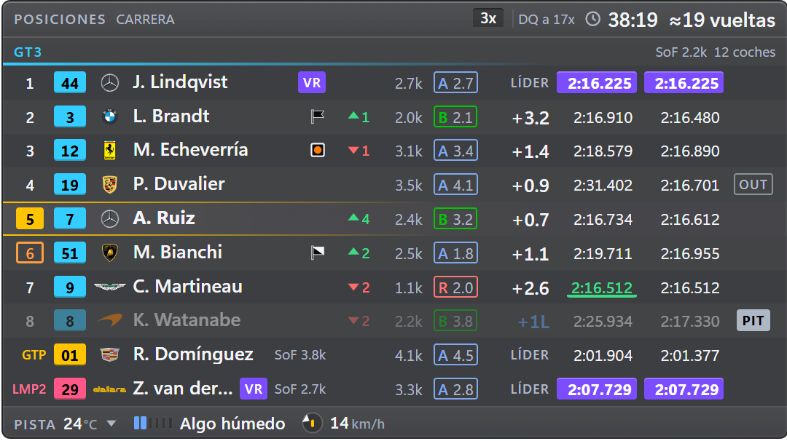
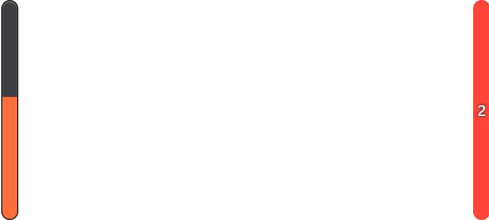

Español: [README.es.md](README.es.md)

# OverLap

An iRacing overlay for Windows. OverLap reads the sim's official telemetry and draws eleven widgets
on top of the game: relative, standings, battle, traffic, radar, spotter, delta, fuel, inputs,
alerts and warning lights. Each one can be placed, scaled and customised to your taste, and you can
save a different layout for each car.

- It only **reads** the iRacing SDK data: it injects nothing into the game and does not use the
  network (see [Privacy and anti-cheat](#privacy-and-anti-cheat)).
- The widgets sit in transparent, always-on-top windows that never take focus and let clicks
  through to the game.
- In Spanish or English: the first time, in the Windows language (if it is neither, in English).


_Every screenshot uses the app's own sample data (made-up drivers) on a transparent background; on
track, the panel lets the game show through according to the opacity you choose._

## Contents

- [Installation](#installation)
- [Widgets](#widgets)
- [Settings and customisation](#settings-and-customisation)
- [Edit mode](#edit-mode)
- [Layouts](#layouts)
- [Keyboard shortcuts](#keyboard-shortcuts)
- [When the overlay shows](#when-the-overlay-shows)
- [Privacy and anti-cheat](#privacy-and-anti-cheat)
- [Known issues](#known-issues)
- [Building from source](#building-from-source)
- [Licence and credits](#licence-and-credits)
- [Code signing policy](#code-signing-policy)
- [Support OverLap](#support-overlap)

## Installation

### Requirements

| Requirement | Detail                                                    |
| ----------- | --------------------------------------------------------- |
| System      | 64-bit Windows 10 or 11                                   |
| iRacing     | In a borderless window (borderless / windowed fullscreen) |

- In **exclusive fullscreen** the overlay does not show.
- In **VR** it does not show, except with a tool such as OpenKneeboard.

### Download and open

1. Download `OverLap-<version>-portable.exe` from the latest release on GitHub.
2. Open it. Nothing is installed: it is a portable executable you can keep wherever you like.
3. The `.exe` is not signed, so **Windows SmartScreen** will warn you the first time. Click **More
   info → Run anyway**.

OverLap stays in the **system tray** (next to the clock). From its icon you see its status (and
whether any shortcut is not working), open the **Settings…**, show or hide each widget (grouped as
in the Settings), change the radar range, when the overlay shows and the layout in use, show or
hide the whole overlay (**Show the overlay**), enter edit mode, bring the widgets to the mouse's
screen (**Bring every widget to this screen**), undo the last thing (**Undo: …**, when there is
something to undo), open the settings folder or quit. Opening the `.exe` again while OverLap is
already running opens the Settings.

If iRacing is not open, Relative and Standings show “Waiting for iRacing…” for a few seconds and
then hide (unless **Keep “Waiting for iRacing”** is on in Visibility); OverLap connects by itself as
soon as the sim starts.

The settings are saved in `%APPDATA%\iracing-overlay\` (**Settings › About and help › Files and
diagnostics › Open folder**, or the tray). On that page, **Export everything…** saves all the
settings (Appearance, shortcuts, visibility and every layout with its options) and your personal
bests to a file, and **Import everything…** brings them back on another computer or after a
reinstall: the settings apply at once (with **Undo**, as long as you change nothing else) and the
file's personal bests are added to yours (the fastest lap wins; none of yours is deleted, and if
the list is full it says how many do not fit). That page also has the version, a quick help,
**User guide** and **Report a problem** (they open the browser), **Open log**, **Copy
diagnostics**, **Show the welcome** and **Reset everything** (press again to confirm; as freshly
installed, in your language; your personal bests stay; with **Undo**). At the bottom, **Licence**
says OverLap is free software (GPL-3.0 or later, with no warranty) and opens the source code, the
licence and the third-party notices in the browser.

## Widgets

Each widget has its page in the Settings, with a live preview and its options. All of them can be
shown or hidden, locked, scaled and limited to certain sessions (practice, qualifying, race). They
come in the same order and the same groups as in the Settings sidebar and the tray: **Track and
rivals** (Relative, Standings, Battle, Traffic, Radar and Spotter), **Your lap** (Delta, Fuel and
Inputs) and **Car status** (Alerts and Warning lights).

### Relative


The cars ahead of and behind you on track (3 and 3 by default, up to 10) with the gap in seconds:
positive ahead, negative behind. Each row has the class position, the number in its class colour,
the make, the country flag, the name, iRating and licence (in the same order as Standings and
Battle). Whoever is about to lap you is in red, lapped cars in blue (with a notch at the top or
bottom of their number, so as not to rely on colour) and cars in the pits are dimmed. The header
shows its name; your incidents and the session's next limit (“3x · DQ at 17x”), the session and
the time left show by default in Standings, and here one click away in its header. In Content,
**Density** (the global one from Appearance or its own).

Optional: pit columns (PIT or TOW in its column; without it, after the name, as in Standings),
stint laps and tyre (in the same order as in Standings), last lap (like the one in Standings: purple
for the fastest in its class, green for its own best; outside a race, its best lap), positions
gained (races only, as in Standings), column titles and an info bar at the top and bottom
(session, time left, SoF, iRating at stake, projected SR, track conditions…). The start of the row
is columns too, as in Standings (see below): position, number, logo, country flag, name and penalty
flags go wherever you put them. Every column has its eye, the position, number and gap too: only
the name always shows. At the foot of the list, **Column titles** and **Match Standings**.

### Standings



Compact mode (the leaders, the cars around you and the leaders of each other class: **Top
positions** and **Around you**, 3 and 3 by default; from each other class, by default its leader,
on one line; with **Cars of other classes** from 0 to 10, as many as you like under its class name)
or full. Each class line has its SoF and its car count, each with its eye in **Customise › Class
line**; the SoF also goes at the end of a one-line leader. Columns that are reordered by dragging
and hide by themselves if the window gets narrow: positions gained (races only), iRating, licence,
iRating at stake, gap (**Measured** to the car ahead, to the leader or both; by default, to the car
ahead), last and best lap (the fastest in the class in purple), pit, last stop, stint and tyre.
Hidden by default: iRating at stake, gap to leader, last stop, stint and tyre. The iRating at stake
row has **iRating at stake for everyone** (off: only yours), and at the foot of the list, **Column
titles**. In Content, **Density** (the global one or its own).

The start of the row is columns from the same list too, in Standings and in Relative: **Position**,
**Number**, **Make logo**, **Country flag**, **Name** (always shown) and **Flags** (the penalty
ones). By default, in the usual order, with the flags after the name. Any column can go between
them: “Positions gained” between the position and the number, the flags between the number and the
logo… Whatever is right next to the name goes with it, in its cell: before it, aligned from row to
row; after it, at the end of its cell, also aligned. Separated by another column, it goes in a
column of its own. One rule: **the list says where; the “Driver” block, whether and how** the logo,
the country flag and the flags show (their row in the list has no eye but a link to their row in
“Driver”, and says how they are set there). The position and the number, which are not in the
block, have their eye. “Match…” carries everything over, and in the preview they are dragged like
the rest. A header with the session, its SoF, your incidents and what is left; a footer with the
track conditions (temperature and its trend, water and rain, wind with a dial pointing at your car)
and the cars. One click away in Customise: a second line with your iRating at stake, your projected
SR and the class fastest lap, and the air and rubber in the footer (by default they do not show on
a new install, so it reads at a glance).

With several classes, **Class order** puts your class first (default), the fastest first (as
iRacing does) or the order you want (**By hand**): a list of classes by their short name that is
remembered between sessions and is reordered by dragging, with ↑ ↓ or by dragging a class's line in
the preview.

Before the green flag it shows the whole grid, and when the session ends it stays with the results
on the session screen.

### Battle


Your class rival ahead and the one behind while they are within the gap you choose (1.5 s by
default): the gap and its trend, the prediction (“Catching in ~4 laps of 19”), the sectors (S1 S2
S3 and the last lap) and the iRating at stake; the last three laps, one click away in Customise
(**Lines › Laps**). One above the other or side by side. By default, races only. **Keep visible**
(3 s by default) keeps the battle on screen for a moment after the rival leaves the gap. The gap,
unsigned (the measured one, by default) or **As Relative** (the same time, positive ahead and
negative behind); and each phrase of the prediction (“Catching in…”, “Catches you in…”, “Need…
s/lap”, “Out of reach · Safe to the flag”) with its eye, in **Catch prediction**. In Customise,
each rival (**Rivals**: the car ahead and the car behind; with neither, the widget does not show)
and each detail (**Details**: iRating, licence, trend text and iRating at stake) has its eye.
Optional: a header and footer with session data (see below).

### Traffic


The faster cars catching you from behind (how soon and in which sector), the slow traffic you are
catching and the hazards ahead (stopped, very slow or off-track cars). Whoever is lapping you, or
passing you under a blue flag, always shows as long as they are within **Look behind** (with the
**Faster class** group shown), in amber or red as they get closer. Each car has, as in the relative,
its make logo, its driver's flag and its penalty flag (the “Driver” block on its page). It fades out
when nobody is near. The header (the title) takes more data, and there is an optional footer.

In Content, how far it looks: **Look behind** (12 s by default), **Look ahead** (8 s) and **Hazards
up to** (8 s); **Entries per group** (3 by default, from 1 to 5) and **Multiclass only** (on: in a
single-class race it only warns about whoever laps you or passes you under a blue flag, and about
hazards). In Customise, the **Groups** (Hazards, Slower traffic and Faster class) and the
**Columns** of each line (icon, class, driver, flags, words before the time, time and sector) are
reordered and hidden, and **Group captions** (on) puts the name above each group.

### Radar


A top-down view with the cars to scale around yours, turning red as they get closer, and a warning
on the side when someone is alongside. Range from 5 to 100 m (20 m by default, with buttons for 10,
20, 30 and 50 m; in feet with imperial units). A car that has just passed you keeps its side for a
few seconds even when iRacing no longer reports it. It hides by itself when nobody is near. In
**Customise › Layers** you can remove the distance guides, their distances and the side alerts. It
is always drawn above the other widgets (see [Edit mode](#edit-mode)).

### Spotter



Two bars, one on each side, for those who prefer side bars to the central radar (or want them
alongside it: they are independent, each with its own page and visibility). **Bar style** chooses
what they tell:

- **Closeness** (default): the radar in two bars. Each bar fills from the bottom the closer the car
  on that side is, with the same rule as the radar: full when it is alongside you, and it empties as
  it moves away ahead or behind (up to about 12 m), from amber to red; when full it is also marked
  with a red border. With two cars on one side, a “2”.
- **Where it covers you**: each bar is your car, from nose (top) to tail (bottom), and it fills with
  how much of you the car on that side covers: from the top if it is ahead, from the bottom if it
  is behind, and all of it when it is right alongside you, from grey to red. With two cars on one
  side, a “2”; with one that has just been alongside you and is now right ahead or behind, a faint
  cap at that end. If iRacing says someone is there but they cannot be placed, the whole bar is
  dashed.

The two marks (the cap and the “2”) have their eye in **Customise › Marks** (“Car about to come
alongside”, this one only with “Where it covers you”, and “Two cars on one side”); by default, both.

Which side comes from iRacing's spotter, and only once the car is level with you: one coming up from
behind that has not yet been alongside you has no side yet. How much is the distance along the
track. iRacing does not give the lateral distance: full means “alongside you”, not “contact”.

The window's width is the gap between the bars (to put them at the sides of the car or of the
screen) and its height is their length; their thickness, **Bar thickness** (14 px by default), is
chosen in Content. By default it only shows with a car alongside or about to be (**Only with a car
alongside**, in Content, on), and it is hidden: turn it on in Visibility, the sidebar or the tray.

### Delta


A delta bar against the reference you choose, with trend, predicted lap and each sector. The
reference can be your personal best with that car on that layout (it is stored on your computer and
is not lost when the session changes; the list, **Personal bests**, is at the end of the Delta
page), your session best, your optimal lap from sectors, the class fastest lap or the class optimal,
and it can differ in practice, qualifying and race: by default, your personal best in practice and
your optimal lap in qualifying and race. With **Fall back to the next one** (on), while that
reference does not exist the delta uses the next one (for example, your personal best until you
have a clean lap); off, it shows no delta until it exists. **Bar range** (1 s by default, from 0.5
to 3 s) is what fills it. Only legal laps count: without going off track (not even with an iRacing
1x), without stopping, without pit lane, tow or yellow; a touch or a spin does not invalidate it.
The reference only changes when a lap starts.

In **Customise › Lines**, the **Top line** (lap state, predicted lap and reference, each with its
eye). Optional: a **Lap times** row with your last, your best and your optimal (and your personal
best, one click away), and several references at once (**Rows per reference**, by default your
three; the two class ones, one click away): each one with an identical row (its name, its delta,
its trend and its bar, all on the same scale, green on the left: faster), under a line naming the
one the delta uses (the predicted lap and the sectors go with it; without that line, the sectors
carry its name). With only one, the usual delta. When you turn rows on from its page the window
grows just enough for all of them to fit; if you then shrink it, the ones that fit show (always the
one for the reference in use) and the page says “No room” on the rest.

### Fuel


More drawing than text: the laps the fuel gives you in large type (in green if you make it to the
finish), the litres and the laps left; the tank marked in laps, with a line where what you need
reaches; the use with a line of your last clean laps (average, last and the thirstiest); what to
add next to a bar for the pit menu; the race as a line with your position, the pit window
(“L17–L33”) and the stops (“1 stop”); the saving per lap that cuts a stop, as a bar with the cut;
the car seen from above with the wear of each tyre in three bands (from green to red, or from blue
to orange with the colour-blind palette, measured at your last stop) and the sets left; and the
fast repairs if the session limits them (these two lines, one click away in Customise: they do not
show by default on a new install). It only measures clean laps, and the plan does not change within
a lap. By default, in practice (where the use is measured) and in races. Optional: a header and
footer with session data.

In Content, **Laps to average** (how many clean laps are averaged: 5 by default) and **Margin** (0.5
laps to spare at the finish; the fuel alerts use the same average, without the margin). In
**Customise › Lines**, every line except “Fuel and laps” has its eye, and the “Add and to finish”
one carries the **Pit menu** bar (on).

### Inputs


Throttle, brake and clutch trace, bars, gear, speed and steering, in the order you want. Shift
lights with the car's own rev ranges and a “Car” block with RPM, brake bias, TC level and FFB (in
red when it reaches 100%). The steering can be a bar or a minimal, realistic (GT) or formula wheel
that turns the real degrees.

Everything is in Customise: **Trace length** (5 s by default, from 2 to 10), **Trace thickness**,
**Clutch in the trace** (on; turn it off if you shift with paddles), the colour of each pedal and,
under Steering, its **Steering style** (Bar by default), **Wheel size**, **Centre mark colour** (by
default, the global accent) and **Steering angle** (off).

### Alerts


A band with what affects you, the most important in large type and the rest below, small. Flags
(also the furled black flag and the blue flag, each with its own row), limiter and speeding in the
pit lane, “LIMITER OFF” before the entry, 10 and 5 laps to go, tow with a countdown, engine stalled,
wrong way, oil pressure, damage with mandatory repairs, “BOX THIS LAP”, low fuel and each incident
as it is added (“+2x Loss of control · L5 · S3 · gravel”). Each case is shown or hidden with its eye
in **Customise › Alerts**, grouped (Flags, Pit lane, During the race, Engine, Fuel), and each alert
has its shape as well as its colour (it reads with the colour-blind palette). Engine stalled, oil
pressure, pit limiter and damage (the mandatory repairs) are warning lights too: their row has a
**Warning light** checkbox that turns theirs on or off in Warning lights, and the other way round
(**Alert** on the Warning lights page). **Keep visible** (3 s by default) keeps a brief alert on
screen long enough to read it; in **Customise › Extras** you can remove the what-to-do line and the
chips for the other alerts.

### Warning lights


The engine warning lights as on a dashboard, in a row or a column (**Orientation**): oil and fuel
pressure, engine stalled, mandatory and optional repairs (with the crew's time, “42 s (crew)”, or
“42 s crew” if the window is narrow; with **Real countdown**, the real seconds estimated stopped in
your pit box), water and oil temperature and, if you turn them on, pit limiter and rev limiter. Each
severity has its colour and its shape; in yellow it warns when the water or oil rise well above your
average, before the car's own light comes on. Its Settings page explains what each one is and what
to do, in its **Legend**.

In Content, **Lit only** (off: with it on, the widget hides while none is lit). In **Customise ›
Lights**, each one with its eye (and **Alert** on the ones it shares with Alerts) and, below,
**Captions** (off), **Text side** (in a column), **Temperatures** (off: “98° +6°”), **Repair time**
(on, with **Mark as crew time**, on, and **Real countdown (estimated)**, off) and **Rising
temperature** (on).

## Settings and customisation

The first time, OverLap opens the Settings, in the Windows language (Spanish or, if not, English),
with a three-step **welcome**: language and units, which widgets to use (six ticked to begin with,
at least one) and where everything is, with **Try with sample data** to see the widgets on your
screen and place them. Windows notes that OverLap stays in the tray.


They open from the tray (**Settings…**), with `Ctrl+Shift+O`, by opening the `.exe` again or by
starting it with `--settings` (handy for a shortcut). Everything applies **live** and saves by
itself; at the top of each page there is a preview of the widget on a night or day track
background; as you scroll down the options it folds into a strip (or stays fixed, or is always a
strip: **Scrolling**, in its footer). With a wide window (from 1100 px) the options go in two
columns: “Customise” on the right. What you change shows in the preview; if it does not, the option
says why with a short note: **No room at 540 px** (the widget's width leaves no room for that column
or that data: widen it or hide another). Options that act during the session (when a widget shows,
the lock, how long an alert stays…) say **Not shown in the preview**. When a setting only shows in
another situation, the preview switches to it and says so below: the reference of the session you
change in Delta, your car further back when you change the top positions in Standings, five cars per
group when you change the entries in Traffic. A list that sits inside a hidden block (the car data
in Inputs, the lap times in Delta) says so below, and showing one of its items also shows the block.
At the top of the sidebar, **Search settings** finds any setting by its words and takes you to it
(it opens its section and points it out), the buttons too (“export”, “edit position”, “reset”) and
the options of each selector (“imperial”, “surname”, “Español”), by everyday words (“zoom”, “lock”,
“blinking”, “colour-blind”, “gallons”, “rpm”, “key”, “wheel button”, “per car”, “bigger”) or by
the name of a style; what another setting now hides is marked “with another setting”. The sidebar
groups the widgets in **Track and rivals**, **Your lap** and **Car status**, as the tray does. The
eye of each one shows or hides it; faint and with a dashed circle, it is on but not showing now: a
rule hides it or you have hidden the overlay (hovering says why). In a narrow window (under 640 px)
the sidebar becomes a column of icons, with each widget's eye beside it and its name on hover, and
the search box, the status chip and **Edit mode** go at the top. The **status chip** at the top says
what is hidden and why; one click opens a panel with what to do, **Copy diagnostics** (for a bug
report, without names) and **Open log**.

- **Per widget**: visible, locked, background (the global one from Appearance or its own opacity;
  only the panel: the text stays sharp and, at low opacity, gets an outline), scale (the same row
  and the same 80/100/125/150% buttons in all eleven; in Relative, Radar, Spotter and Delta it
  changes the size of its window, like the wheel in edit mode), automatic or fixed height, which way
  it grows (down or up, with automatic height), which sessions it shows in, hide in the pits (except
  Alerts, which warns about the limiter and the pit entry) and show on the session screen (except
  those that only have data in the car; by default, only Standings).
- **Reset and undo**: at the top of each page (the widgets, Appearance, Visibility and Shortcuts),
  **Reset…** says what it returns to default, section by section (in a widget: Content, Driver,
  Customise, Window and visibility, Position and size, or the whole widget), and each section has
  its ↺ icon in the header, which resets only that section. It is a single click: a notice at the
  bottom says what was reset (and in which layout, if you have several) with **Undo** (or `Ctrl+Z`)
  for a few seconds. The same when you reset a list or a shortcut, use “Global” on all widgets, hide
  a widget or delete a layout. **Reset everything** (in About and help) and **Copy these options to
  all layouts** ask for a second click (they can be undone too), and so does deleting personal
  bests, the only thing that cannot be undone.
- **Customise**: on each widget's page, editors to reorder (by dragging or with ↑ ↓) and show or
  hide each part: columns, header, second line, footer, rows, groups, alerts… One rule for every
  page: **Content** is the behaviour (how many, how long, thresholds, modes) and **Customise** is
  what you see (each list with its eye and, with it, how its items look; an item's option, in its
  row).
- **Header and footer**: Relative, Standings, Fuel, Traffic and Battle have the same ones: a “No /
  Small / Normal / Large” selector and the Left and Right boxes with the data you want from the same
  catalogue (with **+ Add a data item**, on the left or on the right: title, session, time left,
  local time, sim time (the sim's, with a sun), SoF, cars, incidents, iRating at stake, projected
  SR, class fastest lap, laps of fuel, track, water, wind, air, rubber; Fuel does not offer its own
  laps of fuel, which it already shows). By default they follow a rule: on the left of the header
  the title and the session, on the right your incidents and the time left; on the left of the
  footer the conditions, on the right the cars and the fuel; and the session data, only in
  Standings. **Copy to** copies a header or a footer, with its size, to the same place in another
  widget. If they do not fit, the least important are removed whole; the text never shrinks. Delta,
  Inputs, Radar, Spotter, Warning lights and Alerts do not have them: they are compact readouts, and
  a bar would only add height.
- **Style** (at the top of Appearance), four that look different at a glance: **OverLap**
  (everything by default: the look and what each widget shows, with Relative and Delta at their
  default size, or just enough more if you show more cars, so the text does not shrink), **Clean**
  (no background: just the text over the game, with its outline; no alternating rows, logos or
  flags, number as a stripe, licence as letter only), **Compact** (small but readable: compact rows,
  text at 85%, surnames, number as a stripe, licence as letter only, no logos or country flags) and
  **Complete** (background at 90%, logos always and everything in view in the eleven widgets of the
  layout in use: every column, element, info bar and alert; the widgets grow so the text does not
  shrink). If it is going to change something you set yourself, it first tells you what changes
  (from before to after) and where it is saved, and waits for you to **Apply**; everything is undone
  with **Undo**, windows included. The rest of Appearance remains as **Fine tuning of the style**
  (Colour and Text on the left, Rows and drivers on the right), and if you touch it (or what a
  widget shows, with OverLap or Complete) the style becomes “Custom”. Clean and Compact only change
  the look: when you leave **Complete** for one of them, what Complete added stays, unless you tick
  “Also take away what Complete added” (each widget goes back to what it showed before); with
  **OverLap** it always goes, because everything returns to default. They do not change the accent,
  Accessibility, the SIM tag, the language, the units, the positions or which widgets show (the
  layouts choose that).
- **Appearance**: language, accent colour (it marks you and nothing else), widget background (80% by
  default, the one all follow except those with their own), text size (it multiplies the scale of
  all eleven widgets: in Relative, Radar, Spotter and Delta, which fill their window, it enlarges
  their window in the same proportion, in all your layouts), text outline, density and alternating
  rows, licence and number style, logo colour (colour or monochrome), metric or imperial units (mph,
  °F, gallons in Fuel and feet in the radar range), **SIM tag** (marks the widgets with simulated
  data; on by default) and the global **Driver** block: name format, make logo (Auto, Always or
  Never), country flag, penalty flags, **iRating format** (“2.5k” or the whole number, “2,520”,
  with the language's thousands separator; the SoF too) and **iRating in the licence colour** (off
  by default: each driver's in the colours and style of their licence).
- **Accessibility** (in the **General** group of Appearance, with Language and Other), all off by
  default: **Colour-blind palette** (blue and orange instead of green and red, in the pedals too,
  with a thicker brake trace), **10 px minimum text** (instead of 9; no widget gets wider, they drop
  a piece of data first), **No flashing** (shift lights steady in blue) and the **Size of this
  window** (80–150%, also with `Ctrl` and `+` / `-` / `0` or `Ctrl` and the wheel; 80/100/125/150%
  buttons, like the other sizes). At the bottom, two buttons lead to **Text size** and **Text
  outline**.
- **“Driver” block**: Relative, Standings, Battle and Traffic have on their page, right after
  Content, the same rows (name format, make logo, country flag, penalty flags, iRating format and
  iRating in the licence colour; in Traffic, which does not show the drivers' iRating, the last one
  is off), each with “Global (…)”, the Appearance value, or a value of its own. The logo, the
  country flag and the penalty flags show or not according to their row; where is decided by the
  column list of Relative and Standings (and Traffic's column list, for the flags): right after the
  name, after its text; anywhere else, in a column of its own. Battle, with no columns, puts them
  after the name.
- **Personal bests** (at the end of the Delta page): the list by car and layout, with deleting one,
  the current one or all.

## Edit mode

Enter it with `Ctrl+Shift+E`, from the tray or with the **Edit mode** button in the Settings. On a
widget's page, **Edit position** (next to “Visible”) enters it and points that widget out over the
game.

- Drag a widget to move it and use its edges and corners to resize it; the mouse wheel scales it.
  The help on each widget and the notice in the Settings use the same words (“Wheel: scale · Arrows:
  move · Alt: no snap · Esc: exit”). It snaps to the edges of the other widgets and of the screen,
  and to their centre, and a line marks where it has snapped (not with `Alt` or `Shift` held).
- For fine tuning, the **arrows** move the last widget you touched by 1 px (`Shift`: 10 px) and
  `Ctrl` + arrows resize it. Its label has its border in the edit colour, so you know which one they
  apply to; `Tab` and `Shift+Tab` go to the next or previous widget (from top to bottom), also
  without a cursor, with an “Arrows: Relative” notice. They work with the game or the desktop in
  front, and also with the Settings in front (right after **Edit position**, `Tab` too), except
  while a field, a slider or a list in the Settings has focus: then they belong to it.
- `Ctrl+Z` undoes the last edit-mode change (a drag, a resize, the wheel, the arrows or the label's
  eye and padlock), and then the one before; the tray also offers **Undo: …** with what you did
  (“move Relative”, “resize Relative”, “hide Battle”). When you leave edit mode they are forgotten.
- Drag it off its screen to take it to another (“Release to move it to the other display”). If you
  disconnect a monitor, **Bring every widget to this screen** (in the tray, to the mouse's screen,
  or in **Layouts › Screens**, to the Settings' screen) brings them all back at once. For a minute
  it can be undone from either place (**Undo: …** in the tray).
- The radar always stays above the other widgets (so you never lose the car alongside you). In edit
  mode, its label says which panels it covers (“Covers: Alerts, Delta”) and a covered panel says
  “The radar covers it”.
- Each widget's label has an **eye** (show or hide), a **padlock** (lock) and a **⚙** that opens its
  page in the Settings. A hidden widget shows as a dashed outline so you can get it back.
- Leave with `Esc`, with the same shortcut or from the tray. Leaving in the middle of a drag cancels
  it.
- With iRacing in front and you in the car, the sim hides the cursor: the notice over the game names
  the **Open settings** shortcut (the Settings free the cursor) and `Alt+Tab`, and reminds you that
  `Tab` and the arrows move the widgets without it. The most comfortable way is to place the widgets
  in the garage or in the menus.
- For the wheel to work over a widget, Windows needs _Settings > Bluetooth & devices > Mouse >
  Scroll inactive windows when hovering over them_.

Position, size and visibility save by themselves. Outside edit mode the widgets let every click
through to the game.

## Layouts


A layout saves, under a name, where each widget is (on each screen), its size, its scale, whether
it shows and whether it is locked, and also each widget's options: columns and their order,
elements, info bars, delta references, steering style, opacity, which sessions it shows in… One for
the Mazda, another for the GT3. The appearance (language, units, colour, text size…), when the
overlay shows and the shortcuts are always the same.

- Each layout is **Position and options** (default) or **Position only**: the latter only moves the
  widgets and uses the **shared options**, shared by every position-only layout. You choose it when
  saving or importing it, and change it later with **Edit**.
- In **Settings › Layouts** you save the current one with a name and apply, edit, duplicate,
  reorder, export to a `.json` (with its options), import or delete (the one in use cannot be
  deleted). Up to 30 layouts; **Search layouts** finds them by name or by car, and **Sort by** lists
  them in your order (**Custom**, default, the same as the tray and the shortcut), by **Name** or by
  **Recently used**. The tray shows the first five and **More…**.
- **The one in use updates by itself** when you move, resize, hide or lock a widget and when you
  change its options. On each widget's page, under the preview (with two or more layouts, or a
  position-only one), it says where what you change is saved (**Saving to:** the layout, or
  **Shared options**), with **Copy these options to all layouts** to carry that widget's options to
  every layout.
- It is switched from the tray (**Layout** submenu), from the Settings or with the **Next layout**
  shortcut.
- **Examples**: **Light** (Relative with 2 cars ahead and 2 behind, Radar, Delta, Fuel and Alerts)
  and **All eleven** (all eleven widgets) are added to the list with your widgets where they are,
  without being applied; with **Next layout** you switch between less and more information in a
  race.
- **By car** (off by default): links a layout to the car you are in, to a recent one or to one of
  your personal bests, and it applies by itself when you get into that model; linking a car turns
  it on (with **Undo**, on the page or in the tray, which also goes back to the layout you had).
  While in a car with no layout, the page and the tray offer **Link to “…”**, and when saving a new
  one you can link it to your car (ticked to begin with only if **By car** is already on). Each
  layout shows its cars as tags. A car with no link keeps the last one you used.

## Keyboard shortcuts

They are global: they work with iRacing in the foreground. Each action can have **up to three
shortcuts at once**, each one a key combination or a button on the wheel, the button box, the pedals
or the shifter (see [Wheel buttons](#wheel-buttons)): for example `Ctrl+Shift+H` and button 24 on
the G29, or a button on each wheel. Any of them runs the action.

| Shortcut (default) | Action                                                    |
| ------------------ | --------------------------------------------------------- |
| `Ctrl+Shift+H`     | Show or hide the whole overlay at once                    |
| `Ctrl+Shift+E`     | Enter or leave edit mode                                  |
| `Ctrl+Shift+O`     | Open the Settings (or bring them to the front)            |
| (unassigned)       | Next layout                                               |
| (unassigned)       | Next delta reference                                      |
| `Esc`              | Exit edit mode (only while editing; it cannot be changed) |
| (unassigned)       | **More actions**: show or hide each widget, one by one    |

- **More actions**, folded under the table, has one row per widget (“Show or hide Relative”…): the
  same as its eye in the sidebar or its checkbox in the tray (which shows the shortcut next to the
  widget). None has a shortcut by default; it unfolds by itself if any has one. To take a widget off
  or put it back during a race without changing layout; the notice over the game says “Standings
  hidden” or “Standings shown”.
- Hiding the overlay does not stop the telemetry: when you show it again it comes back with
  up-to-date data. When the app opens, the overlay is always visible.
- They are changed in **Settings › Shortcuts**, a table with one row per action and one column per
  shortcut (**Shortcut 1 · main**, **Shortcut 2**, **Shortcut 3**), like a game's controls screen.
  Each cell is the control: a click on a cell with a shortcut swaps it for another, and its **×**
  (on hover) or `Delete` removes it; the first free cell says **+ Assign** and waits for a
  combination or a wheel button. When you remove one, those to its right shift left (the first is
  the one version 2.1.1 reads). With none, the action is turned off. The ↺ icon on the right leaves
  it with only the default one. While recording, `Esc` cancels and `Backspace` or `Delete` remove
  the shortcut you are changing.
- Warnings go in the cell they refer to (**Disconnected**, **Used by another app**), and any
  sentence that is needed (a rejected shortcut, the `AltGr` warning) shows below that same column.
- When you use one (also `Esc` when leaving edit mode), a brief notice at the top of the screen
  where your widgets are says what it did, or why nothing shows (for example, “There is only one
  layout”); it also confirms the tray's **Bring every widget…** and **Link…**. It is turned off in
  **Confirm over the game**. The action's row says “Pressed 3 s ago”, so you can test it from the
  game, and if a shortcut cannot be registered, the tray says so under the status.
- The same shortcut cannot be on two actions (nor twice on the same one): the page says who already
  has it.
- **An assigned combination no longer reaches other programs, iRacing included**, while OverLap is
  open: do not pick one you use in the sim. If another application already has it, the page says so.
- They need `Ctrl` or `Alt`, except `F13`–`F24`, which many button boxes and macro keyboards send.
  `Ctrl+Alt` is the same as `AltGr` on a Spanish keyboard: it is allowed, but warns that it may stop
  you typing `@`, `#` or `€`. The Windows key cannot be used; letters, numbers, `F1`–`F24`, the
  numeric keypad, `Space` and the navigation keys are fine.

### Wheel buttons

- In **Settings › Shortcuts**, click **+ Assign** (or the shortcut you want to change) and then the
  button: any button on a wheel or its rim, a button box, pedals, a shifter or a handbrake that
  Windows sees as a game controller works, including those with more than 32 buttons. It shows as
  “Button 12 · G29 Driving Force Racing Wheel”.
- **They are only read**: the button is shared with iRacing and nothing is blocked, so **iRacing
  also gets the press**. Pick one you have not assigned in iRacing.
- Holding it down counts as a single press.
- D-pads and hats cannot be assigned: only buttons.
- If the page asks you to **press the button again**, it has just started reading that controller
  and does not know which buttons were already down (a rotary selector or a latching switch); the
  second press is the one that is saved.
- If the device is unplugged, the shortcut stays saved and its cell says **Disconnected** (the
  action's other shortcuts keep working); when you plug it in it works again by itself.
- Two identical devices (same model) share the buttons: either one works.
- `Esc` to leave edit mode is still keyboard only.
- Buttons are only read while some shortcut is a button (or while you are choosing one): with none,
  OverLap does not read the controllers.
- If you go back to version 2.1.1, each action keeps only its first shortcut (the rest are lost on
  saving), and if it was a button it goes back to its default combination.

## When the overlay shows

In **Settings › Visibility**:

- **When to show the overlay**: only when you are in the car (default), races only or always. Out of
  the car only Standings stays, on the session screen, with the results.
- **In replays**: **Hide** (default) or **Follow the car on camera**: the widgets follow the car you
  are watching; when you rewind only Standings stays (with the live race), and those that only have
  data from your car (Radar, Inputs, Delta…) hide while you watch another one.
- **Hide with the iRacing UI**, **Hide in the garage** and **Hide on the session screen**, on by
  default (the last one is only offered when it changes something). Only the session screen has a
  per-widget exception: **Show on the session screen**, on its page.
- **Keep “Waiting for iRacing”** (off): without iRacing, Standings and Relative keep the notice
  instead of hiding.
- Each widget also has its own rules: which sessions it shows in and whether it hides in the pits.
  Below, the **Where each widget shows** table brings them all together (visible, practice,
  qualifying, race, hide in the pits, session screen and locked), one row per widget: each cell is
  the same setting, with the same meaning, as on its page (the Visible column is the sidebar's eye),
  and its name leads to it.
- Edit mode always shows every widget, with the reason if one is hidden.

For OBS, use the window capture “Display N · OverLap” (it brings every widget on that screen) or the
display capture.

## Privacy and anti-cheat

- OverLap **only reads** the official iRacing SDK shared memory map, in read-only mode, like any
  telemetry tool. **It injects nothing** into the game process (iRacing uses EasyAntiCheat) and does
  not write to that memory.
- The widgets are windows of their own, transparent, that do not take focus or send anything to the
  game. The shortcuts use Windows' hotkey registration: there are no keyboard hooks. The wheel
  buttons are read with Windows Raw Input, like SimHub or Crew Chief: shared with iRacing, without
  blocking or opening the device, without hooks and without sending it anything.
- **No network**: it does not connect to the internet, has no accounts and sends data nowhere. Your
  settings and personal bests stay on your computer. The buttons in **About and help** (guide,
  issues, code, licence and third-party notices) only open the browser when you click them.
- It does not turn on iRacing's `.ibt` telemetry recording.

The full privacy policy is in [PRIVACY.md](PRIVACY.md). The technical details, in the
[development notes](docs/README.dev.md#anti-cheat).

## Known issues

- The `.exe` is not signed: Windows SmartScreen warns when you open it (see
  [Installation](#installation)).
- The portable unpacks into a temporary folder on every start, so it takes a few seconds to open.
- If a window shows with a black background instead of a transparent one, it may be the graphics
  card's hardware acceleration.
- Names with letters that do not exist in Windows-1252 (Cyrillic, Chinese…) already arrive from
  iRacing as `?`: they show with the team name or as “Driver #7”.
- What is still to be confirmed in a real session is in the [changelog](CHANGELOG.md).

## Building from source

You need 64-bit Windows 10 or 11, [Git](https://git-scm.com) and [Node.js](https://nodejs.org) 22
(22.13 or later) or 24 (it is developed and tested in CI with Node 24). You do not need Visual
Studio or Python: the native addons come prebuilt.

```bash
git clone https://github.com/jesus-molano/OverLap.git
cd OverLap
npm ci
npm run dev:mock    # try it without iRacing, with a simulated race
npm run build:win   # the portable, in dist/OverLap-<version>-portable.exe
```

`npm run build:win` checks the types, builds and packages with electron-builder; the first time it
downloads the NSIS tools. The resulting `.exe` is not signed. The other scripts, how it is put
together inside and how to add a widget are in the [development notes](docs/README.dev.md); to send
changes, read [CONTRIBUTING.md](CONTRIBUTING.md).

## Licence and credits

OverLap is free software. Copyright © 2026 Jesús Molano.

You can redistribute it and modify it under the terms of the GNU General Public License (GNU GPL)
as published by the Free Software Foundation, either version 3 of the License or, at your option,
any later version (`GPL-3.0-or-later`). OverLap is distributed in the hope that it will be useful,
but **without any warranty**, not even the implied warranty of merchantability or fitness for a
particular purpose. The full text is in [LICENSE](LICENSE) (in English), which is the legally binding
version.

The OverLap name and the “OL” icon are not licensed as a trademark (GPL §7(e)): the GPL gives you
the code, not the right to use that name or that icon. So if you distribute a modified version, it
must carry another name and another icon, and that way nobody will mistake it for OverLap. iRacing
is a trademark of iRacing.com Motorsport Simulations, LLC; OverLap is not affiliated with or
endorsed by iRacing.

**The colour logos of the car makes are not under the GPL.** They are third-party trademarks and
artwork (from Wikimedia, from worldvectorlogo.com and from the Dallara and Tatuus websites), shown
only so you can tell which make each car is; their owners keep all their rights and OverLap grants
none. The monochrome set comes from [Simple Icons](https://simpleicons.org) (CC0, public domain) and
is chosen in **Appearance › Rows and drivers › Logo colour › Monochrome**: it has 18 of the makes,
and the rest are still drawn in greys from the colour set. OverLap is not affiliated with any car
maker. The detail, source by source, is in
[THIRD_PARTY_NOTICES.md](THIRD_PARTY_NOTICES.md#brand-logos).

OverLap uses third-party components (such as [irsdk-node](https://github.com/bengsfort/irsdk-node)
to read the iRacing SDK and the flags from
[country-flag-icons](https://gitlab.com/catamphetamine/country-flag-icons)), each with its own
licence; the third-party notices are in [THIRD_PARTY_NOTICES.md](THIRD_PARTY_NOTICES.md).
[irDashies](https://github.com/tariknz/irdashies) served as a reference for the relative's sign
convention.

The changes in each version are in the [changelog](CHANGELOG.md). To build OverLap or see how it
works inside, read the [development notes](docs/README.dev.md).

## Code signing policy

**Status: OverLap's executables are not code-signed yet.** Windows SmartScreen warns when you open
them (see [Installation](#installation)). Free code signing from the SignPath Foundation will be
requested; until it is granted and in use, no OverLap release is signed by anyone.

<!--
TODO (SignPath): once the SignPath Foundation accepts OverLap and releases are signed through it,
replace the status paragraph above with the line SignPath asks for:
  Free code signing provided by SignPath.io, certificate by SignPath Foundation.
Also say "Code signing policy" on the Releases page (one line in each release's notes).
-->

- **Team roles:**
  - Committers and reviewers: [jesus-molano](https://github.com/jesus-molano)
  - Approvers: [jesus-molano](https://github.com/jesus-molano)
- **What would be signed:** only the binaries built from this repository's source, by GitHub
  Actions on GitHub-hosted runners, after the maintainer approves each release by hand.
- **Privacy:** see [PRIVACY.md](PRIVACY.md). Today OverLap transfers no information to any networked
  system.

## Support OverLap

OverLap is free and will stay free, with no accounts, no ads and no paid features. If it helps you
and you want to help keep it going, a donation is voluntary and unlocks nothing. A link will be here
soon (also in **About and help**); in the meantime, reporting bugs, suggesting ideas or sending
changes ([CONTRIBUTING.md](CONTRIBUTING.md)) helps just as much.

<!-- TODO (Ko-fi): when the account exists, replace "A link will be here soon…" with the link,
and fill SUPPORT_URL in src/shared/projectLinks.ts and ko_fi in .github/FUNDING.yml. -->
