Español: [README.es.md](README.es.md)

# OverLap

An iRacing overlay for Windows. OverLap reads the sim's official telemetry and draws its widgets
on top of the game: relative, standings, battle, traffic, radar, spotter, track map, delta, fuel,
inputs, alerts and warning lights. Each one can be placed, scaled and customised to your taste, and you can
save a different layout for each car.

- It only **reads** the iRacing SDK data: it injects nothing into the game. It only goes online to
  check for updates on GitHub, and that can be turned off (see
  [Privacy and anti-cheat](#privacy-and-anti-cheat)).
- The widgets sit in transparent, always-on-top windows that never take focus and let clicks
  through to the game.
- In Spanish or English: the first time, in the Windows language (if it is neither, in English).

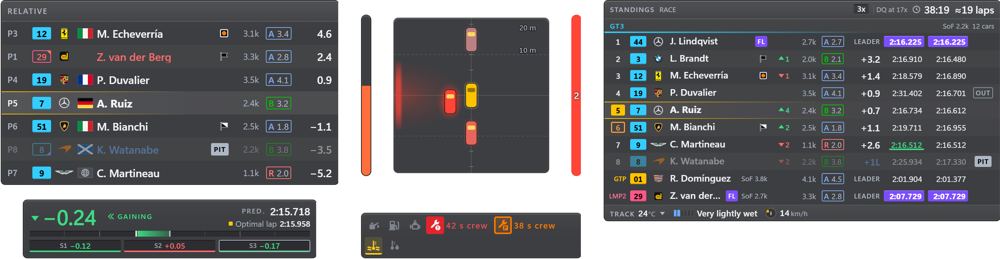

_Every screenshot uses the app's own sample data (made-up drivers) on a transparent background; on
track, the panel lets the game show through according to the opacity you choose._

## Contents

- [Installation](#installation)
- [Widgets](#widgets)
- [Settings and customisation](#settings-and-customisation)
- [Edit mode](#edit-mode)
- [Layouts](#layouts)
- [Keyboard shortcuts](#keyboard-shortcuts)
- [When the overlay shows](#when-the-overlay-shows)
- [Streaming](#streaming)
- [VR](#vr)
- [Privacy and anti-cheat](#privacy-and-anti-cheat)
- [Known issues](#known-issues)
- [Licence and credits](#licence-and-credits)
- [Code signing policy](#code-signing-policy)
- [Support OverLap](#support-overlap)

## Installation

> [!WARNING]
> **Windows SmartScreen / Microsoft Defender will warn you about OverLap.** The first time you open
> each downloaded version, Windows says it protected your PC from an “unrecognised app”, and Smart
> App Control may block it. Not because OverLap contains anything harmful: it is not code-signed,
> because a signing certificate costs money every year, and OverLap is a small, free project. I
> built it for my own races and now I share it.
>
> - **What to do:** click **More info → Run anyway**.
> - **If Smart App Control blocks it:** it cannot be allowed for one app only. You can turn Smart
>   App Control off (Settings › Privacy & security › Windows Security › App & browser control ›
>   Smart App Control settings; on most Windows 11 versions, once off it cannot be turned back on
>   without reinstalling Windows) or wait for a signed version.
> - **To stay safe:** download OverLap only from the official
>   [Releases page](https://github.com/jesus-molano/OverLap/releases), and if you like, check the
>   file on [VirusTotal](https://www.virustotal.com/) before you open it.

### Requirements

| Requirement | Detail                                                    |
| ----------- | --------------------------------------------------------- |
| System      | 64-bit Windows 10 or 11                                   |
| iRacing     | In a borderless window (borderless / windowed fullscreen) |

- In **exclusive fullscreen** the overlay does not show.
- In **VR** it does not show, except with OpenKneeboard: see [VR](#vr).

### Download and open

Each [GitHub release](https://github.com/jesus-molano/OverLap/releases/latest) has two versions;
pick one:

- **Installer (recommended)**: `OverLap-<version>-setup.exe`. It installs for your user only,
  without asking for administrator rights, in `%LOCALAPPDATA%\Programs\overlap`, with shortcuts in
  the Start menu and on the desktop (they open the Settings). **It updates itself** (see
  [Updates](#updates)). Uninstall it from **Settings › Apps** in Windows; your settings stay.
- **Portable**: `OverLap-<version>-portable.exe`. Nothing is installed: it is an executable you can
  keep wherever you like. **It does not update itself**: it tells you when there is a new version and
  opens its download page.

Both use the same settings, so you can move from the portable to the installer without losing
anything (they cannot run at the same time: if you open the installed one while the portable is
running, the portable asks you to close it). Windows warns the first time you open each downloaded
version: see the warning at the start of this section.

OverLap stays in the **system tray** (next to the clock). From its icon you see its status (and
whether any shortcut is not working), open the **Settings…**, show or hide each widget (grouped as
in the Settings), change the radar range, the names (**Names**: Driver, Team or Team · driver), when
the overlay shows and the layout in use, show or
hide the whole overlay (**Show the overlay**), enter edit mode, bring the widgets to the mouse's
screen (**Bring every widget to this screen**), undo the last thing (**Undo: …**, when there is
something to undo), open the settings folder or quit. Opening the `.exe` again while OverLap is
already running opens the Settings.

If iRacing is not open, Relative and Standings show “Waiting for iRacing…” for a few seconds and
then hide (unless **Keep “Waiting for iRacing”** is on in Visibility); OverLap connects by itself as
soon as the sim starts.

The settings are saved in `%APPDATA%\iracing-overlay\` (**Settings › Help and about › Files and
diagnostics › Open folder**, or the tray). On that page, **Export everything…** saves all the
settings (Appearance, shortcuts, visibility and every layout with its options) and your personal
bests to a file, and **Import everything…** brings them back on another computer or after a
reinstall: the settings apply at once (with **Undo**, as long as you change nothing else) and the
file's personal bests are added to yours (the fastest lap wins; none of yours is deleted, and if
the list is full it says how many do not fit). That page also has the version, a quick help,
**User guide** and **Report a problem** (they open the browser), **Open log**, **Copy
diagnostics**, **Show the welcome** and **Reset everything** (press again to confirm; as freshly
installed, in your language; your personal bests stay; with **Undo**). At the bottom, **Licence**
says OverLap is free to use but not open source (with no warranty) and opens the licence and the
third-party notices in the browser.

### Updates

The installed version looks for a new version in the GitHub releases a minute after it starts and
then every 5 hours, downloads it in the background and installs it **when OverLap closes**, or right
away with **Restart and update** (in **Settings › Help and about › Updates** or in the tray).

- **Never during an iRacing session**: nothing downloads (a half-finished download stops and
  resumes when the session ends), nothing installs, OverLap does not restart and no notice shows
  over the game (only a line in the tray and in the Settings). The session ends once iRacing has
  been closed for half a minute. If you close OverLap with iRacing open, the update waits for the
  next time; it does not install while Windows is shutting down or restarting either.
- When it is ready, Windows says so with a notification that does not take your focus (once per
  version, never during a session). After it installs, OverLap says it is on the new version; if it
  could not install, the Settings say so (the details are in **Open log**).
- **Skip this version** leaves it uninstalled; **Check now** looks right away (and offers a skipped
  version again).
- **Check for updates automatically** can be turned off; then it only looks when you press **Check
  now**. It is an option of this computer: **Import everything** and **Reset everything** do not
  change it. Being offline does no harm: a line goes into the log and it tries again later.
- The updates are **not signed** (like the rest of the app, see
  [Code signing policy](#code-signing-policy)). When it downloads one, OverLap checks that it matches
  the fingerprint (sha512) published with the release: that protects against a damaged download, not
  against whoever controls this repository's releases, who controls the updates.
- The portable does not update itself: it tells you about the new version and **Download** opens its
  release.

## Widgets

Each widget has its page in the Settings, with a live preview and its options. All of them can be
shown or hidden, locked, scaled and limited to certain sessions (practice, qualifying, race). They
come in the same order and the same groups as in the Settings sidebar and the tray: **Track and
rivals** (Relative, Standings, Battle, Traffic, Radar, Spotter and Track map), **Your lap** (Delta, Fuel and
Inputs) and **Car status** (Alerts and Warning lights).

### Relative

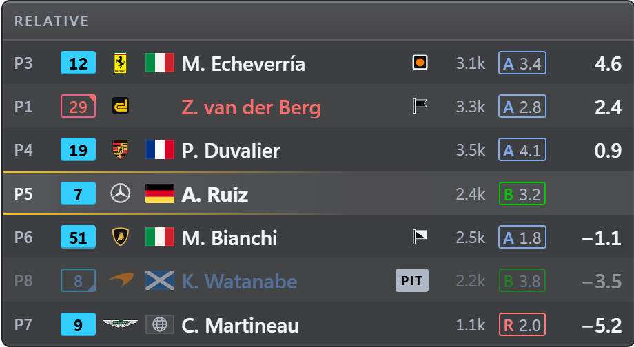

The cars ahead of and behind you on track (3 and 3 by default, up to 10) with the gap in seconds:
positive ahead, negative behind. Each row has the class position, the number in its class colour,
the make, the country flag, the name, iRating and licence (in the same order as Standings and
Battle). Whoever is about to lap you is in red, lapped cars in blue (with a notch at the top or
bottom of their number, so as not to rely on colour) and cars in the pits are dimmed. The header
shows its name; your incidents and the session's next limit (“3x · DQ at 17x”), the session and
the time left show by default in Standings, and here one click away in its header. In Options,
**Density** (the global one from Appearance or its own).

Optional: pit columns (PIT or TOW in its column; without it, after the name, as in Standings),
stint laps and tyre (in the same order as in Standings), last lap (like the one in Standings: purple
for the fastest in its class, green for its own best; outside a race, its best lap), positions
gained (races only, as in Standings), column titles and an info bar at the top and bottom
(session, time left, SoF, iRating at stake, projected SR, track conditions…). The start of the row
is columns too, as in Standings (see below): position, number, logo, country flag, name and penalty
flags go wherever you put them. Every column has its eye, the position, number and gap too: only
the name always shows. At the foot of the list, **Column titles** and **Match Standings**.

### Standings

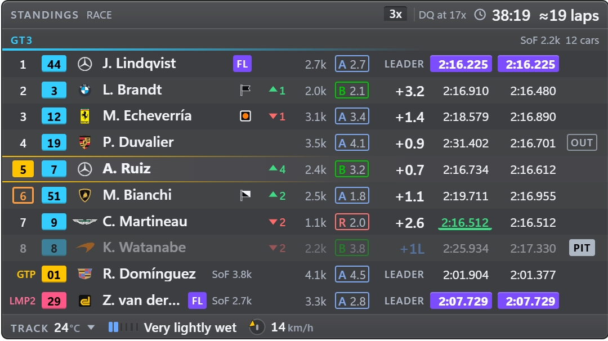

Short table (the leaders, the cars around you and the leaders of each other class: **Top
positions** and **Around you**, 3 and 3 by default; from each other class, by default its leader,
on one line; with **Cars of other classes** from 0 to 10, as many as you like under its class name)
or full. With **With a single class too** on, a session with one class has its class line as well, and its SoF and car count leave the bars. Each class line has its SoF and its car count, each with its eye in **Elements › Class
line**; the SoF also goes at the end of a one-line leader. Columns that are reordered by dragging
and hide by themselves if the window gets narrow: positions gained (races only), iRating, licence,
iRating at stake, gap (**Measured** to the car ahead, to the leader or both; by default, to the car
ahead), last and best lap (the fastest in the class in purple), pit, last stop, stint and tyre.
Hidden by default: iRating at stake, gap to leader, last stop, stint and tyre. The iRating at stake
row has **iRating at stake for everyone** (off: only yours), and at the foot of the list, **Column
titles**. In Options, **Density** (the global one or its own).

The start of the row is columns from the same list too, in Standings and in Relative: **Position**,
**Number**, **Make logo**, **Country flag**, **Name** (always shown) and **Flags** (the penalty
ones). By default, in the usual order, with the flags after the name. Any column can go between
them: “Positions gained” between the position and the number, the flags between the number and the
logo… Whatever is right next to the name goes with it, in its cell: before it, aligned from row to
row; after it, at the end of its cell, also aligned. Separated by another column, it goes in a
column of its own. One rule: **the list says where; the “Drivers” block, whether and how** the logo,
the country flag and the flags show (their row in the list has no eye but a link to their row in
“Drivers”, and says how they are set there). The position and the number, which are not in the
block, have their eye. “Match…” carries everything over, and in the preview they are dragged like
the rest. A header with the session, its SoF, your incidents and what is left; a footer with the
track's name, the track conditions (temperature and its trend, water, the rain percentage, wind with
a dial pointing at your car) and the cars. One click away in Elements: a second line with your
iRating at stake, your projected
SR and the class fastest lap, and the air and rubber in the footer (by default they do not show on
a new install, so it reads at a glance).

With several classes, **Class order** puts your class first (default), the fastest first (as
iRacing does) or the order you want (**By hand**): a list of classes by their short name that is
remembered between sessions and is reordered by dragging, with ↑ ↓ or by dragging a class's line in
the preview. The list fills itself as you race: every class of a multiclass session is remembered
at its end, in every layout, without touching your order, and the × on a remembered class forgets
it (until it comes back in another session).

Before the green flag it shows the whole grid, and when the session ends it stays with the results
on the session screen.

### Battle

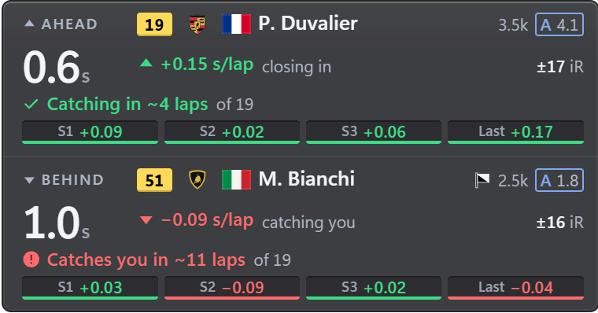

Your class rival ahead and the one behind while they are within the gap you choose (1.5 s by
default): the gap and its trend, the prediction (“Catching in ≈4 laps and 19 left”), the sectors (S1 S2
S3 and the last lap) and the iRating at stake; the last three laps, one click away in Elements
(**Lines › Laps**). One above the other or side by side. By default, races only. **Keep visible**
(3 s by default) keeps the battle on screen for a moment after the rival leaves the gap. The gap,
unsigned (the measured one, by default) or **Signed** (the same time, positive ahead and
negative behind); and each phrase of the prediction (“Catching in…”, “Catches you in…”, “Need…
s/lap”, “Out of reach · Safe to the flag”) with its eye, in **Catch prediction**. In Elements,
each rival (**Rivals**: the car ahead and the car behind; with neither, the widget does not show)
and each detail (**Details**: iRating, licence, trend text and iRating at stake) has its eye.
Optional: a header and footer with session data (see below).

### Traffic

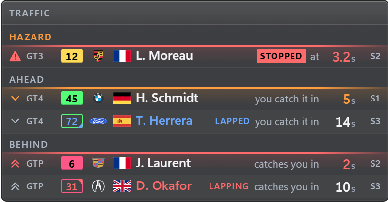

The faster cars catching you from behind (how soon and in which sector), the slow traffic you are
catching and the hazards ahead (stopped, very slow or off-track cars). Whoever is lapping you, or
passing you under a blue flag, always shows as long as they are within **Look behind** (with the
**Faster class** group shown), in amber or red as they get closer. Each car has, as in the relative,
its make logo, its driver's flag and its penalty flag (the “Drivers” block on its page). It fades out
when nobody is near. The header (the title) takes more data, and there is an optional footer.

In Options, how far it looks: **Look behind** (12 s by default), **Look ahead** (8 s) and **Hazards
up to** (8 s); **Cars per group** (3 by default, from 1 to 5) and **Multiclass only** (on: in a
single-class race it only warns about whoever laps you or passes you under a blue flag, and about
hazards). **Gap**, as in Battle: **Unsigned** (by default: “catches you in 6 s”, “you catch it in 5
s”) or **Signed** (each car's time as the Relative shows it, positive ahead and negative
behind, without the words before it); a hazard always reads “at 3.2 s”. In Elements, the **Groups**
(Hazards, Slower traffic and Faster class) and the **Columns** of each line (icon, class, driver,
flags, words before the time, time and sector) are reordered and hidden, and **Group captions** (on)
puts the name above each group.

### Radar

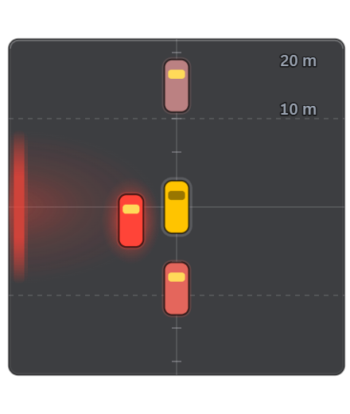

A top-down view with the cars to scale around yours, turning red as they get closer, and a warning
on the side when someone is alongside. Range from 5 to 100 m (20 m by default, with buttons for 10,
20, 30 and 50 m; in feet with imperial units). A car that has just passed you keeps its side for a
few seconds even when iRacing no longer reports it. It hides by itself when nobody is near. In
**Elements › Layers** you can remove the distance guides, their distances and the side alerts. It
is always drawn above the other widgets (see [Edit mode](#edit-mode)).

### Spotter

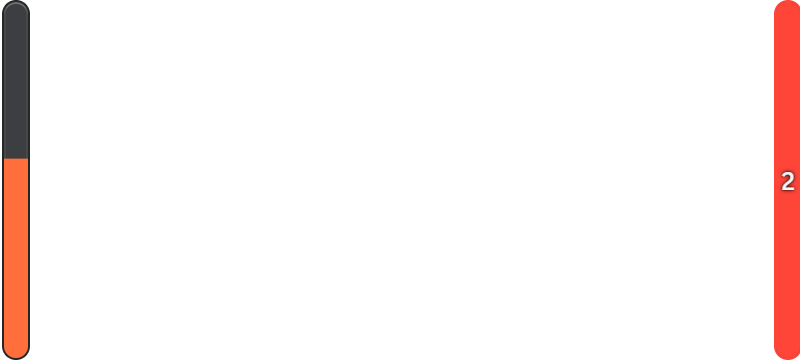

Two bars, one on each side, for those who prefer side bars to the central radar (or want them
alongside it: they are independent, each with its own page and visibility). **Bar style** chooses
what they tell:

- **Closeness** (default): the radar in two bars. Each bar fills from the bottom the closer the car
  on that side is, with the same rule as the radar: full when it is alongside you, and it empties as
  it moves away ahead or behind (up to about 12 m), from amber to red; when full it is also marked
  with a red border. With two cars on one side, a “2”.
- **Where it covers you**: each bar is your car, from nose (top) to tail (bottom), and it fills with
  how much of you the car on that side covers: from the top if it is ahead, from the bottom if it
  is behind, and all of it when it is right alongside you, from grey to red. With two cars on one
  side, a “2”; with one that has just been alongside you and is now right ahead or behind, a faint
  cap at that end. If iRacing says someone is there but they cannot be placed, the whole bar is
  dashed.

The two marks (the cap and the “2”) have their eye in **Elements › Marks** (“Car about to come
alongside”, this one only with “Where it covers you”, and “Two cars on one side”); by default, both.

Which side comes from iRacing's spotter, and only once the car is level with you: one coming up from
behind that has not yet been alongside you has no side yet. How much is the distance along the
track. iRacing does not give the lateral distance: full means “alongside you”, not “contact”.

The window's width is the gap between the bars (to put them at the sides of the car or of the
screen) and its height is their length; their thickness, **Bar thickness** (14 px by default), is
chosen in Options. By default it only shows with a car alongside or about to be (**Only with a car
alongside**, in Options, on), and it is hidden: turn it on in Visibility, the sidebar or the tray.

### Track map

Every car along one line that runs from the start/finish to the start/finish, with a mark for each
sector. Each dot is a car at its fraction of the lap, and it says nothing else: OverLap never places
a car it has no data for. Classes differ by colour and by shape, your car is larger and ringed, a
car a lap up on you has a dashed outline and one a lap down a dotted one, and the pace car is grey
and labelled PC. A car off track or stopped stays in its place and changes style, because iRacing
gives no sideways position.

A car on pit road or in its box leaves the line for the **Pits** row, as a chip with its number and
no place along it. A registered car that iRacing sends no data for is not drawn: a line at the foot
says how many and which ones (“2 without data: #12 and #44”). Your car stays on the map with a
teammate driving, because it is read like any other car; to see it on iRacing's session screen too,
turn on that widget's switch in Visibility.

In Options you choose each dot's **label** (none, car number or place in its class; labels that
would collide are dropped, but yours always stays) and the **cars on the map** (all or your class).
In **Elements › Map parts** you can remove the sector marks, the pit row and the line of cars without
data, and the header and footer are there for the laps, the time or the position after a stop. Its
**Legend** tab shows each mark as the widget draws it and says what it means. It is hidden by default:
turn it on in Visibility, the sidebar or the tray.

### Delta

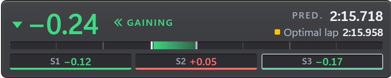

A delta bar against the reference you choose, with trend, predicted lap and each sector. The
reference can be your personal best with that car on that layout (it is stored on your computer and
is not lost when the session changes; the list, **Personal bests**, is at the end of the Delta
page), your session best, your optimal lap from sectors, the class fastest lap or the class optimal,
and it can differ in practice, qualifying and race: by default, your personal best in practice and
your optimal lap in qualifying and race. With **Fall back to the next one** (on), while that
reference does not exist the delta uses the next one (for example, your personal best until you
have a clean lap). If no clean lap exists at all, it compares with your fastest lap so far, tagged
**not clean**, so laps with an off-track or a race's first lap still give you a delta on the next
one. Off, it shows no delta until the chosen one exists. With **Show without a reference** (on),
while you drive with no reference yet the widget stays and shows iRacing's current lap time, empty
sectors and a sentence asking for a lap, and marks a dirty lap as invalid, but never an
invented delta or predicted lap; off, it stays hidden until there is one. In team races, **In team races, compare
with** decides whose laps your session best and your optimal lap count: yours by default (the
team's, with a **team** tag, until you have a clean one) or the whole team's. **Bar range** (1 s by
default, from 0.5 to 3 s) is what fills it. Only legal laps count: without going off track (not even with an iRacing
1x), without stopping, without pit lane, tow or yellow; a touch or a spin does not invalidate it.
The reference only changes when a lap starts.

In **Elements › Lines**, the **Top line** (lap state, predicted lap and reference, each with its
eye). Optional: a **Lap times** row with your last, your best and your optimal (and your personal
best, one click away), and several references at once (**Rows per reference**, by default your
three; the two class ones, one click away): each one with an identical row (its name, its delta,
its trend and its bar, all on the same scale, green on the left: faster), under a line naming the
one the delta uses (the predicted lap and the sectors go with it; without that line, the sectors
carry its name). With only one, the usual delta. When you turn rows on from its page the window
grows just enough for all of them to fit; if you then shrink it, the ones that fit show (always the
one for the reference in use) and the page says there is no room for the rest.

### Fuel

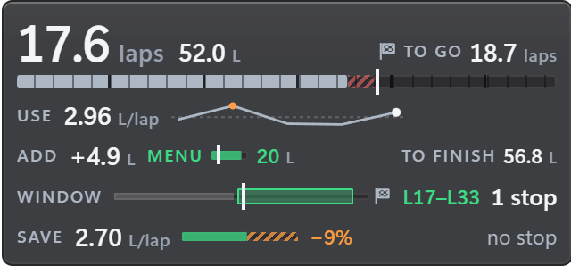

More drawing than text: the laps the fuel gives you in large type (in green if you make it to the
finish), the litres and the laps left; the tank marked in laps, with a line where what you need
reaches; the use with a line of your last clean laps (average, last and the thirstiest); what to
add next to a bar for the pit menu; the race as a line with your position, the pit window
(“L17–L33”) and the stops (“1 stop”); the saving per lap that cuts a stop, as a bar with the cut;
the car seen from above with the wear of each tyre in three bands (from green to red, or from blue
to orange with the colour-blind palette, measured at your last stop) and the sets left; and the
fast repairs if the session limits them (these two lines, one click away in Elements: they do not
show by default on a new install). It only measures clean laps, and the plan does not change within
a lap. By default, in practice (where the use is measured) and in races. Optional: a header and
footer with session data.

In Options, **Laps to average** (how many clean laps are averaged: 5 by default) and **Safety margin** (0.5
laps to spare at the finish; the fuel alerts use the same average, without the margin). In
**Elements › Lines**, every line except “Fuel and laps” has its eye, and the “Add and to finish”
one carries the **Pit menu** bar (on).

### Inputs

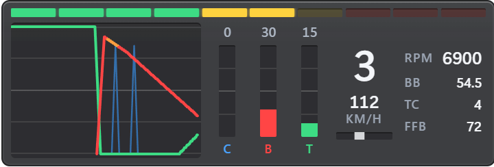

Throttle, brake and clutch trace, bars, gear, speed and steering, in the order you want. Shift
lights with the car's own rev ranges and a “Car” block with RPM, brake bias, TC level and FFB (in
red when it reaches 100%). The steering can be a bar or a minimal, realistic (GT) or formula wheel
that turns the real degrees. **Wind** (off by default; turn it on in Readouts) shows where the air
hits your car from and how hard, in km/h or mph: on its own, as a small dial with your car in the
middle, or **On the wheel**, an arrow running round the steering wheel's rim (with the bar, on its
own). The arrow is in colour (by default, the global accent) and dims when the air is calm.

Everything is in Elements: **Trace length** (5 s by default, from 2 to 10), **Trace thickness**,
**Clutch in the trace** (on; turn it off if you shift with paddles), the colour of each pedal and,
under Steering, its **Steering style** (Bar by default), **Wheel size**, **Centre mark colour** (by
default, the global accent) and **Steering angle** (off); under Wind, its **Wind style** (On its own
by default) and **Wind colour** (by default, the global accent).

**Show** chooses between **What you press** (by default) and **What the car applies**. When stopped,
iRacing applies the brake and the clutch by itself, so with the second choice both show at full
without you touching them.

### Alerts

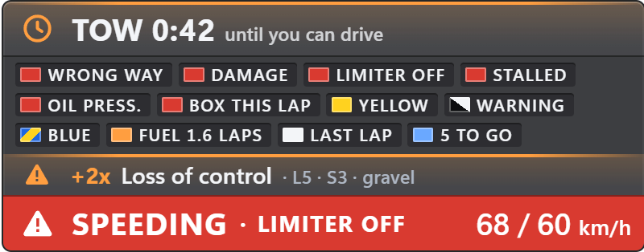

A band with what affects you, the most important in large type and the rest below, small. Flags
(also the warning flag and the blue flag, each with its own row), limiter and speeding in the
pit lane (“LIMITER OFF” waits until the car rolls out of its stall), “LIMITER OFF” before the entry, 10 and 5 laps to go, tow with a countdown, engine stalled,
wrong way, oil pressure, “BOX THIS LAP”, low fuel and each incident
as it is added (“+2x Loss of control · L5 · S3 · gravel”). Each case is shown or hidden with its eye
in **Elements › Alerts**, grouped (Flags, Pit lane, During the race, Engine, Fuel), and each alert
has its shape as well as its colour (it reads with the colour-blind palette). Engine stalled, oil
pressure and pit limiter are warning lights too: their row has a
**Also in Warning lights** checkbox that turns theirs on or off in Warning lights, and the other way round
(**Also in Alerts** on the Warning lights page). **Keep visible** (3 s by default) keeps a brief alert on
screen long enough to read it; in **Elements › Extras** you can remove the what-to-do line and the
chips for the other alerts. The blue flag says a faster car is behind you. It lasts exactly as long
as iRacing gives it, and it is not shown while the green flag is out, because iRacing's own graphic
shows green then.

### Warning lights

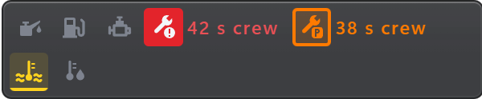

The engine warning lights as on a dashboard, in a row or a column (**Orientation**): oil and fuel
pressure, engine stalled, mandatory and optional repairs (with the crew's time, “42 s (crew)”, or
“42 s crew” if the window is narrow; with **Real countdown**, the real seconds estimated stopped in
your pit box), water and oil temperature and, if you turn them on, pit limiter and rev limiter. Each
severity has its colour and its shape; in yellow it warns when the water or oil rise well above your
average, before the car's own light comes on. Its Settings page explains what each one is and what
to do, in its **Legend**.

In Options, **Lit only** (off: with it on, the widget hides while none is lit). In **Elements ›
Lights**, each one with its eye (and **Also in Alerts** on the ones it shares with Alerts) and, below,
**Name beside the icon** (off), **Text side** (in a column), **Temperatures** (off: “98° +6°”), **Repair time**
(on, with **Mark as crew time**, on, and **Real countdown (estimated)**, off) and **Rising
temperature** (on).

## Settings and customisation

The first time, OverLap opens the Settings, in the Windows language (Spanish or, if not, English),
with a three-step **welcome**: language and units, which widgets to use (six ticked to begin with,
at least one) and where everything is, with **Try with sample data** to see the widgets on your
screen and place them. Windows notes that OverLap stays in the tray.

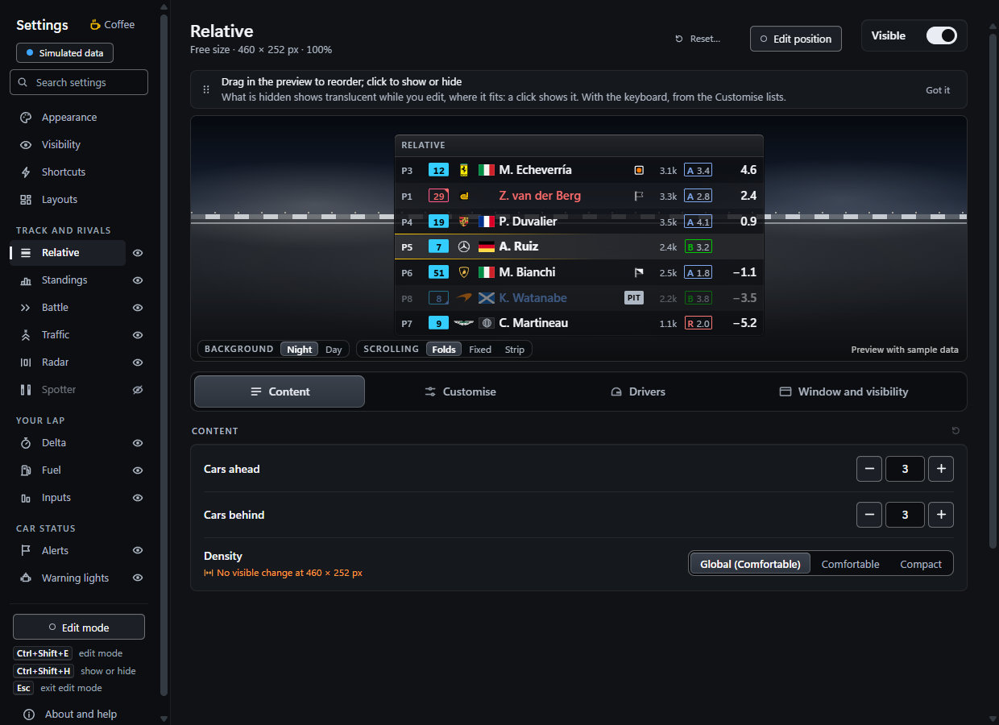

They open from the tray (**Settings…**), with `Ctrl+Shift+O`, by opening the `.exe` again or by
starting it with `--settings` (the installer's shortcuts do). Everything applies **live** and saves by
itself; at the top of each page there is a preview of the widget on a night or day track
background, which stays at the top as you scroll down the options. It takes 45 % of the window at most,
never goes below a size that reads (if it does not fit, it shows its first rows) and the line under it
changes its height: stretched past what the widget needs, the widget grows with it, up to twice its real
size or 60 % of the window. Each widget keeps its own, and a double click returns to the original size. **Open in a window** takes the preview to a window of its own that stays on
top, can go to another screen and follows the page you are on. It opens right beside Settings when that
screen has room, and after that where you left it. You edit it as you do in Settings, with
example data: a click hides an element, and a drag moves it or changes its slot, with its **Undo**. It
stays above the widgets too and closes with Settings, while the options take all the room. Under the preview, each widget's page has **tabs**, the same names in the same order on
every page: **Options**, **Elements**, the widget's own tab where it has one (**Drivers** on
Relative, Standings, Battle and Traffic, **Personal bests** on Delta, **Legend** on Lights and Track map) and
**Size and visibility**. No mark on a tab says it has changes: the ↺ at the end of the tab bar and the
**Reset…** menu at the top do that. The tab bar stays under the preview, `Ctrl+PgUp` / `Ctrl+PgDn`
change tab, and the tab you chose is kept as you go from widget to widget while the window is open.
In a narrow window the tabs drop their icons, then say **Size** (and **Bests**), and only then
scroll sideways. Lines in one tab take you to a setting in another: “Which alerts show · Go to
Elements”, “The row height is changed with Density, in Options”, “The width is changed with Edit position” (“The
size…” when the height is yours to set too), the row of Options that also decides when Battle,
Spotter or Lights show, and in **Drivers** the iRating column's row in Elements. With a wide window
(from 1100 px) Elements puts its main list on the left and the others on the right (a single list
keeps the whole width), and Drivers and Size and visibility go in two columns. What you change
shows in the preview; if it does not, the option
says why with a short note: **At 540 px wide there is no room for this** (the widget's width leaves no room for that column
or that data: widen it or hide another). Options that act during the session (when a widget shows,
the lock, how long an alert stays…) say **Not shown in the preview**. When a setting only shows in
another situation, the preview switches to it and says so below: the reference of the session you
change in Delta, your car further back when you change the top positions in Standings, five cars per
group when you change the entries in Traffic. A list that sits inside a hidden block (the car data
in Inputs, the lap times in Delta) says so below, and showing one of its items also shows the block.
At the top of the sidebar (or with **Ctrl+K**), **Search settings** finds any setting by its words and takes you to it
(it opens its tab and its section and points it out), the buttons too (“export”, “edit position”, “reset”) and
the options of each selector (“imperial”, “surname”, “Español”), by everyday words (“zoom”, “lock”,
“blinking”, “colour-blind”, “gallons”, “rpm”, “key”, “wheel button”, “per car”, “bigger”) or by
the name of a style; what another setting now hides is marked “with another setting”. The sidebar
groups the widgets in **Track and rivals**, **Your lap** and **Car status**, as the tray does. The
eye of each one shows or hides it; faint and with a dashed circle, it is on but not showing now: a
rule hides it or you have hidden the overlay (hovering says why). In a narrow window (under 640 px)
the sidebar becomes a column of icons, with each widget's eye beside it and its name on hover, and
the search box, the status chip and **Edit mode** go at the top. The **status chip** at the top says
what is hidden and why; one click opens a panel with what to do, **Copy diagnostics** (for a bug
report, without names) and **Open log**.

- **Per widget**: visible, locked, background (the global one from Appearance or its own opacity,
  and the same choice for its colour; only the panel: the text stays sharp and, at low opacity, gets an outline), scale (the same row
  and the same 80/100/125/150% buttons in every widget; in Relative, Radar, Spotter and Delta it
  changes the size of its window, like the wheel in edit mode), automatic or fixed height, which way
  it grows (down or up, with automatic height), which sessions it shows in, hide in the pits (except
  Alerts, which warns about the limiter and the pit entry) and show on the session screen (except
  those that only have data in the car; by default, only Standings).
- **Reset and undo**: at the top of each page (the widgets, Appearance, Visibility and Shortcuts),
  **Reset…** says what it returns to default, section by section (in a widget: Options, Elements,
  Drivers, Size and visibility, Position and size, or the whole widget), and each section has
  its ↺ icon (at the end of the tab bar in a widget, in the header on the other pages), which resets
  only that section. It is a single click: a notice at the
  bottom says what was reset (and in which layout, if you have several) with **Undo** (or `Ctrl+Z`)
  for a few seconds. The same when you reset a list or a shortcut, use “Global” on all widgets, hide
  a widget or delete a layout. **Reset everything** (in Help and about) and **Copy these options to
  all layouts** ask for a second click (they can be undone too), and so does deleting personal
  bests, the only thing that cannot be undone.
- **Elements**: in that tab of each widget's page, editors to reorder (by dragging or with ↑ ↓) and show or
  hide each part: columns, header, second line, footer, rows, groups, alerts… The preview draws only
  what the widget really shows, a click on an element hides it, with **Undo**, and what is hidden
  comes back with the eye on its row. One rule for every page: **Options** is the behaviour (how
  many, how long, thresholds, modes) and **Elements** is what you see (each list with its eye and, with it, how its items look; an item's option, in its
  row).
- **Header and footer**: Relative, Standings, Fuel, Traffic and Battle have the same ones: a row of
  0 to 9 **slots**, a “Small / Normal / Large” size and the data you want from the same catalogue
  (with **+ Add a data item**: title, session, time left,
  local time, sim time (the sim's, with a sun), SoF, cars, incidents, iRating at stake, projected
  SR, class fastest lap, laps of fuel, track name, track temperature, water, rain, wind, air,
  rubber, and on their own laps done
  and total, laps done, laps left, time gone and total, time gone, time left, stint laps, position
  after a stop (an estimate in races, once someone has stopped) and each part of the iRating; Fuel does not offer its own
  laps of fuel, which it already shows). By default each bar is one line with its data together:
  the header says the title and the session, then your incidents and the time left; the footer
  the conditions, then the cars and the fuel; and the session data and the track's name, only in
  Standings. The slots share the width equally: the first aligns its item to the left, the last to
  the right and those between to the centre, so items in slots 1, 3 and 5 of 5 sit at the left end,
  the true centre and the right end. An empty slot is simply space, and 0 slots hide the bar with its
  items kept. An item with nothing to say, such as the water on a dry track, keeps its slot empty, so
  nothing else moves. When none of a bar's items has anything to say, such as a line of race figures in
  practice, the bar is not shown over the game or on the stream pages. It returns as soon as an item has
  data, and it leaves a few seconds after the last one goes, or at once in a new session. The preview
  still shows it with its empty slots, so you can edit it. An item too long for its slot takes room from the empty slots and then from
  others with room to spare. In the preview, a thin strip on the widget's edges changes its size as in edit mode, the width alone while its height follows the content, with **Undo**. While the **Elements** tab is open, each empty slot is a
  faint outline: a click lists what can go there, a click on an item removes it, and a drag takes it to
  any slot of that widget's header, second line or footer, swapping with what is there. The keyboard
  does the same from the list, with arrows and a menu. Fewer slots never lose an item: the items move
  into the free ones, or the bar keeps its slots and says why. An item can be in two bars of a widget,
  such as the clock in the header and the footer. **Highlight** on an item's row draws it in the accent
  colour of **Appearance** and about 9% larger, without changing the bar's height, and anything that
  signals something keeps its own colour. On its row, **Water on track** chooses **Graph
  and text**, **Text only** or **Graph only**, and **Rain**, **Air temperature**, **Track
  temperature**, **Rubber**, **Wind** without its dial, **SoF**, the car count, the laps of fuel, the position after a stop and the
  stint choose **Name and value** or **Icon and value**, the incidents **Text only** or **Icon and value**, the sim time **Icon and value** or **Name and value** (“TRACK 14:32”), and the local time **Time only** or **Name and time** (“LOCAL 14:32”), per widget. The track's
  name is the one iRacing writes, its short form when the line is tight, and the rain is iRacing's
  precipitation percentage, 0% too, and the first thing to go when the line is tight. **Copy to** copies a header or a footer, with its size, to the
  same place in another
  widget. If the line really does not fit, the least important are removed whole, and they come back
  when there is clearly room to spare; the text never shrinks. Delta,
  Inputs, Radar, Spotter, Warning lights and Alerts do not have them: they are compact readouts, and
  a bar would only add height.
- **Style** (at the top of Appearance), four that look different at a glance: **OverLap**
  (everything by default: the look and what each widget shows, with Relative and Delta at their
  default size, or just enough more if you show more cars, so the text does not shrink), **Clean**
  (no background: just the text over the game, with its outline; no alternating rows, logos or
  flags, number as a stripe, licence as letter only), **Compact** (small but readable: compact rows,
  text at 85%, surnames, number as a stripe, licence as letter only, no logos or country flags) and
  **Complete** (background at 90%, logos always and everything in view in every widget of the
  layout in use: every column, element, info bar and alert; the widgets grow so the text does not
  shrink). If it is going to change something you set yourself, it first tells you what changes
  (from before to after) and where it is saved, and waits for you to **Apply**; everything is undone
  with **Undo**, windows included. The rest of Appearance remains as **Fine tuning of the style**
  (Colour and Text on the left, Rows and drivers on the right), and if you touch it (or what a
  widget shows, with OverLap or Complete) the style becomes “Custom”. Clean and Compact only change
  the look: when you leave **Complete** for one of them, what Complete added stays, unless you tick
  “Also take away what Complete added” (each widget goes back to what it showed before); with
  **OverLap** it always goes, because everything returns to default. They do not change the accent,
  Accessibility, the SIM tag, the language, the units, the positions or which widgets show (the
  layouts choose that).
- **Appearance**: language, accent colour (it marks you and nothing else), widget background (80% by
  default, the one all follow except those with their own) and its **Background colour** (today’s
  near-black by default; on a light colour the text turns dark by itself and the car logos use their printed colours, on a saturated one the coloured text turns paler until it reads, and a note appears only on a mid tone where neither light nor dark text reads well), text size (it multiplies the scale of
  every widget: in Relative, Radar, Spotter and Delta, which fill their window, it enlarges
  their window in the same proportion, in all your layouts), text outline, density and alternating
  rows, **Lines between rows** (the thin line drawn while alternating rows are off; with both off
  the rows are left clean), **Your row’s highlight** (**Line** by default, or **Gradient**: your
  accent crosses the row and fades towards its end), licence and number style, logo colour (colour or monochrome), metric or imperial units (mph,
  °F, gallons in Fuel and feet in the radar range), **SIM tag** (marks the widgets with simulated
  data; on by default) and the global **Drivers** block: **Which name shows** (**Driver**, the default;
  **Team**: in team races each car is named by its team, as iRacing sends it, the Delta's class best
  too; or **Team · driver**: both on one line, “Vela Rossa Corse · M. Echeverría”, the driver
  smaller and grey and in the name format; when it does not fit the driver is cut first. A car
  without a team of its own, as in every other race, keeps its driver), name format,
  make logo (Auto, Always or Never), country flag, penalty flags, **iRating format** (“2.5k”, cut and not rounded, or the whole number, “2,520”,
  with the language's thousands separator; the SoF too) and **iRating in the licence colour** (off
  by default: each driver's in the colours and style of their licence).
- **Accessibility** (in the **General** group of Appearance, with Language and units), all off by
  default: **Colour-blind palette** (blue and orange instead of green and red, in the pedals too,
  with a thicker brake trace), **10 px minimum text** (instead of 9; no widget gets wider, they drop
  a piece of data first), **No flashing** (shift lights steady in blue) and the **Size of this
  window** (80–150%, also with `Ctrl` and `+` / `-` / `0` or `Ctrl` and the wheel; 80/100/125/150%
  buttons, like the other sizes). At the bottom, two buttons lead to **Text size** and **Text
  outline**.
- **“Drivers” block**: Relative, Standings, Battle and Traffic have on their page, in its own
  **Drivers** tab, the same rows (name, name format, make logo, country flag, penalty flags, iRating format and
  iRating in the licence colour; in Traffic, which does not show the drivers' iRating, the last one
  is off), each with “Global (…)”, the Appearance value, or a value of its own. The logo, the
  country flag and the penalty flags show or not according to their row; where is decided by the
  column list of Relative and Standings (and Traffic's column list, for the flags): right after the
  name, after its text; anywhere else, in a column of its own. Battle, with no columns, puts them
  after the name.
- **Personal bests** (a tab of the Delta page, which also says where its reference is chosen): the list by car and layout, with deleting one,
  the current one or all.

## Edit mode

Enter it with `Ctrl+Shift+E`, from the tray or with the **Edit mode** button in the Settings. On a
widget's page, **Edit position** (next to “Visible”) enters it and points that widget out over the
game.

- Drag a widget to move it and use its edges and corners to resize it; the mouse wheel scales it.
  The help on each widget and the notice in the Settings use the same words (“Wheel: scale · Arrows:
  move · Alt: no snap · Esc: exit”). It snaps to the edges of the other widgets and of the screen,
  and to their centre, and a line marks where it has snapped (not with `Alt` or `Shift` held).
- For fine tuning, the **arrows** move the last widget you touched by 1 px (`Shift`: 10 px) and
  `Ctrl` + arrows resize it. Its label has its border in the edit colour, so you know which one they
  apply to; `Tab` and `Shift+Tab` go to the next or previous widget (from top to bottom), also
  without a cursor, with an “Arrows: Relative” notice. They work with the game or the desktop in
  front, and also with the Settings in front (right after **Edit position**, `Tab` too), except
  while a field, a slider or a list in the Settings has focus: then they belong to it.
- `Ctrl+Z` undoes the last edit-mode change (a drag, a resize, the wheel, the arrows or the label's
  eye and padlock), and then the one before; the tray also offers **Undo: …** with what you did
  (“move Relative”, “resize Relative”, “hide Battle”). When you leave edit mode they are forgotten.
- Drag it off its screen to take it to another (“Release to move it to the other display”). If you
  disconnect a monitor, **Bring every widget to this screen** (in the tray, to the mouse's screen,
  or in **Visibility**, to the Settings' screen) brings them all back at once. For a minute
  it can be undone from either place (**Undo: …** in the tray).
- The radar always stays above the other widgets (so you never lose the car alongside you). In edit
  mode, its label says which panels it covers (“Covers: Alerts, Delta”) and a covered panel says
  “The radar covers it”.
- Each widget's label has an **eye** (show or hide), a **padlock** (lock) and a **⚙** that opens its
  page in the Settings. A hidden widget shows as a dashed outline so you can get it back.
- Leave with `Esc`, with the same shortcut or from the tray. Leaving in the middle of a drag cancels
  it.
- With iRacing in front and you in the car, the sim hides the cursor: the notice over the game names
  the **Open settings** shortcut (the Settings free the cursor) and `Alt+Tab`, and reminds you that
  `Tab` and the arrows move the widgets without it. The most comfortable way is to place the widgets
  in the garage or in the menus.
- For the wheel to work over a widget, Windows needs _Settings > Bluetooth & devices > Mouse >
  Scroll inactive windows when hovering over them_.

Position, size and visibility save by themselves. Outside edit mode the widgets let every click
through to the game.

## Layouts

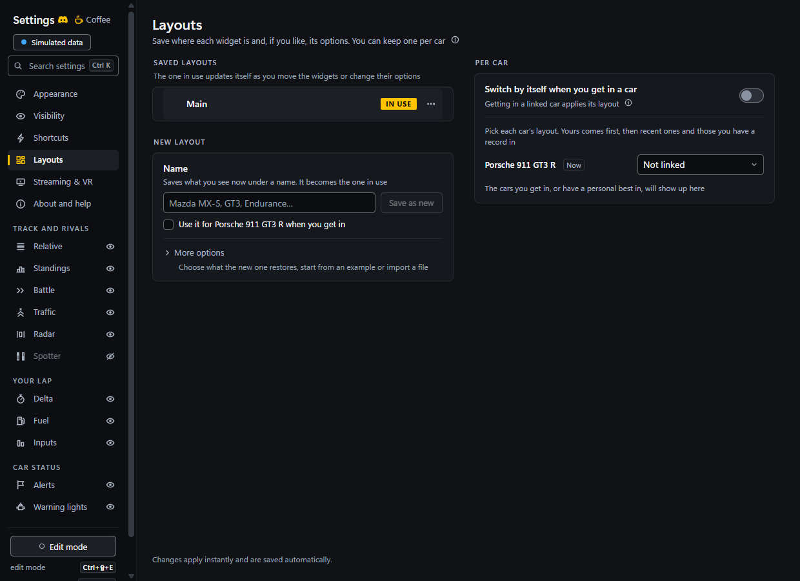

A layout saves, under a name, where each widget is (on each screen), its size, its scale, whether
it shows and whether it is locked, and also each widget's options: columns and their order,
elements, info bars, delta references, steering style, opacity, which sessions it shows in… One for
the Mazda, another for the GT3. The appearance (language, units, colour, text size…), when the
overlay shows and the shortcuts are always the same.

- Each layout is **Position and options** (default) or **Position only**: the latter only moves the
  widgets and uses the **shared options**, shared by every position-only layout. You choose it when
  saving or importing it (under **More options**), and change it later with **Rename or edit**; only a
  position-only layout says so on its row.
- **Settings › Layouts** has three blocks. **Saved layouts**: each row shows its name, its cars and
  **Apply** (or **In use**); its **⋯** menu has **Rename or edit** (a double click on the name
  does the same), **Duplicate**, **Export…** (a `.json` with its options), **Move up** / **Move
  down** and **Delete** (the one in use cannot be deleted).
  Drag a row by its handle, or focus the handle and use the arrow keys, to change your order. **New
  layout** saves what you see with a name; its **More options** fold, which lists what it holds, has
  what the new one will restore, **New from an example** and **Import from a file**. **Per car** holds every car link. Up to 30 layouts;
  **Search layouts** finds them by name or by car, and **Sort by** lists them in your order
  (**Custom**, default, the same as the tray and the shortcut), by **Name** or by **Recently used**.
  The tray shows the first five and **More…**.
- **The one in use updates by itself** when you move, resize, hide or lock a widget and when you
  change its options. On each widget's page, one line above the preview (with two or more layouts,
  or a position-only one) says where what you change is saved (**Saving to** the layout, or **Shared
  options**). Its **⋯** menu has **Copy these options to all layouts**, to carry that widget's options
  to every layout, with a second click to confirm and a sentence saying how it went.
- It is switched from the tray (**Layout** submenu), from the Settings or with the **Next layout**
  shortcut.
- **New from an example** (in **More options**) adds one of two very different overlays to the
  list, without applying it, with its own places (for the screen your widgets are on: drawn for
  1920 x 1080, kept to their edges on any 16:9 size and in the middle of an ultrawide) and options;
  your Appearance stays:
  - **Balanced**: the essentials for a race (Relative, Radar, Delta, Fuel, Alerts and Inputs) in
    comfortable places and at a good size, with the factory options.
  - **Race engineer**: every widget, small and full of data, along the edges (the mirror and the
    road stay clear), each one in its other look: every column, more cars, a bar per reference,
    the car's readouts...

  With **Next layout** you switch between them in a race.

- **Per car**: the **Switch by itself when you get in a car** switch (off by default) and one list of cars, the one you are in
  first, then recent ones and those of your personal bests, each with the layout it uses; that
  layout applies by itself when you get into that model. Linking a car turns the switch on (with
  **Undo**, on the page or in the tray, which also goes back to the layout you had). While in a car
  with no layout, the page offers **Use “…”** and the tray **Link … to “…”**, and when saving a new
  one you can use it for your car (ticked to begin with only if the switch is already on and the
  car has no layout yet). Each layout shows its
  cars as tags. A car with no link keeps the last one you used.

## Keyboard shortcuts

They are global: they work with iRacing in the foreground. Each action can have **up to three
shortcuts at once**, each one a key combination or a button on the wheel, the button box, the pedals
or the shifter (see [Wheel buttons](#wheel-buttons)): for example `Ctrl+Shift+H` and button 24 on
the G29, or a button on each wheel. Any of them runs the action.

| Shortcut (default) | Action                                                    |
| ------------------ | --------------------------------------------------------- |
| `Ctrl+Shift+H`     | Show or hide the whole overlay at once                    |
| `Ctrl+Shift+E`     | Enter or leave edit mode                                  |
| `Ctrl+Shift+O`     | Open the Settings (or bring them to the front)            |
| (unassigned)       | Next layout                                               |
| (unassigned)       | Next delta reference                                      |
| (unassigned)       | Switch between driver and team, in every widget           |
| `Esc`              | Exit edit mode (only while editing; it cannot be changed) |
| (unassigned)       | **More actions**: show or hide each widget, one by one    |

- **More actions**, folded under the table, has one row per widget (“Show or hide Relative”…): the
  same as its eye in the sidebar or its checkbox in the tray (which shows the shortcut next to the
  widget). None has a shortcut by default; it unfolds by itself if any has one. To take a widget off
  or put it back during a race without changing layout; the notice over the game says “Standings
  hidden” or “Standings shown”.
- **Switch between driver and team** puts every widget on the next of Driver, Team and Team · driver
  (Appearance's **Which name shows** and the value of each widget that has its own, in every saved layout
  too, so they all agree; when they did not, on Team). It is saved like any option and the notice
  over the game says “Names: Team”, “Names: Team · driver” or “Names: Driver” (outside a team
  session it adds that the drivers' names stay). If the widgets showed different names, the tray's
  **Undo** puts that back. The tray has it too (**Names**, with the three and the one every widget
  shows ticked).
- Hiding the overlay does not stop the telemetry: when you show it again it comes back with
  up-to-date data. When the app opens, the overlay is always visible.
- They are changed in **Settings › Shortcuts**, a table with one row per action and one column per
  shortcut (**Main shortcut**, **Alternative**, **Alternative**), like a game's controls screen.
  Each cell is the control: a click on a cell with a shortcut swaps it for another, and its **×**
  (on hover) or `Delete` removes it; the first free cell says **+ Assign** and waits for a
  combination or a wheel button. When you remove one, those to its right shift left (the first is
  the one version 2.1.1 reads). With none, the action is turned off. The ↺ icon on the right leaves
  it with only the default one. While recording, `Esc` cancels and `Backspace` or `Delete` remove
  the shortcut you are changing.
- Warnings go in the cell they refer to (**Disconnected**, **Used by another app**), and any
  sentence that is needed (a rejected shortcut, the `AltGr` warning) shows below that same column.
- When you use one (also `Esc` when leaving edit mode), a brief notice at the top of the screen
  where your widgets are says what it did, or why nothing shows (for example, “There is only one
  layout”); it also confirms the tray's **Bring every widget…** and **Link…**. It is turned off in
  **Confirm over the game**. The action's row says “Pressed 3 s ago”, so you can test it from the
  game, and if a shortcut cannot be registered, the tray says so under the status.
- The same shortcut cannot be on two actions (nor twice on the same one): the page says who already
  has it.
- **An assigned combination no longer reaches other programs, iRacing included**, while OverLap is
  open: do not pick one you use in the sim. If another application already has it, the page says so.
- They need `Ctrl` or `Alt`, except `F13`–`F24`, which many button boxes and macro keyboards send.
  `Ctrl+Alt` is the same as `AltGr` on a Spanish keyboard: it is allowed, but warns that it may stop
  you typing `@`, `#` or `€`. The Windows key cannot be used; letters, numbers, `F1`–`F24`, the
  numeric keypad, `Space` and the navigation keys are fine.

### Wheel buttons

- In **Settings › Shortcuts**, click **+ Assign** (or the shortcut you want to change) and then the
  button: any button on a wheel or its rim, a button box, pedals, a shifter or a handbrake that
  Windows sees as a game controller works, including those with more than 32 buttons. It shows as
  “Button 12 · G29 Driving Force Racing Wheel”.
- **They are only read**: the button is shared with iRacing and nothing is blocked, so **iRacing
  also gets the press**. Pick one you have not assigned in iRacing.
- Holding it down counts as a single press.
- D-pads and hats cannot be assigned: only buttons.
- If the page asks you to **press the button again**, it has just started reading that controller
  and does not know which buttons were already down (a rotary selector or a latching switch); the
  second press is the one that is saved.
- If the device is unplugged, the shortcut stays saved and its cell says **Disconnected** (the
  action's other shortcuts keep working); when you plug it in it works again by itself.
- Two identical devices (same model) share the buttons: either one works.
- `Esc` to leave edit mode is still keyboard only.
- Buttons are only read while some shortcut is a button (or while you are choosing one): with none,
  OverLap does not read the controllers.
- If you go back to version 2.1.1, each action keeps only its first shortcut (the rest are lost on
  saving), and if it was a button it goes back to its default combination.

## When the overlay shows

In **Settings › Visibility**:

- **When to show the overlay**: only when you are in the car (default), races only or always. Out of
  the car only Standings stays, on the session screen, with the results.
- **In replays**: **Hide** (default) or **Follow the car on camera**: the widgets follow the car you
  are watching; when you rewind only Standings stays (with the live race), and those that only have
  data from your car (Radar, Inputs, Delta…) hide while you watch another one.
- **Hide with the iRacing UI**, **Hide in the garage** and **Hide on the session screen**, on by
  default (the last one is only offered when it changes something). Only the session screen has a
  per-widget exception: **Show on the session screen**, on its page.
- **Keep “Waiting for iRacing”** (off): without iRacing, Standings and Relative keep the notice
  instead of hiding.
- Each widget also has its own rules: which sessions it shows in and whether it hides in the pits.
  Below, the **Where each widget shows** table brings them all together (visible, practice,
  qualifying, race, hide in the pits, session screen and locked), one row per widget: each cell is
  the same setting, with the same meaning, as on its page (the Visible column is the sidebar's eye),
  and its name leads to it.
- Edit mode always shows every widget, with the reason if one is hidden.

For OBS and other streaming programs, see [Streaming](#streaming): your widgets as browser
sources, with a transparent background. Capturing the window “Display N · OverLap” or the display
still works too.

## Streaming

OverLap can put your widgets in **OBS, Streamlabs, vMix or XSplit** as a **browser source**: a web
page your streaming program draws over the game, with a transparent background. You choose which
widgets go to the stream, apart from what you see on screen, and you place and size each one in
your streaming program. Turn it on in **Settings › Streaming & VR**.

**How to add a widget to OBS**

Your streaming program runs on **this same PC**, or on a separate streaming PC on your home network
with **From another PC on my network** (see **A separate streaming PC** below).

1. In **Settings › Streaming & VR**, turn on **Turn on streaming mode**.
2. In OBS: drag **Drag to OBS**, next to the widget (the screen or the curtain), onto the OBS
   scene. OBS asks whether to add the source (“Add Source via URL”): say **Yes**. It makes a Browser
   source with its name (“OverLap · Relative”) and size: the one on your screen, and for a widget that
   grows with the session (Standings, Relative…) its width and room in height, below it the source
   is transparent. The screen mirror and the curtain get the canvas size.
3. With Streamlabs, or in OBS by hand: press **Copy URL**, **Add source › Browser**, paste the URL
   and set the width and height the page shows for that widget (**Source size**). Any size with the
   same proportions works: the widget scales to the source.
4. Turn off **Refresh browser when scene becomes active**: the source reconnects by itself when
   OverLap restarts, and reloads itself after an OverLap update.
5. vMix: **Add Input › Web Browser**. XSplit: **Add Source › Webpage**. Same URL and size (**Copy
   URL**).

Add `?preview=1` to the end of a URL to see sample content while you place it without iRacing.
While iRacing is not running the sources stay empty and transparent: no “Waiting for iRacing”.

**The addresses** (the port is `39217` unless you change it):

- `http://127.0.0.1:39217/w/relative` (one per widget: `standings`, `battle`, `inputs`,
  `delta`…): that widget alone. It shows only while it is ticked **In the stream**, even if you hid
  it on your screen. In the stream by default: Standings, Relative, Inputs, Delta and Battle. Fuel
  (strategy your rivals could read live) and the driver aids (Radar, Spotter, Traffic, Warning
  lights, Alerts) are off until you tick them.
- `http://127.0.0.1:39217/screen/1` (one per screen, the **screen mirror**): what OverLap draws
  over the game on that screen, where it is, transparent, but only the stream's widgets: one source
  with all of that monitor's stream widgets. Use it instead of the single widgets, not with them
  (they would show twice). Each display's row draws its monitor small with its stream widgets and
  says how many it shows; **Identify** shows each display's number in big over its monitor for
  three seconds, so you know which one to drag (drag the one of the monitor you play on).
- `http://127.0.0.1:39217/curtain` (**Setup curtain**): while iRacing shows the garage (the setup
  screen), an opaque panel with your text (“Adjusting the car…” unless you write another) covers the
  stream; the rest of the time it is transparent. Put it on top of everything in your streaming
  program: at the canvas size to cover it all, or smaller to cover just a part. It only appears in
  the stream, never on your screen.

  **Image** (in **Setup curtain**): your logo or a background image for the curtain, with
  **Choose image…**: PNG, JPG, WebP or GIF (animated too), up to 20 MB. OverLap keeps a copy in its
  folder, so it keeps working if you move the file, and the stream changes at once, without
  reloading the source. **Sizing**: **Fill** (default: fills the curtain, cropping what is left
  over) or **Fit** (all of it shows, with dark bands). **Show text** (on by default; with or without an
  image) puts your text on the curtain, low over the image with a shadow and a soft backing; off,
  the curtain is the plain panel or your image alone. **Remove image** deletes the copy. A
  backup never carries the image: importing one keeps this PC's.

**A separate streaming PC**

With **From another PC on my network** (in **Separate streaming PC**, off by default), a second PC
at home runs OBS and reads the widgets from the gaming PC over your network. The page explains it
in numbered steps, with streaming mode already on:

1. Turn on **From another PC on my network**.
2. On the streaming PC, open a browser and type the address the page shows exactly into the bar at
   the top (for example `http://192.168.1.37:39217/links`). If two show, the one marked **Try this
   first**; if the first one doesn't open, try the other. (**Copy address** copies it with the code
   already in it, in case you message it to the other PC.)
3. Enter this PC's code (press **Show** to see it): 20 letters and digits in groups of four, without
   I, L, O or U so none is misread; upper or lower case and dashes do not matter. It lists every
   source of the stream.
4. Drag each widget into its OBS (OBS asks whether to add the source: say **Yes**), or **Copy URL**
   for other programs. Each address carries the code.
5. If Windows asks, tick only **Private networks** and press **Allow** (never **Public networks**).

Above the steps, a line says how the other PC is doing: **Waiting for the other PC**, **Connected: 1
source from another PC**, **You changed the code: update the other PC's sources** or, when off,
**Off: the other PC gets nothing**.

**If it doesn't work** (the same list is under the steps):

- Both PCs on the same home network or Wi‑Fi (OverLap does not answer another network, a VPN's
  included).
- OverLap open on this PC, with **From another PC on my network** on.
- The address in the browser's address bar (not the search box), with the numbers at the end.
- If a second address shows, try that one.
- Windows: your network set to **Private** (**Settings › Network & internet**).
- Firewall: OverLap with **Private** ticked (**Windows Security › Firewall & network protection ›
  Allow an app through firewall**).
- Use the installed version: the portable one runs from a new folder with each version, so Windows
  asks again after every update.
- Changed the code? Type the new one on the other PC and drag the sources again.

The code is random and belongs to this PC (an import and **Reset everything** keep it; a backup
never carries it). Whoever has this code sees your widgets: do not show the Settings window on
stream. **Change the code** (on its own line, it asks for a second click) if you shared it by
mistake: the other PC's sources stop working, and there you will have to open the address again,
type the new code and drag them again; the line reminds you until a source of the other PC is back.
Off, the other PC stops getting the widgets: its sources stay empty until you turn it back on (with
the same code, they come back by themselves); this PC's keep working.

**Brand logos in the stream** can be **As on screen** (default), **Monochrome**, **Text** (the
make's three letters) or **None**. **Hide the overlay from capture** (off by default) is only for a
streaming program that captures the whole screen (in OBS, **Display Capture**): it asks Windows to
leave OverLap's windows out of screen captures, so the overlay on your monitor is not in that
capture and the stream shows only the widgets you add as sources. If you capture only the game (in
OBS, **Game Capture**), you do not need it. It also disappears from your own recordings, screenshots and Discord shares,
and Windows does not guarantee every program honours it.

If streaming mode is off, or the server stops, a curtain that is up stays up until OverLap is back
and you leave the garage. A mistyped address draws nothing on the stream (with `?preview=1` it says
so).

**Privacy and security.** The server only exists while streaming mode is on (off, no port is open;
importing a backup never turns it on), it listens only on this PC (`127.0.0.1`: nothing on your
network or the internet can connect) unless you turn on **From another PC on my network**, and it
is **read only**: a page can only receive the widgets'
data, it cannot change anything in OverLap. It refuses requests from other web sites, serves only
the stream page's own files (and the copy of the curtain's image, if you choose one; no other file
of yours), and sends a page only what its widgets draw with (never your
controllers' names, shortcuts or layouts). Its port is fixed so your OBS sources keep
working; if another program uses it, the page says so and offers a free one, but OverLap never
changes it by itself. Nothing in streaming mode touches iRacing: it shows the same data the widgets
already read.

With **From another PC on my network** on, it also listens on this PC's private network addresses
(followed as they change), and there: only computers on the same network as that address may
connect (the adapter's own subnet: never a public address, nor carrier-grade NAT, `100.64.0.0/10`,
nor another private network such as a VPN's, also with the code), every request and connection must
carry this PC's code (in the address; the page's own script and style files get it from a cookie
named after the port and sent only to `/assets/`), compared in constant time; the right code
always passes, while an address that tries wrong codes has to wait, longer each time, up to five
minutes (an old code after **Change the code** is refused without counting, so a forgotten OBS
source never locks the streaming PC out); the request must name this PC by its network address or
its name; the code is never written to the log. Off, nothing listens on your network.

## VR

OverLap does not draw inside the headset, but [OpenKneeboard](https://openkneeboard.com), a free
program, can show your widgets in VR. It is tested with a Quest 3S and Meta Horizon Link. The same
steps are in **Settings › Streaming & VR**, under the **VR guide** button at the top.

**On your PC**

1. Install OpenKneeboard. In OverLap, turn on **Turn on streaming mode**.
2. Tick **In the stream** for the widgets you want to see in the headset and copy their URL with
   **Copy URL**.
3. In OpenKneeboard, open **Settings › Tabs**, press **Add a tab**, choose **Web Dashboard** and paste
   the URL. Each widget goes in its own tab, and the page tells OpenKneeboard its name and size, so
   the widget fills its panel with a transparent background.

**In the headset**

4. With a Quest, open Meta Horizon Link and set it as the active OpenXR runtime in **Settings ›
   General**. Connect it with Link or Air Link.
5. In iRacing, choose **OpenXR** in the display mode menu at the top right. Oculus mode does not work
   with OpenKneeboard.
6. Go on track with the headset on. The panel appears on your knees and the widget shows once iRacing
   is running.

**Placing the panel**

7. Bind a key to **Recenter VR** in OpenKneeboard's **Settings › Input** and press it seated as you
   drive, looking ahead. That unlocks the position in **Settings › Virtual Reality**.
8. This is a good starting point to have it in front of you:

| OpenKneeboard setting            | Value                         |
| -------------------------------- | ----------------------------- |
| Vertical distance from eye level | 0.25 m                        |
| Forward position                 | 0.70 m                        |
| Left-to-right position           | to taste, for example -0.30 m |
| Kneeboard width and height limit | 0.40 m                        |
| Pitch                            | 67°, so it faces you          |

To see several widgets at once, add more views in **Settings › Virtual Reality**. You can also paste a
screen's URL to see them all together, only smaller.

**If something fails.** If you cannot see the panel, press Recenter and check that OpenXR is on in
OpenKneeboard. If it ends up behind the cockpit, close iRacing and set
`DepthLayerExtensionEnabled=0` in the `[OpenXR]` section of
`Documents\iRacing\rendererDX11OpenXR.ini`.

**Anti-cheat.** OpenKneeboard hooks into how the game draws. Its
[compatibility page](https://openkneeboard.com/compatibility/games/) says they know of no bans, but
that the theoretical risk exists, so using it is your call.

## Privacy and anti-cheat

- OverLap **only reads** the official iRacing SDK shared memory map, in read-only mode, like any
  telemetry tool. **It injects nothing** into the game process (iRacing uses EasyAntiCheat) and does
  not write to that memory.
- The widgets are windows of their own, transparent, that do not take focus or send anything to the
  game. The shortcuts use Windows' hotkey registration: there are no keyboard hooks. The wheel
  buttons are read with Windows Raw Input, like SimHub or Crew Chief: shared with iRacing, without
  blocking or opening the device, without hooks and without sending it anything.
- **Network, only for updates**: OverLap has no accounts and sends none of your data anywhere. Its
  only connection is the update check against this repository's GitHub releases (a minute after it
  starts and every 5 hours; GitHub sees your IP address, as with any download), and it is turned off
  in **Help and about › Updates**. Your settings and personal bests stay on your computer. The
  buttons in **Help and about** (guide, issues, licence, third-party notices and download) only
  open the browser when you click them.
- **Streaming mode, on this PC only**: off by default. Turned on, it opens a read-only local server
  on `127.0.0.1` for your streaming program; nothing on your network or the internet can reach it,
  and nothing goes out. Only if you also turn on **From another PC on my network** does it answer
  your home network, and only with this PC's code (see [Streaming](#streaming)).
- It does not turn on iRacing's `.ibt` telemetry recording.

The full privacy policy is in [PRIVACY.md](PRIVACY.md).

## Known issues

- The `.exe` files are not code-signed, so Windows warns about them (see the warning at the start of
  [Installation](#installation)).
- The portable unpacks into a temporary folder on every start, so it takes a few seconds to open
  (the installed version does not).
- If a window shows with a black background instead of a transparent one, it may be the graphics
  card's hardware acceleration.
- Names with letters that do not exist in Windows-1252 (Cyrillic, Chinese…) already arrive from
  iRacing as `?`: they show with the team name or as “Driver #7”.
- What is still to be confirmed in a real session is in the [changelog](CHANGELOG.md).

## Licence and credits

OverLap is **free to use, but it is not open source** (freeware). Copyright © 2026 Jesús Molano.

You can install and use it free of charge, for personal or commercial use (streaming and videos
included), and share the official, unmodified installer or portable; the best way to share it is a
link to the [releases page](https://github.com/jesus-molano/OverLap/releases/latest). You may not
sell it, modify it, decompile it or reverse engineer it (except where the law allows it), or
distribute modified copies. It comes **without any warranty**. The full terms are in
[LICENSE](LICENSE) (in English, with a summary in Spanish), and the English text is the one that
counts. The OverLap name and the “OL” icon are not licensed. iRacing is a trademark of iRacing.com
Motorsport Simulations, LLC; OverLap is not affiliated with or endorsed by iRacing.

Versions 2.4.2 to 2.5.2 were published under the GNU GPL version 3 or later
(`GPL-3.0-or-later`), and copies of those versions keep that licence.

**The colour logos of the car makes are not under OverLap's licence.** They are third-party
trademarks and artwork (from Wikimedia, from worldvectorlogo.com and from the Dallara and Tatuus
websites), shown only so you can tell which make each car is; their owners keep all their rights and
OverLap grants none. The monochrome set comes from [Simple Icons](https://simpleicons.org) (CC0,
public domain) and is chosen in **Appearance › Rows and drivers › Logo colour › Monochrome**: it has
18 of the makes, and the rest are still drawn in greys from the colour set. OverLap is not
affiliated with any car maker. The detail, source by source, is in
[THIRD_PARTY_NOTICES.md](THIRD_PARTY_NOTICES.md#brand-logos).

OverLap uses third-party components (such as [irsdk-node](https://github.com/bengsfort/irsdk-node)
to read the iRacing SDK and the flags from
[country-flag-icons](https://gitlab.com/catamphetamine/country-flag-icons)), each with its own
licence; the third-party notices are in [THIRD_PARTY_NOTICES.md](THIRD_PARTY_NOTICES.md).
[irDashies](https://github.com/tariknz/irdashies) served as a reference for the relative's sign
convention.

The changes in each version are in the [changelog](CHANGELOG.md).

## Code signing policy

**Status: OverLap's executables are not code-signed** (what Windows does when you open them: see
[Installation](#installation)). The
installed app's updater accepts unsigned updates: it checks that the downloaded installer matches
the sha512 in the release's `latest.yml`, served over HTTPS from this repository's GitHub Releases,
so whoever controls this repository's releases controls the updates. No OverLap release is signed by
anyone.

- **Who publishes:** every release is built and uploaded by hand by the author,
  [jesus-molano](https://github.com/jesus-molano), only to this repository's
  [Releases](https://github.com/jesus-molano/OverLap/releases). Download OverLap only from there.
- **Privacy:** see [PRIVACY.md](PRIVACY.md). OverLap's only connection to the internet is the
  update check against this repository's GitHub Releases, which can be turned off; it sends nothing
  about iRacing or your settings. Streaming mode (off by default) only listens on this PC, or also on
  your home network, with a code, when you turn that on.

## Support OverLap

OverLap is free and will stay free, with no accounts, no ads and no paid features. If it helps you
and you want to help keep it going, a donation is voluntary and unlocks nothing. You can buy me a
coffee on [Ko-fi](https://ko-fi.com/jesusmolano) (also from **Help and about › Support OverLap** in
the app). Reporting bugs or suggesting ideas in the
[issues](https://github.com/jesus-molano/OverLap/issues) helps just as much.

