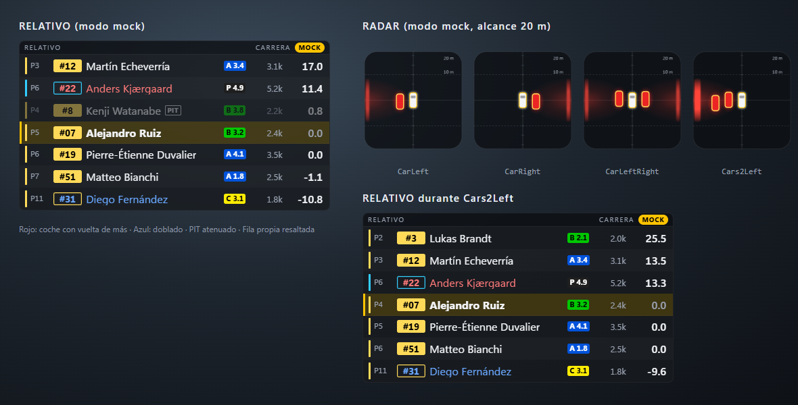
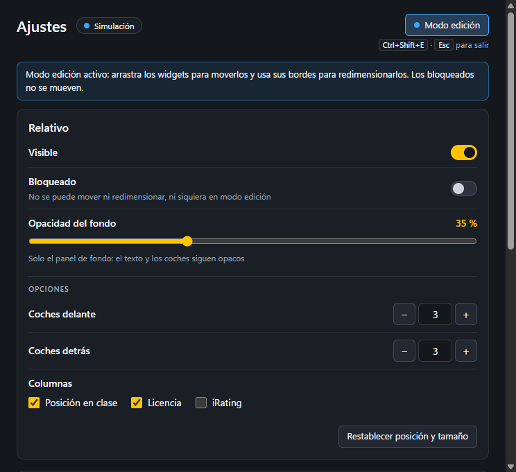
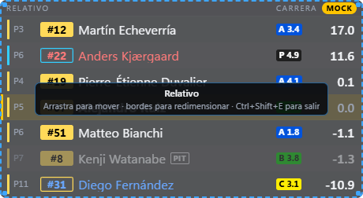
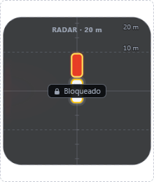

# iRacing Overlay

Overlay personal para iRacing al estilo RaceLab. La v1 trae dos widgets: **relativo** y **radar de
proximidad**. Uso personal, sin distribución.

- Solo **lee** la telemetría oficial del iRacing SDK (vía `irsdk-node` 4.4.0) y dibuja los widgets en
  ventanas propias, transparentes y siempre encima del juego: una por pantalla que tenga widgets.
- **No inyecta nada** en el proceso del juego (iRacing usa EasyAntiCheat). Ver
  [Anti-cheat](#anti-cheat).
- Sin servicios externos ni cuentas.

Stack: Electron 44, electron-vite 6, Vue 3 (`<script setup lang="ts">`), TypeScript estricto y
Vitest 5.



_Capturas reales del overlay en modo mock (`npm run dev:mock`). El radar muestra, de
izquierda a derecha, un coche a la izquierda, uno a la derecha, uno a cada lado y dos a la izquierda._

## Requisitos

| Requisito     | Detalle                                                    |
| ------------- | ---------------------------------------------------------- |
| Sistema       | Windows 10/11 x64                                          |
| iRacing       | Modo ventana sin bordes (borderless / windowed fullscreen) |
| Desarrollo    | Node.js >= 22.12 (desarrollado con Node 24) y npm          |
| No hace falta | Visual Studio, Python ni `electron-rebuild`                |

- En **pantalla completa exclusiva** las ventanas del overlay no se ven.
- En **VR** no se ve salvo que uses una herramienta como OpenKneeboard.

### Addon nativo y `postinstall`

`@irsdk-node/native` trae binarios N-API precompilados (`prebuildify --napi --electron-compat`), así
que funcionan tal cual con Node y con Electron sin recompilar nada.

- El `postinstall` solo ejecuta `install-electron`: Electron 44 ya no descarga su binario durante
  `npm install`.
- Se quitó `electron-builder install-app-deps` del `postinstall` porque intentaba compilar el addon
  desde el código fuente con node-gyp, lo que exige MSVC. Por lo mismo, `electron-builder.yml` tiene
  `npmRebuild: false`.

## Instalación y scripts

```bash
npm install
npm run dev:mock   # sin iRacing: carrera simulada
npm run dev        # con iRacing abierto
```

| Script                 | Qué hace                                                                                                                             |
| ---------------------- | ------------------------------------------------------------------------------------------------------------------------------------ |
| `npm run dev`          | Electron + Vite con HMR del renderer y recarga de main (`-w`). Fuente real de iRacing en Windows                                     |
| `npm run dev:mock`     | Igual, con `OVERLAY_SOURCE=mock`: carrera simulada, ~20 coches de 2 clases, coches que se ponen al lado, doblados y paradas en boxes |
| `npm run typecheck`    | Comprobación de tipos de shared + node (main, preload, telemetría) + web (renderer, `vue-tsc`)                                       |
| `npm test`             | Tests con Vitest (`src/**/*.test.ts`); `npm run test:watch` en modo watch                                                            |
| `npm run build`        | `typecheck` + `electron-vite build` a `out/`                                                                                         |
| `npm run build:win`    | `build` + `.exe` portable en `dist/` con electron-builder                                                                            |
| `npm run build:unpack` | `build` + carpeta `dist/win-unpacked` (sin instalar), útil para probar el empaquetado                                                |

También están `npm start` (`electron-vite preview`, arranca lo que haya en `out/`), `npm run lint` y
`npm run format`.

El primer `build:win` descarga una vez las herramientas de NSIS que usa electron-builder. El resultado
es `dist/iracing-overlay-<versión>-portable.exe` (sin firmar). El portable se descomprime en una
carpeta temporal en cada arranque; `dist/win-unpacked/iracing-overlay.exe` arranca más rápido.

## Fuente de datos

| Forma                                | Valores                                       |
| ------------------------------------ | --------------------------------------------- |
| Variable de entorno `OVERLAY_SOURCE` | `iracing` o `mock`                            |
| Por defecto                          | `iracing` en Windows, `mock` fuera de Windows |
| Flag del `.exe` empaquetado          | `--mock` o `--source=mock`                    |
| Abrir Ajustes al arrancar            | `--settings`                                  |

Fuera de Windows se puede desarrollar con `npm run dev:mock` (Linux/macOS).

```bash
./dist/iracing-overlay-1.0.0-portable.exe --mock
```

Si iRacing no está abierto, el relativo muestra **"Esperando a iRacing…"** (el radar sigue oculto,
igual que cuando no hay nadie cerca) y se reintenta la conexión cada ~2 s. Si se corta la conexión,
los widgets dejan de pintar el último dato en vez de quedarse congelados. Si el proceso de telemetría
falla, main lo reinicia con espera creciente.

## Uso

### Ventana de Ajustes

Se abre desde la bandeja (**Ajustes…**), volviendo a lanzar la app mientras ya está abierta o
arrancándola con `--settings` (útil para un acceso directo). Todo se aplica **en vivo** y se guarda
solo.

- **Por widget**: visible, **bloqueado** (no se mueve ni se redimensiona, ni siquiera en modo edición),
  **opacidad del fondo** (0–100 %: solo el panel; el texto y los coches siguen nítidos, y con poca
  opacidad el texto lleva un contorno para leerse sobre el juego) y restablecer posición y tamaño.
- **Relativo**: coches delante y detrás (0–10) y columnas opcionales (posición en clase, licencia,
  iRating).
- **Radar**: alcance (5–100 m, con atajos 10/20/30/50) y mostrar u ocultar las distancias.
- **Idioma** (en Apariencia): español (por defecto) o inglés. Cambia al momento los widgets, la
  ventana de Ajustes, los títulos de las ventanas y el menú de la bandeja
  (`appearance.language`: `"es"` o `"en"` en `settings.json`).
- Botón de modo edición y acceso a la carpeta de ajustes.

Es una ventana normal y sí coge el foco al abrirla (lo pides tú); los widgets nunca lo hacen.

| Ajustes                                  | Modo edición: relativo al 35 % sin iRating            | Radar bloqueado                                        |
| ---------------------------------------- | ----------------------------------------------------- | ------------------------------------------------------ |
|  |  |  |

### Atajos y modo edición

| Atajo          | Acción                          |
| -------------- | ------------------------------- |
| `Ctrl+Shift+E` | Entrar / salir del modo edición |
| `Esc`          | Salir del modo edición          |

En modo edición se arrastra el widget para moverlo y se usan sus bordes y esquinas para
redimensionarlo; los widgets bloqueados muestran un candado y no se mueven. Fuera del modo edición
todos dejan pasar los clics al juego. Posición, tamaño y visibilidad se guardan solos.

- Al arrastrar, el widget se pega a los bordes de los demás widgets de esa pantalla y a los de la
  pantalla y su área de trabajo; con `Alt` (o `Shift`) pulsado no se pega.
- La **rueda del ratón** sobre un widget cambia su tamaño (escala del texto en los de alto
  automático). Windows solo la entrega si está activado _Configuración > Bluetooth y dispositivos >
  Mouse > Desplazar ventanas inactivas al mantener el puntero sobre ellas_.
- Para llevar un widget a **otra pantalla**, arrástralo fuera de la suya: aparece "Suelta para
  moverlo a la otra pantalla" y al soltar queda bajo el puntero.
- Salir del modo edición (`Esc`, `Ctrl+Shift+E` o la bandeja) en mitad de un arrastre lo **cancela**:
  el widget vuelve a donde estaba.
- Coloca los widgets en el garaje o en los menús: mientras el modo edición está activo, los clics
  sobre un widget no llegan al juego.

### Bandeja del sistema

Desde el icono de la bandeja: **Ajustes…**, mostrar/ocultar cada widget, entrar en modo edición,
alcance del radar (10 / 20 / 30 / 50 m), abrir la carpeta de ajustes y salir.

Al hacer clic en la bandeja, Windows le quita el foco al juego; mientras conduces usa el atajo.

### Archivo de ajustes (`settings.json`)

Se guardan en `%APPDATA%iracing-overlaysettings.json` (la misma carpeta en desarrollo y en el
portable). Lo normal es cambiarlos desde la ventana de Ajustes; si lo editas a mano, hazlo **con la
app cerrada**. Los archivos de la versión 1 se migran solos. Valores por defecto:

```json
{
  "version": 2,
  "widgets": {
    "relative": {
      "visible": true,
      "bounds": { "x": 60, "y": 260, "width": 460, "height": 252 },
      "locked": false,
      "backgroundOpacity": 0.78
    },
    "radar": {
      "visible": true,
      "bounds": { "x": 560, "y": 260, "width": 220, "height": 260 },
      "locked": false,
      "backgroundOpacity": 0.8
    }
  },
  "relative": {
    "carsAhead": 3,
    "carsBehind": 3,
    "showClassPosition": true,
    "showLicense": true,
    "showIRating": true
  },
  "radar": { "rangeM": 20, "showRangeLabels": true }
}
```

Las coordenadas son DIP de la pantalla principal. Si un archivo está dañado se guarda una copia
`.bak` y se usan los valores por defecto.

## Widgets

| Widget   | Id         | Frecuencia | Tamaño mínimo |
| -------- | ---------- | ---------- | ------------- |
| Relativo | `relative` | 10 Hz      | 300 x 150     |
| Radar    | `radar`    | 60 Hz      | 120 x 140     |
| Delta    | `delta`    | 30 Hz      | 200 x 48      |

### Relativo

- 3 coches delante y 3 detrás por defecto (`relative.carsAhead` / `carsBehind`); si faltan coches se
  rellena con filas vacías para que tu fila quede centrada.
- Cada fila incluye posición en clase, número, nombre, licencia, iRating y gap.
- **Gap**: a partir de `CarIdxEstTime`, normalizado a la clase del jugador y corregido en el cruce de
  meta con el `CarClassEstLapTime` de tu clase.
- **Signo** como irDashies: positivo = delante en pista, negativo = detrás.
- Color de clase en cada fila (franja y fondo del número).
- **Rojo**: coche con vuelta(s) de más que te va a doblar. **Azul**: coche doblado. Solo en carrera.
- Atenuados los coches en boxes (pit road o puesto).
- Excluye pace car, espectadores y coches fuera del mundo.

### Radar

- Vista cenital en SVG alrededor de tu coche.
- iRacing no da coordenadas X/Y de los demás coches:
  - **lateral**: `CarLeftRight` (solo válido con el jugador en pista, `IsOnTrack`);
  - **longitudinal**: diferencia de `CarIdxLapDistPct` × longitud de pista (`WeekendInfo.TrackLength`).
- Alcance configurable (`radar.rangeM`), 20 m por defecto.
- Color de verde a rojo según cercanía.
- Los coches se dibujan a escala: un icono mide lo que un coche (4,6 m), así que el hueco que ves es
  el real con cualquier alcance.
- Los coches que se solapan contigo conservan su lado mientras dura el solape (iRacing no dice cuál es
  cuál, solo cuántos hay a cada lado) y lo mantienen hasta 3 s (o 12 m) después, cuando el SDK ya no
  da información lateral: un coche que te acaba de pasar por la izquierda se sigue viendo a la
  izquierda en vez de "en tu carril".
- Se desvanece cuando no hay nadie cerca ni al lado, con histéresis para que no parpadee en el límite
  del alcance.
- Si la longitud de pista falta o viene rara, solo se muestran los avisos laterales.

### Delta

- Barra delta a 30 Hz: segundos arriba o abajo frente a una referencia en tu punto de la vuelta,
  tendencia (ganando / perdiendo), vuelta prevista y cada sector frente a la referencia (el que estás
  corriendo, en vivo).
- Referencias (`delta.reference`):
  - **Récord personal** (`pb`): tu mejor vuelta limpia de siempre con ese coche en ese trazado. Se
    guarda en `personal-bests.json`, junto a `settings.json` (el modo mock usa su propia subcarpeta
    `mock/`), y no se pierde al cambiar de sesión, a diferencia del delta de iRacing.
  - **Mejor vuelta de la sesión** (`session`): tu mejor vuelta limpia de esta sesión.
  - **Vuelta óptima** (`optimal`): tus mejores tiempos de cada sector del circuito en tus vueltas
    limpias de esta sesión, unidos en una vuelta. Sin sectores en la sesión es tu mejor vuelta.
  - **Mejor de tu clase** (`class`): la vuelta limpia más rápida de tu clase en la sesión, sea de
    quien sea.
  - **Óptima de tu clase** (`classOptimal`): los mejores tiempos de cada sector en las vueltas
    limpias de tu clase en esta sesión, sean de quien sean (tú incluido), unidos en una vuelta.
- Con `delta.fallback` se usa la siguiente mientras no exista la elegida: pb → session → class,
  optimal → pb → classOptimal y classOptimal → pb (`class` no tiene ninguna).
- La referencia solo cambia al empezar una vuelta, así el delta nunca salta a mitad de vuelta (un
  sector mejor marcado a mitad de vuelta cuenta desde la siguiente).
- Solo cuentan vueltas limpias conducidas por ti (sin boxes, salidas de pista, paradas ni amarillas).
  La vuelta en curso se marca como inválida en cuanto deja de contar.
- El récord se escribe unos segundos después de cruzar meta, cuando llega el tiempo oficial, de forma
  atómica y sin frenar el bucle. Si el archivo está dañado se guarda una copia `.bak`.

## Arquitectura

```
 iRacing SDK (memoria compartida, solo lectura)
        |
        v
 +--------------------------------------+
 | utilityProcess de telemetría         |  src/telemetry
 |  TelemetrySource: IRacingSource      |
 |                   MockSource         |
 |  bucle ~60 Hz -> PROVIDERS (shared)  |
 +--------------------------------------+
        |  status / data / log      ^  config / shutdown
        v                           |
 +--------------------------------------+
 | main (Electron)                      |  src/main
 |  dónde está cada widget, qué ventana |
 |  lo aloja, ratón, estado, bandeja,   |
 |  ajustes                             |
 +--------------------------------------+
        |  IPC: cada payload solo a la ventana que aloja su widget
        +------------------------------+
        v                              v
 [ ?view=overlay  pantalla 1 ]  [ ?view=overlay  pantalla 2 ]   src/renderer (Vue) + src/preload
   relativo, radar, ...           clasificación, ...            (un panel por widget)
```

Una sola ventana por pantalla: Chromium presenta más o menos una ventana por refresco, así que ocho
ventanas que se actualizan a la vez se reparten los ~60 fps (unos 7 fps cada una); en un solo
documento todos los paneles van a la tasa de refresco.

- **Telemetría** (`src/telemetry`, un `utilityProcess`): bucle a ~60 Hz que cede el event loop con
  `setImmediate`. Lee solo las variables de `TELEMETRY_VARS` (`src/shared/telemetry.ts`) con
  `getTelemetryVariable`, reparsea el YAML de sesión solo cuando cambia `getSessionVersionNum` y
  calcula cada payload con los providers de `src/shared/providers.ts`, cada uno a la frecuencia de su
  widget. Solo calcula los widgets activos que le indica main (`TelemetryConfig`).
- **Main** (`src/main`): decide dónde está cada widget (coordenadas de pantalla en DIP, las de
  `settings.json`), a qué pantalla pertenece (la que contiene su centro; si su monitor no está, cae en
  la principal sin guardar ese cambio) y qué ventana lo aloja (`overlayWindows.ts`,
  `overlayWindow.ts`, reglas puras en `overlayLayout.ts`). Cada ventana cubre su pantalla, es
  transparente, no coge el foco (`focusable: false`, solo `showInactive()`), está siempre encima y
  deja pasar los clics. Main reenvía cada payload solo a la ventana que aloja su widget, decide cuándo
  una ventana coge el ratón (`mouseMode.ts`), guarda lo que el renderer confirma y la oculta en
  cuanto su superficie puede quedar mal (fallo o cuelgue del renderer, pérdida de la GPU, suspensión,
  cambio de pantalla) hasta recuperarla.
- **Renderer** (`src/renderer`): la misma app Vue con `?view=overlay` (las ventanas del overlay) o
  `?view=settings` (Ajustes). En el overlay, `overlay/OverlayApp.vue` pinta un panel con posición
  absoluta por widget (`WidgetSlot.vue`, `contain: strict`), ajusta los de alto automático a su
  contenido y hace las interacciones del modo edición (`EditFrame.vue`, `dragSession.ts`); lo que
  cambian vuelve a main como `BoundsCommit`. Preload tipado con `contextBridge` (`window.overlay`,
  tipo `OverlayApi`) y sandbox.
- **Lógica pura** en `src/shared`: sin Electron, Node ni DOM, y con tests.

Canales IPC (`src/shared/ipc.ts`):

| Canal                     | Sentido          | Contenido                                                                |
| ------------------------- | ---------------- | ------------------------------------------------------------------------ |
| `overlay:init`            | renderer -> main | devuelve `InitialState` (invoke), con el `OverlayLayout`                 |
| `overlay:layout`          | main -> overlay  | `OverlayLayout`: qué widgets aloja la ventana y dónde                    |
| `overlay:data`            | main -> overlay  | `WidgetDataMessage`, solo de los widgets que aloja                       |
| `overlay:auto-hidden`     | main -> overlay  | `AutoHiddenMessage` (una regla oculta o muestra uno)                     |
| `overlay:status`          | main -> renderer | `OverlayStatus`                                                          |
| `overlay:edit-mode`       | main -> renderer | `boolean`                                                                |
| `overlay:settings`        | main -> renderer | `OverlaySettings` al cambiar                                             |
| `overlay:commit-bounds`   | overlay -> main  | `BoundsCommit` (arrastre, rueda, alto ajustado, soltar en otra pantalla) |
| `overlay:scale-step`      | overlay -> main  | `ScaleStepMessage` (rueda sobre un widget de alto automático)            |
| `overlay:drag-state`      | overlay -> main  | `DragStateMessage` (hay un arrastre en curso)                            |
| `overlay:update-settings` | Ajustes -> main  | `SettingsPatch` validado (invoke)                                        |
| `overlay:command`         | Ajustes -> main  | modo edición, restablecer, carpeta, récords                              |
| `overlay:personal-bests`  | main -> Ajustes  | `PersonalBestList`                                                       |

### Anti-cheat

La app nunca toca el proceso del juego: solo lee el mapa de memoria del iRacing SDK (en el
`utilityProcess` de telemetría) y dibuja ventanas propias, transparentes, que no cogen el foco y dejan
pasar los clics, encima del juego. **Solo en modo edición**, el reenvío de ratón de Electron
(`setIgnoreMouseEvents(true, { forward: true })`, para los resaltados al pasar por encima) instala un
gancho de ratón de bajo nivel (`WH_MOUSE_LL`) en este proceso: observa movimientos del ratón, nunca
inyecta entrada, y se quita al salir del modo edición. `FORWARD_IN_EDIT = false`
(`src/main/mouseMode.ts`) lo elimina del todo sin perder nada más que esos resaltados. La única
ventana normal, que sí coge el foco, es la de Ajustes, y solo cuando la abres tú.

## Cómo añadir un widget nuevo

1. **Registro**: añade la entrada en `WIDGET_DEFS` (`src/shared/widgets.ts`) con `id`, `hz`,
   `defaultBounds`, `minSize` y `defaultVisible`, y su nombre en `widgetTitles` de cada idioma
   (`src/shared/i18n/messages/core.ts`); `WIDGET_DEFS` no lleva textos.
2. **Tipo del payload**: añádelo a `WidgetPayloads` (`src/shared/types.ts`) con la misma clave que el
   `id`. `WidgetDataMessage` se deriva solo.
3. **Variables**: si necesitas variables nuevas, añádelas a `TELEMETRY_VARS`
   (`src/shared/telemetry.ts`; los nombres se comprueban contra los tipos de irsdk-node, así que una
   errata no compila), al mock (`src/telemetry/mock/simulation.ts`) para poder desarrollarlo sin
   iRacing y a los `makeFrame` de `relative.test.ts` y `radar.test.ts` (si no, `npm run typecheck`
   falla). Las variables propias de cada coche (`dcBrakeBias`, `dcABS`…) no existen en todos: la
   fuente real solo pide las que hay en la sesión y las demás llegan como array vacío, así que el
   provider debe tratarlas como "sin dato".
   - Si necesitas datos nuevos del YAML de sesión, añádelos a `SessionMeta` (`src/shared/types.ts`),
     a `parseSessionMeta` y `EMPTY_SESSION` (`src/shared/session.ts`, con su test) y a
     `sessionInfo()` del mock.
4. **Cálculo**: función pura en `src/shared/<widget>.ts` con sus tests (`<widget>.test.ts` al lado) y
   regístrala en `PROVIDERS` (`src/shared/providers.ts`). Recibe `{ frame, session, config }` y el
   payload anterior (`prev`) por si necesitas suavizado.
5. **Vista**: componente en `src/renderer/src/widgets/<widget>/<Name>Widget.vue` que use
   `useWidgetData('<id>')` y regístralo en `src/renderer/src/widgets/index.ts`. Ningún texto va en el
   código: todos salen de `useI18n()`, de los diccionarios de `src/shared/i18n/messages/` (el español
   es la referencia y el inglés tiene que tener las mismas claves, o no compila). Los payloads llevan
   códigos, nunca frases.
6. **Opciones** (si las tiene): añádelas a `OverlaySettings` y `TelemetryConfig` (`types.ts`), a los
   valores por defecto y la normalización de `src/shared/settings.ts` y, si quieres tocarlas desde la
   bandeja, a `src/main/tray.ts`.

Main, bandeja, ajustes y el proceso de telemetría lo recogen solos a partir de `WIDGET_DEFS`.

Consejos:

- `useWidgetData` devuelve un `shallowRef`: cada mensaje es un objeto nuevo y se sustituye entero.
  **No mutes nunca los payloads**; el provider devuelve un objeto nuevo en cada frame.
- Si el widget pasa mucho tiempo sin nada que pintar, añade una regla a `SKIP_EMIT`
  (`src/shared/providers.ts`) para no enviar payloads repetidos (el radar oculto no envía nada).
- Nada de animaciones infinitas, filtros SVG/CSS ni sombras grandes en lo que se repinta a 60 Hz: las
  ventanas son transparentes y cada repintado cuesta GPU mientras juegas.
- Usa las variables CSS de `src/renderer/src/styles/theme.css` para colores y tipografía.

## Notas y limitaciones

- No se activa `autoEnableTelemetry` de irsdk-node: ese broadcast enciende la grabación de `.ibt` en
  disco y los datos en vivo no lo necesitan.

- Fuera de alcance en la v1: temperatura de neumáticos, minimapa y VR.
- **Nombres con caracteres no ASCII** pueden verse con `�`: `irsdk-node` decodifica el texto de sesión
  como UTF-8, pero iRacing usa ISO-8859-1 por defecto. Se puede probar `irsdkUTF8SessionStr=1` en el
  `app.ini` de iRacing (Documentos\iRacing); **no verificado**.
- Si el nombre de algún piloto rompe el parseo del YAML de sesión, la app recurre a un parser tolerante.
- Si alguna ventana se ve con fondo negro en lugar de transparente, puede ser la aceleración por
  hardware (Electron issue #40515).
- **OBS**: ya no hay una ventana por widget. Con captura de ventana, elige "Pantalla N · OverLap"
  ("Display N · OverLap" en inglés), que trae todos los widgets de esa pantalla; o usa la captura de
  pantalla.
- Con widgets en dos o más pantallas hay una ventana por pantalla, y esas ventanas sí se reparten el
  refresco entre ellas.

## Licencias y créditos

- [irDashies](https://github.com/tariknz/irdashies) (MIT): referencia para la convención de signo del
  relativo y sus casos límite.
- [irsdk-node](https://github.com/bengsfort/irsdk-node) (MIT): acceso al iRacing SDK desde Node.
